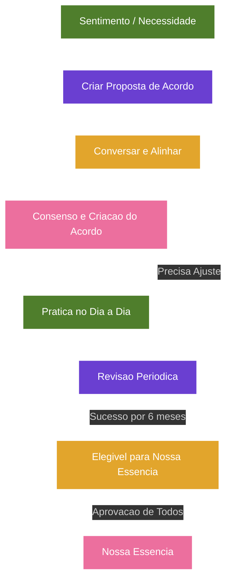

# Projeto Nós - Documento de Visão e Regras de Negócio (Versão 1.1)

## Categoria
**1.x - Visão e Regras de Negócio**

## Documentos Relacionados

### Versões 1.x (Visão e Regras de Negócio)
- [v1.2 - Sistema de Aprovação e Construção de Acordos](Projeto_Nos_v1.2_Sistema_de_Aprovacao_e_Construcao_de_Acordos.md)
- [v1.3 - Evolução para Núcleos](Projeto_Nos_v1.3_Evolucao_Para_Nucleos.md)
- [v1.4 - Sistema de Impacto](Projeto_Nos_v1.4_Sistema_de_Impacto.md)
- [v1.5 - Sistema de Reconhecimento e Gratidão](Projeto_Nos_v1.5_Sistema_de_Reconhecimento_e_Gratidao.md)
- [v1.6 - Sistema de Marcos de Evolução e Celebrações Saudáveis](Projeto_Nos_v1.6_Sistema_de_Marcos_de_Evolucao_e_Celebracoes_Saudaveis.md)
- [v1.7 - Sistema de Linguagens de Cuidado e Amor](Projeto_Nos_v1.7_Sistema_de_Linguagens_de_Cuidado_e_Amor.md)
- [v1.8 - Manifesto do Núcleo](Projeto_Nos_v1.8_Manifesto_do_Nucleo.md)
- [v1.9 - Calendário do Núcleo e Sincronização Segura](Projeto_Nos_v1.9_Calendario_do_Nucleo_e_Sincronizacao_Segura.md)
- [v1.10 - Sistema de Conversas Guiadas e Mediação Afetiva](Projeto_Nos_v1.10_Sistema_de_Conversas_Guiadas_e_Mediacao_Afetiva.md)

### Versões 2.x (Interface e Implementação)
- [v2.0 - Alinhamento das Telas com a Documentação](Projeto_Nos_v2.0_Alinhamento_das_Telas_com_a_Documentacao.md)
- [v2.1 - Catálogo Completo das Interfaces](Projeto_Nos_v2.1_Catalogo_Completo_das_Interfaces.md)
- [v2.2 - Fluxos, Navegação e Interações](Projeto_Nos_v2.2_Fluxos_Navegacao_e_Interacoes.md)
- [v2.3 - Design System, Componentes e Tom de Interface](Projeto_Nos_v2.3_Design_System_Componentes_e_Tom_de_Interface.md)
- [v2.4 - Modelo Funcional, Dados, Estados e Regras](Projeto_Nos_v2.4_Modelo_Funcional_Dados_Estados_e_Regras.md)
- [v2.5 - Matriz de Permissões, Privacidade e Visibilidade](Projeto_Nos_v2.5_Matriz_de_Permissoes_Privacidade_Visibilidade.md)
- [v2.6 - Estados Vazios, Erros e Carregamento](Projeto_Nos_v2.6_Estados_Vazios_Erros_e_Carregamento.md)
- [v2.7 - Notificações e Eventos do Sistema](Projeto_Nos_v2.7_Notificacoes_e_Eventos_do_Sistema.md)

---

### Nome Oficial da Plataforma **Nós**

Motivos do nome do projeto:

- Curto e fácil de memorizar.
- Forte apelo emocional.
- Não transmite sensação jurídica ou burocrática.
- Aplicável a casais, famílias e futuras expansões.
- Representa união, laços e construção conjunta.

### Possível Slogan

**Fortalecendo os laços que unem quem você ama.**

---

## Natureza

O Projeto Nós é como uma mistura de:

- Desenvolvimento pessoal
- Terapia de casal preventiva
- Gamificação de hábitos afetivos
- Gestão de expectativas
- Construção de cultura familiar

---

## Propósito

O Nós é uma plataforma voltada para o fortalecimento de relacionamentos e famílias através da construção consciente de hábitos, comportamentos, experiências e valores compartilhados.

Seu objetivo não é controlar pessoas ou impor obrigações, mas promover diálogo, alinhamento de expectativas e evolução contínua dos relacionamentos.

---

## O verdadeiro problema que o sistema resolve

A maioria dos relacionamentos não termina por falta de amor.

Termina por:

- expectativas não comunicadas;
- necessidades emocionais ignoradas;
- pequenas frustrações acumuladas;
- falta de reconhecimento;
- ausência de evolução conjunta.

O Projeto Nós ataca exatamente esse problema.

---

# Filosofia Central

O amor não é construído por grandes acontecimentos isolados.

Ele é fortalecido através de pequenas atitudes repetidas ao longo do tempo.

O Nós existe para ajudar pessoas a transformarem desejos, necessidades e expectativas em hábitos saudáveis e duradouros.

---

# Jornada Principal do Usuário

Necessidade

↓

Conversa

↓

Acordo

↓

Prática

↓

Nossa Essência

---

# Estrutura Principal da Plataforma

## Categoria 1 – Hábitos que Queremos Construir

Comportamentos que fortalecem a relação através da repetição frequente.

### Exemplos

- Demonstrar carinho
- Conversar sem distrações
- Demonstrar gratidão
- Fazer elogios sinceros
- Passar mais tempo juntos

| Hábito | Por que isso é importante para nós? | Ritmo | Data de Revisão |
| ------ | ----------------------------------- | ----- | --------------- |

---

## Categoria 2 – Experiências que Queremos Viver

Momentos especiais que fortalecem o relacionamento de forma periódica.

### Exemplos

- Jantar romântico
- Viagem
- Passeio diferente
- Assistir um filme juntos
- Realizar um projeto em conjunto

| Experiência | Objetivo | Ritmo | Próxima Data |
| ----------- | -------- | ----- | ------------ |

---

## Categoria 3 – Nossa Essência

Valores, comportamentos e atitudes que deixaram de ser objetivos temporários e passaram a representar a identidade do vínculo ou Núcleo.

| Nossa Essência |
| -------------- |

### Exemplos

- Conversamos com respeito.
- Demonstramos gratidão.
- Celebramos conquistas juntos.
- Mantemos a transparência.
- Cuidamos um do outro.
- Não utilizamos humilhações ou insultos.

---

# Regras de Negócio

## Regra 1

Toda sugestão deve ser apresentada com respeito, empatia e mente aberta.

Se uma pessoa deseja inserir algo no sistema, presume-se que aquela necessidade possui importância emocional para ela.

## Regra 2

Nenhuma sugestão é uma ordem.

Todo item deve passar por conversa e consenso entre as partes.

## Regra 3

O objetivo não é mudar outra pessoa do vínculo.

O objetivo é construir uma convivência melhor para todos os membros diretamente envolvidos.

## Regra 4

Os acordos devem ser realistas, alcançáveis e compatíveis com a rotina do Núcleo, seja ele casal, família, irmãos, amigos ou outro tipo de vínculo.

## Regra 5

Após a aprovação de um novo acordo, existe um período de reflexão de até 7 dias para possíveis ajustes ou cancelamento consensual.

## Regra 6

Ao final de cada ciclo de revisão, os participantes avaliam os resultados alcançados.

## Regra 7

Após pelo menos 6 meses de prática, revisões positivas, alinhamento ao propósito do Núcleo e consenso dos membros diretamente envolvidos, um item poderá ser considerado elegível para promoção para Nossa Essência.

## Regra 8

Itens presentes em Nossa Essência representam compromissos identitários e duradouros da identidade do vínculo ou Núcleo. Eles continuam revisáveis por consenso, pois a identidade do Núcleo pode amadurecer ao longo do tempo.

## Regra 9

Uma vez por ano, os participantes poderão revisar Nossa Essência. Alterações, substituições ou remoções devem ocorrer apenas por consenso dos membros diretamente envolvidos.

## Regra 10

Respeitar os acordos construídos em conjunto é uma demonstração prática de respeito, consideração e amor.

## Regra 11

Toda métrica visual de evolução deve reforçar cuidado coletivo, continuidade e maturidade, nunca desempenho individual, disputa ou comparação entre membros.

---

# Princípios Fundamentais

- Respeito mútuo
- Escuta ativa
- Evolução contínua
- Transparência
- Empatia
- Gratidão
- Cooperação
- Responsabilidade afetiva

---

# Visão de Longo Prazo

Transformar o Nós na principal plataforma de fortalecimento de relacionamentos e famílias, ajudando pessoas a construir conexões mais saudáveis, duradouras e significativas através de hábitos, acordos e valores compartilhados.

---

# Complemento de Alinhamento com as Telas do Protótipo

## Confirmações vindas das telas

As telas do protótipo confirmam que o Projeto Nós deve ser percebido primeiro como um espaço íntimo de cuidado, e não como uma ferramenta de tarefas, controle ou cobrança.

A promessa visual e textual principal aparece já na abertura:

> Fortalecendo os laços que unem quem você ama.

Essa frase deve permanecer como eixo de posicionamento da plataforma.

## Metáfora central da experiência

A árvore passa a ser a principal metáfora visual e emocional do produto.

Ela representa:

- crescimento do vínculo;
- continuidade das pequenas atitudes;
- maturidade do Núcleo;
- progresso sem competição;
- memória viva da caminhada.

A árvore não deve ser tratada como ranking ou placar individual. Ela representa o amadurecimento coletivo do Núcleo.

## Áreas principais do produto observadas nas telas

As telas indicam uma primeira arquitetura de navegação com as seguintes áreas:

- Início/Home do Núcleo.
- Nossa árvore.
- Acordos.
- Memórias.
- Núcleos.
- Perfil afetivo.
- Notificações.
- Configurações.

Essas áreas não alteram as categorias centrais da plataforma. Elas organizam a experiência prática do usuário em torno das categorias já definidas.

## Jornada de produto observada

A jornada conceitual permanece:

Necessidade -> Conversa -> Acordo -> Prática -> Nossa Essência

As telas refinam essa jornada para a interface:

Necessidade -> Proposta -> Conversar -> Acordo -> Registrar momento -> Revisar -> Promover para Essência

## Tom de interface

O tom textual deve ser:

- afetivo;
- calmo;
- encorajador;
- não acusatório;
- íntimo sem ser invasivo;
- claro sem ficar burocrático.

Exemplos de tom validado nas telas:

- "Pequenas atitudes diárias constroem grandes histórias."
- "Nossa história floresce a cada escolha."
- "Quando um acordo fica difícil, não é falha de ninguém."
- "Um pequeno obrigado faz a árvore de vocês crescer."

---

# Diagrama de Fluxo da Versao

