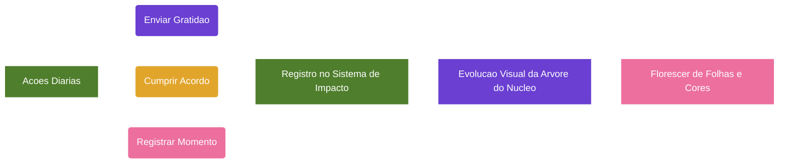

# Projeto Nós - Sistema de Impacto dos Compromissos (Versão 1.4)

## Categoria
**1.x - Visão e Regras de Negócio**

## Documentos Relacionados

### Versões 1.x (Visão e Regras de Negócio)
- [v1.2 - Sistema de Aprovação e Construção de Acordos](Projeto_Nos_v1.2_Sistema_de_Aprovacao_e_Construcao_de_Acordos.md)
- [v1.3 - Evolução para Núcleos](Projeto_Nos_v1.3_Evolucao_Para_Nucleos.md)
- [v1.4 - Sistema de Impacto](Projeto_Nos_v1.4_Sistema_de_Impacto.md)
- [v1.5 - Sistema de Reconhecimento e Gratidão](Projeto_Nos_v1.5_Sistema_de_Reconhecimento_e_Gratidao.md)
- [v1.6 - Sistema de Marcos de Evolução e Celebrações Saudáveis](Projeto_Nos_v1.6_Sistema_de_Marcos_de_Evolucao_e_Celebracoes_Saudaveis.md)
- [v1.7 - Sistema de Linguagens de Cuidado e Amor](Projeto_Nos_v1.7_Sistema_de_Linguagens_de_Cuidado_e_Amor.md)
- [v1.8 - Manifesto do Núcleo](Projeto_Nos_v1.8_Manifesto_do_Nucleo.md)
- [v1.9 - Calendário do Núcleo e Sincronização Segura](Projeto_Nos_v1.9_Calendario_do_Nucleo_e_Sincronizacao_Segura.md)
- [v1.10 - Sistema de Conversas Guiadas e Mediação Afetiva](Projeto_Nos_v1.10_Sistema_de_Conversas_Guiadas_e_Mediacao_Afetiva.md)

### Versões 2.x (Interface e Implementação)
- [v2.0 - Alinhamento das Telas com a Documentação](Projeto_Nos_v2.0_Alinhamento_das_Telas_com_a_Documentacao.md)
- [v2.1 - Catálogo Completo das Interfaces](Projeto_Nos_v2.1_Catalogo_Completo_das_Interfaces.md)
- [v2.2 - Fluxos, Navegação e Interações](Projeto_Nos_v2.2_Fluxos_Navegacao_e_Interacoes.md)
- [v2.3 - Design System, Componentes e Tom de Interface](Projeto_Nos_v2.3_Design_System_Componentes_e_Tom_de_Interface.md)
- [v2.4 - Modelo Funcional, Dados, Estados e Regras](Projeto_Nos_v2.4_Modelo_Funcional_Dados_Estados_e_Regras.md)
- [v2.5 - Matriz de Permissões, Privacidade e Visibilidade](Projeto_Nos_v2.5_Matriz_de_Permissoes_Privacidade_Visibilidade.md)
- [v2.6 - Estados Vazios, Erros e Carregamento](Projeto_Nos_v2.6_Estados_Vazios_Erros_e_Carregamento.md)
- [v2.7 - Notificações e Eventos do Sistema](Projeto_Nos_v2.7_Notificacoes_e_Eventos_do_Sistema.md)

---

## Status

Planejado

## Tipo

Melhoria Incremental de Priorização, Revisão e Maturidade dos Compromissos

## Compatibilidade

100% compatível com a Documentação v1.2 e com a Evolução para Núcleos v1.3.

Esta melhoria não altera a filosofia central do Projeto Nós.

Esta melhoria não cria uma nova categoria principal.

---

# Objetivo

Criar um Sistema de Impacto para ajudar cada Núcleo a identificar quais compromissos possuem maior capacidade de fortalecer, transformar ou amadurecer o relacionamento entre seus membros.

O impacto funciona como uma camada de avaliação dos compromissos, ajudando o Núcleo a focar no que realmente muda a qualidade da convivência, dos vínculos e da identidade compartilhada.

---

# Decisão Estrutural

O Sistema de Impacto não será uma nova categoria.

O Projeto Nós permanece organizado nas três categorias principais já definidas:

## Categoria 1

Hábitos que Queremos Construir

## Categoria 2

Experiências que Queremos Viver

## Categoria 3

Nossa Essência

O impacto passa a ser um atributo dos compromissos, acordos, hábitos e experiências existentes dentro dessas categorias.

---

# Conceito de Impacto

Impacto representa o quanto um compromisso pode melhorar, fortalecer ou transformar a dinâmica de um Núcleo.

Ele não mede valor absoluto, superioridade ou importância moral.

Um compromisso de baixo impacto ainda pode ser válido, importante e saudável.

A classificação de impacto serve para orientar foco, prioridade, reflexão e revisões.

---

# Níveis de Impacto

## Baixo

Representa uma melhoria leve, pontual ou complementar na convivência do Núcleo.

### Exemplo

Enviar uma mensagem carinhosa ocasionalmente.

## Médio

Representa uma melhoria perceptível na rotina, na comunicação ou no vínculo entre os membros.

### Exemplo

Reservar um momento semanal para conversar sem distrações.

## Alto

Representa um compromisso capaz de resolver uma necessidade importante, reduzir conflitos frequentes ou fortalecer significativamente o Núcleo.

### Exemplo

Definir uma rotina semanal de diálogo familiar para alinhar responsabilidades, sentimentos e expectativas.

## Transformador

Representa um compromisso com potencial de mudar profundamente a qualidade do relacionamento, da convivência ou da identidade do Núcleo.

### Exemplo

Substituir discussões impulsivas por um ritual de pausa, escuta e retomada respeitosa em momentos de conflito.

---

# Impacto Esperado e Impacto Percebido

O Sistema de Impacto deve trabalhar com duas camadas.

## Impacto Esperado

Impacto definido durante a criação, discussão ou construção do compromisso.

Representa a expectativa inicial do Núcleo sobre o quanto aquele compromisso pode contribuir para o relacionamento.

## Impacto Percebido

Impacto avaliado depois da prática real do compromisso.

Representa o quanto o Núcleo percebeu que aquele compromisso realmente contribuiu para a convivência, o vínculo ou a identidade compartilhada.

---

# Motivo da Separação

A separação entre Impacto Esperado e Impacto Percebido torna o sistema mais maduro.

Nem todo compromisso que parece importante no início gera grande transformação na prática.

Da mesma forma, alguns compromissos simples podem se revelar profundamente transformadores quando praticados com constância.

Essa diferença ajuda o Núcleo a aprender com a experiência, não apenas com a intenção inicial.

---

# Aplicação Dentro das Categorias

## Hábitos que Queremos Construir

O impacto ajuda a priorizar quais hábitos devem receber mais atenção, acompanhamento e revisão.

### Exemplo

| Hábito                    | Por que isso é importante para nós? | Ritmo   | Impacto Esperado | Impacto Percebido | Data de Revisão |
| ------------------------- | ----------------------------------- | ------- | ---------------- | ----------------- | --------------- |
| Jantar juntos sem celular | Melhorar nossa presença e conexão   | Semanal | Alto             | Transformador     | Mensal          |

## Experiências que Queremos Viver

O impacto ajuda a diferenciar experiências pontuais de experiências com maior potencial de fortalecer o Núcleo.

### Exemplo

| Experiência             | Objetivo                            | Ritmo | Impacto Esperado | Impacto Percebido | Próxima Data |
| ----------------------- | ----------------------------------- | ----- | ---------------- | ----------------- | ------------ |
| Viagem anual em família | Criar memórias e fortalecer a união | Anual | Alto             | Alto              | Dezembro     |

## Nossa Essência

O impacto pode apoiar a reflexão sobre quais compromissos amadureceram o suficiente para representar a identidade do Núcleo.

Porém, impacto alto ou transformador não promove automaticamente um compromisso para Nossa Essência.

---

# Fluxo Atualizado de Construção de Acordos

## Etapa 1 - Proposta

Um membro registra uma necessidade, desejo ou expectativa.

### Exemplo

> Gostaria que a gente tivesse um momento semanal sem celular para conversar.

## Etapa 2 - Compreensão

Os demais membros demonstram que compreenderam a necessidade apresentada.

### Exemplo

> Entendi que voce sente falta de mais presença e atenção durante a semana.

## Etapa 3 - Discussão

O Núcleo conversa sobre importância, dificuldades, frequência e ajustes.

Nesta etapa, também devem ser consideradas perguntas sobre impacto.

### Perguntas de impacto

- O quanto isso pode melhorar nossa convivência?
- Isso resolve uma dor frequente ou uma necessidade pontual?
- Isso fortalece qual valor do nosso Núcleo?
- Se praticarmos isso por meses, o que pode mudar?
- Esse compromisso está alinhado ao Propósito do Núcleo?

## Etapa 4 - Definição do Impacto Esperado

O Núcleo define, por consenso, o impacto esperado do compromisso.

### Opções

- Baixo
- Médio
- Alto
- Transformador

## Etapa 5 - Construção do Acordo

O desejo é transformado em comportamento claro, observável e praticável.

### Exemplo ruim

> Vamos conversar mais.

### Exemplo bom

> Ter uma conversa sem celular uma vez por semana.

### Exemplo excelente

> Ter uma conversa sem celular toda quarta-feira, por pelo menos 30 minutos, depois do jantar.

## Etapa 6 - Período de Teste

O compromisso entra em fase experimental, mantendo as regras já definidas na Documentação v1.2.

Durante essa fase, o impacto esperado ainda pode ser revisto.

## Etapa 7 - Confirmacão

Ao término do periodo de teste, os membros avaliam se o compromisso funcionou.

### Possíveis respostas

- Sim
- Ajustar
- Encerrar

## Etapa 8 - Prática e Revisões

Durante as revisões, o Núcleo avalia o cumprimento, a relevância e o impacto percebido.

### Pergunta adicional de revisão

> O impacto percebido corresponde ao impacto esperado?

### Possiveis respostas

- Sim
- Foi menor que esperávamos
- Foi maior que esperávamos
- Ainda é cedo para avaliar

## Etapa 9 - Elegível para Nossa Essência

Um compromisso pode se tornar elegível para Nossa Essência quando cumprir os critérios já definidos:

- Está ativo há pelo menos 6 meses.
- Passou por revisões positivas.
- Existe consenso entre os membros diretamente envolvidos.
- Está alinhado ao Propósito do Núcleo.
- Representa uma prática real, não apenas uma intenção.

## Etapa 10 - Promoção para Nossa Essência

A promoção para Nossa Essência transforma um compromisso específico em um valor identitário do Núcleo.

### Exemplo

Antes:

> Conversar sem celular toda quarta-feira por 30 minutos.

Depois:

> Praticamos presença e escuta ativa em nossa convivência.

---

# Regra de Consenso para Nossa Essência

## Regra Principal

A promoção de um compromisso para Nossa Essência exige consenso de 100% dos membros diretamente envolvidos.

## Justificativa

Nossa Essência representa a identidade do Núcleo.

Por isso, nenhum valor, comportamento ou compromisso permanente deve ser promovido se houver discordância entre os membros diretamente afetados.

Essa regra evita imposição, ressentimento e perda de legitimidade.

---

# Aplicação por Tipo de Núcleo

## Núcleos Íntimos e Familiares

Para os tipos iniciais de Núcleo, a regra deve ser consenso total entre os membros diretamente envolvidos.

### Tipos incluídos

- Casal
- Familia
- Irmãos
- Pais e Filhos

## Núcleos Ampliados Futuros

Para possíveis expansões futuras, a plataforma poderá permitir regras configuráveis de aceite.

### Exemplos de núcleos ampliados

- Amigos
- Equipes
- Comunidades
- Mentorias coletivas
- Grupos religiosos

Nesses casos, o Núcleo poderá definir previamente um percentual mínimo de aceite para promoções a Nossa Essência.

### Percentuais sugeridos para o futuro

- 100% para Núcleos íntimos e familiares.
- 80% a 90% para Núcleos ampliados, caso essa regra tenha sido definida previamente pelo próprio Núcleo.

## Restrição

Maioria simples não deve ser suficiente para promover um compromisso para Nossa Essência.

---

# Regras de Negócio Adicionais

## Regra I1

Todo compromisso pode possuir um Impacto Esperado.

## Regra I2

O Impacto Esperado deve ser definido durante a discussão ou construção do acordo.

## Regra I3

O Impacto Percebido deve ser avaliado durante as revisões do compromisso.

## Regra I4

O impacto não cria uma nova categoria principal na plataforma.

## Regra I5

O impacto não substitui consenso, tempo mínimo, revisões positivas ou alinhamento ao Propósito do Núcleo.

## Regra I6

Um compromisso de impacto baixo não deve ser tratado como irrelevante.

## Regra I7

Impacto Alto ou Transformador pode indicar prioridade de acompanhamento, mas não garante promoção para Nossa Essência.

## Regra I8

A promoção para Nossa Essência exige consenso de 100% dos membros diretamente envolvidos nos Núcleos íntimos e familiares.

## Regra I9

Percentuais de aceite só devem ser considerados futuramente para Núcleos ampliados, e apenas se forem definidos previamente nas regras internas do Núcleo.

---

# Benefícios do Sistema de Impacto

## Para o Usuário

- Ajuda a entender quais compromissos realmente importam.
- Reduz dispersão e excesso de acordos pouco relevantes.
- Facilita conversas mais conscientes.
- Torna revisões mais profundas.
- Ajuda a perceber a evolução real do relacionamento.

## Para o Núcleo

- Melhora a priorização.
- Fortalece o alinhamento com o Propósito.
- Ajuda a identificar práticas que merecem mais atenção.
- Evita que Nossa Essência seja formada por itens pouco amadurecidos.
- Apoia a construção gradual da identidade compartilhada.

## Para a Plataforma

- Aumenta a profundidade do produto sem inflar a estrutura.
- Mantém as três categorias principais já acordadas.
- Cria base para filtros, indicadores e relatorios futuros.
- Fortalece a maturidade do sistema de revisões.

---

# Recomendações de Implementação Incremental

## Fase 1 - Campo Simples de Impacto Esperado

Adicionar o campo Impacto Esperado aos compromissos.

### Opções

- Baixo
- Médio
- Alto
- Transformador

## Fase 2 - Impacto nas Revisões

Adicionar o campo Impacto Percebido no processo de revisão.

## Fase 3 - Comparação entre Impacto Esperado e Percebido

Permitir que o Núcleo compare expectativa e experiência real.

### Possíveis resultados

- Confirmado
- Abaixo do esperado
- Acima do esperado
- Ainda em avaliação

## Fase 4 - Priorização Visual

Permitir filtros ou destaques por impacto.

### Exemplos

- Ver compromissos Transformadores.
- Ver compromissos de Alto Impacto.
- Ver compromissos com impacto percebido acima do esperado.

## Fase 5 - Apoio a Nossa Essência

Usar o histórico de impacto percebido como um dos elementos de apoio na decisão de promoção para Nossa Essência.

Importante: esse histórico deve apoiar a decisão, não substituir o consenso.

---

# Exemplo Completo

## Núcleo

Família Silva

## Propósito

Construir uma família baseada em respeito, honestidade, presença e apoio mútuo.

## Compromisso Proposto

Jantar juntos sem celular uma vez por semana.

## Categoria

Hábitos que Queremos Construir

## Impacto Esperado

Alto

## Acordo

Jantar juntos sem celular toda quarta-feira, por pelo menos 40 minutos.

## Período de Teste

30 dias

## Resultado da Revisão

O compromisso melhorou a comunicação, reduziu distrações e criou um momento esperado pela família.

## Impacto Percebido

Transformador

## Possível Evolução para Nossa Essência

Após pelo menos 6 meses de prática, revisões positivas e consenso total dos membros envolvidos, o compromisso pode ser promovido.

### Antes

> Jantar juntos sem celular toda quarta-feira.

### Depois

> Valorizamos a presença e a escuta em família.

---

# Resumo da Decisão

O Sistema de Impacto será implementado como atributo dos compromissos, não como nova categoria.

As três categorias principais permanecem:

- Hábitos que Queremos Construir
- Experiências que Queremos Viver
- Nossa Essência

O impacto será dividido em:

- Impacto Esperado
- Impacto Percebido

Para promover um compromisso para Nossa Essência, a regra principal será:

> Consenso de 100% dos membros diretamente envolvidos.

Percentuais de aceite entre 80% e 90% poderão ser considerados apenas em expansões futuras para Núcleos ampliados, desde que definidos previamente pelo próprio Núcleo.

---

# Visão de Longo Prazo

O Sistema de Impacto torna o Projeto Nós mais consciente, priorizado e orientado à transformação real.

Ele ajuda cada Núcleo a não apenas criar compromissos, mas compreender quais práticas realmente fortalecem seus laços, amadurecem sua convivência e constroem sua identidade compartilhada ao longo do tempo.

---

# Complemento de Alinhamento com as Telas do Protótipo

## Impacto na interface

As telas mostram o impacto como um atributo simples e legível dentro do detalhe do acordo.

Exemplo:

- Impacto esperado: Alto.

Esse campo deve aparecer como informação de contexto, não como julgamento moral do acordo.

## Relação com progresso

As telas também apresentam progresso percentual de acordos, como 80%, 90%, 60% e 70%.

O percentual deve representar cumprimento ou continuidade recente, enquanto impacto representa a relevância percebida do compromisso.

Esses dois conceitos não devem ser confundidos:

- Progresso responde: "Quanto praticamos recentemente?"
- Impacto responde: "Quanto isso fortalece ou transforma o Núcleo?"

## Relação com a árvore

A árvore usa experiência, nível e estágio para simbolizar maturidade do Núcleo.

Exemplo observado:

- Nível 7.
- Raízes fortes.
- 1.250 / 1.800 exp.
- Próximo estágio: Copa florescente.

Impacto pode influenciar a relevância de uma prática na evolução do Núcleo, mas não deve criar competição individual.

## Indicadores coletivos observados

A tela "Nossa árvore" apresenta indicadores como:

- hábitos cultivados;
- experiências vividas;
- valores na essência.

Esses indicadores devem ser agregados do Núcleo, não rankings de membros.

## Regra adicional

## Regra I10

Percentuais, experiência, níveis e estágios devem ser apresentados como sinais de amadurecimento coletivo, nunca como pontuação individual de afeto, valor ou desempenho.

---

# Diagrama de Fluxo da Versao

