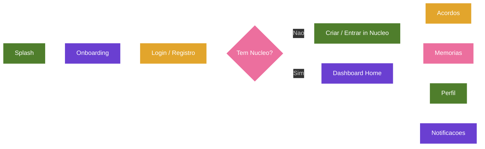

# Projeto Nós - Catálogo Completo das Interfaces (Versão 2.1)

## Categoria
**2.x - Interface e Implementação**

## Documentos Relacionados

### Versões 1.x (Visão e Regras de Negócio)
- [v1.2 - Sistema de Aprovação e Construção de Acordos](Projeto_Nos_v1.2_Sistema_de_Aprovacao_e_Construcao_de_Acordos.md)
- [v1.3 - Evolução para Núcleos](Projeto_Nos_v1.3_Evolucao_Para_Nucleos.md)
- [v1.4 - Sistema de Impacto](Projeto_Nos_v1.4_Sistema_de_Impacto.md)
- [v1.5 - Sistema de Reconhecimento e Gratidão](Projeto_Nos_v1.5_Sistema_de_Reconhecimento_e_Gratidao.md)
- [v1.6 - Sistema de Marcos de Evolução e Celebrações Saudáveis](Projeto_Nos_v1.6_Sistema_de_Marcos_de_Evolucao_e_Celebracoes_Saudaveis.md)
- [v1.7 - Sistema de Linguagens de Cuidado e Amor](Projeto_Nos_v1.7_Sistema_de_Linguagens_de_Cuidado_e_Amor.md)
- [v1.8 - Manifesto do Núcleo](Projeto_Nos_v1.8_Manifesto_do_Nucleo.md)
- [v1.9 - Calendário do Núcleo e Sincronização Segura](Projeto_Nos_v1.9_Calendario_do_Nucleo_e_Sincronizacao_Segura.md)
- [v1.10 - Sistema de Conversas Guiadas e Mediação Afetiva](Projeto_Nos_v1.10_Sistema_de_Conversas_Guiadas_e_Mediacao_Afetiva.md)

### Versões 2.x (Interface e Implementação)
- [v2.0 - Alinhamento das Telas com a Documentação](Projeto_Nos_v2.0_Alinhamento_das_Telas_com_a_Documentacao.md)
- [v2.1 - Catálogo Completo das Interfaces](Projeto_Nos_v2.1_Catalogo_Completo_das_Interfaces.md)
- [v2.2 - Fluxos, Navegação e Interações](Projeto_Nos_v2.2_Fluxos_Navegacao_e_Interacoes.md)
- [v2.3 - Design System, Componentes e Tom de Interface](Projeto_Nos_v2.3_Design_System_Componentes_e_Tom_de_Interface.md)
- [v2.4 - Modelo Funcional, Dados, Estados e Regras](Projeto_Nos_v2.4_Modelo_Funcional_Dados_Estados_e_Regras.md)
- [v2.5 - Matriz de Permissões, Privacidade e Visibilidade](Projeto_Nos_v2.5_Matriz_de_Permissoes_Privacidade_Visibilidade.md)
- [v2.6 - Estados Vazios, Erros e Carregamento](Projeto_Nos_v2.6_Estados_Vazios_Erros_e_Carregamento.md)
- [v2.7 - Notificações e Eventos do Sistema](Projeto_Nos_v2.7_Notificacoes_e_Eventos_do_Sistema.md)

---

## Status

Documento de especificação de interfaces.

## Fonte de referência

Este documento foi criado a partir da análise do protótipo `Nós App.dc 1.html`, das 28 telas exportadas em imagem e das documentações do Projeto Nós nas versões 1.1 a 1.10.

## Objetivo

Descrever todas as interfaces observadas no protótipo com um nível de detalhe suficiente para um designer de produto ou uma equipe de engenharia consiga entender a intenção de cada tela, seus componentes, seus dados, suas interações e suas regras sem depender de interpretação visual solta.

Esta versão não substitui as versões 1.1 a 1.10. Ela traduz os conceitos já documentados para interfaces concretas.

---

# 1. Princípios de Interface Herdados das Versões 1.1 a 1.10

## 1.1 Visão e regras de negócio

O produto é um espaço privado para transformar vínculos em práticas de cuidado. A interface deve evitar tom de cobrança, competição, produtividade afetiva ou vigilância emocional.

Aplicação nas telas:

- o usuário sempre entra por um Núcleo;
- as ações principais são de cuidado, acordo, gratidão, memória e presença;
- a árvore representa crescimento coletivo, não pontuação individual;
- textos devem ser acolhedores, claros e íntimos.

## 1.2 Sistema de aprovação e construção de acordos

Nada vira acordo real sem consentimento. A interface de acordos precisa separar necessidade, proposta, conversa e acordo.

Aplicação nas telas:

- fluxo "Novo acordo" com etapas;
- tela de "Aprovações";
- revisão com opções cuidadosas;
- conversa de cuidado antes de encerrar ou ajustar algo difícil.

## 1.3 Evolução para Núcleos

Núcleo é a unidade central de privacidade, contexto e pertencimento.

Aplicação nas telas:

- seletor de Núcleo na Home;
- tela "Seus núcleos";
- convites por código, link e QR;
- perfil do Núcleo;
- privacidade visível.

## 1.4 Sistema de impacto

Compromissos devem informar impacto esperado e permitir perceber impacto ao longo do tempo.

Aplicação nas telas:

- detalhe do acordo mostra "Impacto esperado";
- progresso de hábito e árvore indicam evolução;
- revisão do acordo considera desempenho recente e próximos passos.

## 1.5 Reconhecimento e gratidão

Gratidão é registro positivo, memória afetiva e reforço de cuidado, sem placar competitivo.

Aplicação nas telas:

- card de gratidão na Home;
- tela "Demonstrar gratidão";
- aba de agradecimentos em Memórias;
- notificações positivas.

## 1.6 Marcos e celebrações saudáveis

Marcos devem celebrar continuidade, cuidado e evolução sem criar pressão.

Aplicação nas telas:

- "Marco alcançado" em Memórias;
- promoção para Essência;
- níveis da árvore;
- jornada do vínculo.

## 1.7 Linguagens de cuidado e amor

O sistema deve ajudar cada pessoa a entender como o outro percebe cuidado.

Aplicação nas telas:

- perfil afetivo;
- lista de desejos;
- gostos, hobbies, datas importantes;
- linguagem de cuidado no detalhe do acordo e no perfil do membro.

## 1.8 Manifesto do Núcleo

O Manifesto é síntese viva do que o Núcleo valoriza, gerada a partir de trajetória, práticas e consentimento.

Aplicação nas telas:

- card "Nossa Constituição do Amor";
- tela do Manifesto;
- assinaturas dos membros;
- compartilhamento.

## 1.9 Calendário do Núcleo e sincronização segura

Agenda deve ser interna, segura, contextual e ligada a experiências, hábitos, revisões e momentos.

Aplicação nas telas:

- calendário na Home;
- próximos momentos;
- experiência com próxima data;
- registro pós-momento.

## 1.10 Conversas Guiadas e Ponte do Nós

Temas sensíveis devem ser preparados com cuidado e encaminhados para encontro presencial. Não existe chat livre no Projeto Nós.

Aplicação nas telas:

- Conversa de Cuidado como preparação, não como mensageria;
- Espaço de Conversa Guiada com Ponte do Nós;
- Cartão de Intenção (mensagem única);
- agendamento de Conversa ao vivo;
- Compreensão como troca única estruturada no Novo Acordo.

---

# 2. Mapa Geral de Interfaces

As interfaces do protótipo se organizam em dez áreas:

1. Entrada e onboarding.
2. Home do Núcleo.
3. Acordos, hábitos, experiências e Essência.
4. Árvore, impacto, maturidade e evolução.
5. Memórias, gratidão e marcos.
6. Núcleos, convites e permissões.
7. Perfil afetivo e perfil de membro.
8. Conexões e força dos laços.
9. Diálogo guiado e cuidado em desencontros.
10. Configurações, privacidade e manifesto.

---

# 3. Catálogo Tela a Tela

## Tela 01 - Splash e Entrada Afetiva

### Objetivo

Apresentar a marca Nós, estabelecer o tom emocional do produto e oferecer entrada para criação de conta ou acesso de usuário existente.

### Conteúdo

- ilustração central da árvore;
- nome "Nós";
- frase: "Fortalecendo os laços que unem quem você ama.";
- ação primária: "Começar agora";
- ação secundária: "Entrar na minha conta";
- separador "ou continue com";
- elementos visuais de natureza, folhas e colinas.

### Interações

- "Começar agora" abre o onboarding em `obStep = 0`;
- "Entrar na minha conta" navega para Home no protótipo, mas em produção deve abrir autenticação;
- botões de login social, quando implementados, devem iniciar autenticação externa.

### Dados necessários

- nenhum dado obrigatório antes da interação;
- configuração de provedores de login social, se habilitados.

### Regras

- deve comunicar privacidade e acolhimento desde o primeiro contato;
- não deve mostrar métricas, ranking ou pressão de uso;
- a árvore aparece como símbolo identitário do app.

### Alinhamento documental

- v1.1: visão, natureza e propósito;
- v1.3: entrada futura em Núcleo;
- v1.8: árvore e linguagem simbólica do Núcleo.

---

## Tela 02 - Home do Núcleo: Resumo Afetivo

### Objetivo

Ser a tela inicial do Núcleo ativo, reunindo saudação, estado emocional do Núcleo, progresso da árvore, gratidão recente e acesso à agenda.

### Conteúdo

- saudação personalizada, exemplo: "Boa noite, Sofia!";
- avatar do usuário;
- seletor de Núcleo, exemplo: "Família Andrade";
- ícones de notificações e ações rápidas;
- card de acolhimento: "Que bom ter vocês aqui! Pequenas atitudes diárias constroem grandes histórias.";
- card "Nossa árvore";
- nível, estágio e experiência, exemplo: "Nível 7 - Raízes fortes" e "1.250 / 1.800 exp";
- card "Hoje";
- momento de gratidão, exemplo: "Ana agradeceu você";
- calendário mensal.

### Interações

- tocar no seletor de Núcleo abre "Seus núcleos";
- tocar em notificações abre "Notificações";
- tocar na árvore abre "Nossa árvore";
- tocar em gratidão abre detalhe ou Memórias;
- tocar em data no calendário filtra agenda daquele dia;
- bottom nav leva a Início, Acordos, Memórias, Conexões e Perfil.

### Dados necessários

- usuário atual;
- Núcleo ativo;
- membros do Núcleo;
- árvore do Núcleo;
- registro positivo mais recente;
- eventos do calendário;
- notificações pendentes.

### Regras

- a Home sempre deve refletir o Núcleo ativo;
- dados sensíveis não devem cruzar Núcleos;
- gratidões e eventos exibidos devem respeitar permissões internas;
- árvore é coletiva.

### Alinhamento documental

- v1.1: Home como expressão da filosofia central;
- v1.3: Núcleo como contexto;
- v1.5: gratidão;
- v1.6: marcos;
- v1.9: calendário.

---

## Tela 03 - Home do Núcleo: Agenda e Próximos Momentos

### Objetivo

Completar a Home mostrando continuação do calendário e lista de próximos momentos do Núcleo.

### Conteúdo

- continuação do calendário mensal;
- lista "Próximos momentos";
- exemplos:
  - "Jantar em família - Hoje - 20:00";
  - "Noite do filme - 24 de mai. - 21:00";
  - "Passeio ao ar livre - 25 de mai. - 09:00".

### Interações

- tocar em evento abre detalhe do evento ou experiência;
- eventos associados a acordos devem abrir o acordo relacionado;
- eventos já realizados devem sugerir "Registrar momento";
- navegação mensal deve permitir avançar e voltar mês.

### Dados necessários

- calendário interno do Núcleo;
- eventos futuros;
- tipo de evento;
- participantes;
- vínculo com acordo, experiência ou data importante.

### Regras

- calendário interno é fonte oficial;
- sincronização externa, quando existir, é espelho controlado;
- eventos devem ter intenção afetiva quando forem do tipo experiência, revisão ou conversa de cuidado.

### Alinhamento documental

- v1.9: calendário seguro, eventos e próximos momentos;
- v1.6: experiências e marcos;
- v1.2: revisões e hábitos agendados.

---

## Tela 04 - Acordos: Hub de Hábitos, Experiências e Essência

### Objetivo

Centralizar os compromissos do Núcleo em três categorias: Hábitos, Experiências e Essência.

### Conteúdo

- título "Acordos";
- subtítulo "Pequenas ações, grandes laços";
- abas: "Hábitos", "Experiências", "Essência";
- filtros: "Todos", "Em andamento", "Concluídos";
- botão de adicionar novo acordo;
- lista de hábitos com progresso:
  - "Conversar sem distrações" - 80% - 3x por semana;
  - "Demonstrar gratidão" - 90% - Diário;
  - "Elogiar sinceramente" - 60% - 3x por semana;
  - "Tempo de qualidade juntos" - 70% - 1x por semana.

### Interações

- trocar abas altera a categoria exibida;
- filtros alteram status da lista;
- tocar em item abre detalhe;
- botão adicionar abre "Novo acordo";
- bottom nav mantém "Acordos" ativo.

### Dados necessários

- lista de acordos do Núcleo;
- categoria;
- status;
- frequência;
- progresso;
- membros envolvidos;
- próxima revisão.

### Regras

- Hábitos são práticas recorrentes;
- Experiências são momentos planejados ou recorrentes;
- Essência contém acordos consolidados e confirmados;
- progresso não deve virar ranking.

### Alinhamento documental

- v1.1: três categorias principais;
- v1.2: construção de acordos;
- v1.4: impacto;
- v1.6: marcos.

---

## Tela 05 - Detalhe do Hábito: Conversar sem Distrações

### Objetivo

Mostrar a visão detalhada de um acordo/hábito, com descrição, metadados, progresso, calendário de prática e próxima ação.

### Conteúdo

- título do hábito: "Conversar sem distrações";
- frequência: "3x por semana";
- abas: "Detalhes", "Histórico", "Reflexões";
- seção "Nosso acordo";
- texto exemplo: "Reservaremos um tempo, pelo menos 3 vezes por semana, para conversarmos sem celular ou TV, apenas nós.";
- metadados:
  - criado em: "12 de jan. 2024";
  - ritmo: "3x por semana";
  - revisão: "12 de jul. 2024";
  - impacto esperado: "Alto";
  - linguagem: "Tempo de qualidade";
- progresso: "80%";
- sequência semanal;
- próxima conversa marcada: "Amanhã às 20:00".

### Interações

- voltar retorna para Acordos;
- abas alternam detalhe, histórico e reflexões;
- progresso pode abrir histórico de registros;
- próxima conversa pode abrir evento do calendário.

### Dados necessários

- acordo;
- descrição;
- frequência;
- impacto esperado;
- linguagem de cuidado;
- histórico de registros;
- próxima revisão;
- próximo evento associado.

### Regras

- acordo deve ser claro, específico e consentido;
- linguagem de cuidado é informativa, não diagnóstica;
- histórico deve valorizar constância sem punir ausência.

### Alinhamento documental

- v1.2: acordo claro e revisável;
- v1.4: impacto esperado;
- v1.7: linguagem de cuidado;
- v1.9: hábito agendado.

---

## Tela 06 - Detalhe do Hábito: Ações Fixas

### Objetivo

Oferecer ações principais para um hábito: revisar ou registrar momento.

### Conteúdo

- continuação da tela de detalhe;
- botão "Revisar";
- botão "Registrar momento".

### Interações

- "Revisar" abre "Revisar acordo";
- "Registrar momento" abre "Registrar momento";
- ações devem permanecer acessíveis no final do scroll.

### Dados necessários

- identificador do acordo;
- permissões do usuário;
- estado atual do acordo.

### Regras

- revisão não deve ser tratada como punição;
- registro deve ser leve e opcionalmente afetivo;
- se houver pendência de aprovação, ações devem refletir o status.

### Alinhamento documental

- v1.2: prática e revisão;
- v1.5: registro positivo;
- v1.6: registro leve;
- v1.9: pós-evento.

---

## Tela 07 - Nossa Árvore

### Objetivo

Visualizar a evolução coletiva do Núcleo através da árvore, dos níveis, da experiência acumulada e dos indicadores de cuidado.

### Conteúdo

- título "Nossa árvore";
- subtítulo "Nossa história floresce a cada escolha";
- árvore central;
- nível e estágio, exemplo: "Nível 7 - Raízes fortes";
- experiência: "1.250 / 1.800 exp";
- indicadores:
  - 23 hábitos cultivados;
  - 17 experiências vividas;
  - 6 valores na essência;
- próximo estágio: "Copa florescente";
- texto: "Faltam 550 exp - cada hábito praticado e momento registrado faz a árvore crescer."

### Interações

- voltar para Acordos ou Home;
- tocar em indicadores pode filtrar para hábitos, experiências ou Essência;
- árvore pode exibir animações leves;
- próximo estágio pode abrir detalhes de maturidade.

### Dados necessários

- nível do Núcleo;
- experiência atual e meta;
- estágio atual;
- próximo estágio;
- contagem de hábitos, experiências e valores.

### Regras

- crescimento é coletivo;
- não deve expor contribuição individual como ranking;
- experiências, hábitos e Essência alimentam a árvore;
- marcos devem ser celebrados sem pressão.

### Alinhamento documental

- v1.3: maturidade do Núcleo;
- v1.4: impacto;
- v1.6: marcos;
- v1.8: identidade simbólica.

---

## Tela 08 - Novo Acordo: Necessidade

### Objetivo

Iniciar a criação de um novo acordo a partir de uma necessidade afetiva, antes de formular uma proposta fechada.

### Conteúdo

- título "Novo acordo";
- etapas: "Necessidade", "Proposta", "Conversar", "Acordo";
- pergunta: "Qual necessidade você gostaria de transformar em um acordo?";
- texto de apoio: "Pense em algo que é importante para você e para este vínculo.";
- opções:
  - "Mais conexão";
  - "Mais tempo juntos";
  - "Mais carinho";
  - "Comunicação";
  - "Respeito";
  - "Outro";
- botão "Continuar".

### Interações

- selecionar necessidade destaca opção;
- continuar avança para Proposta;
- voltar retorna a Acordos;
- etapas futuras devem preservar respostas anteriores.

### Dados necessários

- Núcleo ativo;
- autor da proposta;
- necessidade selecionada;
- categoria sugerida.

### Regras

- fluxo começa por necessidade, não por cobrança;
- texto deve incentivar vulnerabilidade segura;
- proposta ainda não é acordo.

### Alinhamento documental

- v1.2: proposta e compreensão;
- v1.7: linguagem de cuidado;
- v1.4: impacto esperado.

---

## Tela 09 - Memórias

### Objetivo

Reunir registros afetivos do Núcleo em uma linha do tempo: fotos, agradecimentos, marcos e momentos.

### Conteúdo

- título "Memórias";
- subtítulo "Nossos melhores momentos";
- filtros: "Tudo", "Fotos", "Agradecimentos", "Marcos";
- item de gratidão:
  - "Ana agradeceu você";
  - "Hoje - 10:30";
  - mensagem exemplo: "Obrigado por me ouvir com atenção hoje. Isso me fez sentir muito amada.";
- item de marco:
  - "Marco alcançado!";
  - "Completamos 2 meses do hábito Conversar sem distrações!";
- item de momento registrado;
- miniaturas de fotos ou gradientes temporários.

### Interações

- filtros mudam a linha do tempo;
- tocar em item abre detalhe da memória;
- tocar em agradecimento pode permitir reagir ou responder;
- tocar em marco pode abrir celebração;
- tocar em foto abre galeria.

### Dados necessários

- registros de gratidão;
- momentos registrados;
- fotos;
- marcos;
- autor, destinatário, data, visibilidade e vínculo com acordo.

### Regras

- memórias são privadas ao Núcleo por padrão;
- registros positivos não devem virar placar;
- memórias devem aceitar contexto e emoção, não apenas mídia.

### Alinhamento documental

- v1.5: gratidão e reconhecimento;
- v1.6: marcos;
- v1.9: pós-evento;
- v1.3: privacidade do Núcleo.

---

## Tela 10 - Perfil do Usuário e Núcleo Ativo

### Objetivo

Apresentar o perfil de Sofia, sua completude afetiva e o resumo do Núcleo ativo.

### Conteúdo

- avatar com inicial "S";
- nome "Sofia";
- frase "Cultivando laços desde jan. 2024";
- card "Sobre mim" com completude 75%;
- texto: "Lista de desejos, gostos e datas - ajude quem te ama a te conhecer.";
- seção do Núcleo:
  - "Núcleo - Família";
  - "Família Andrade";
  - propósito: "Construir uma família baseada em respeito, presença e apoio mútuo.";
  - membros A, L, M;
  - "3 membros";
- card "Nossa Constituição do Amor";
- prévia do manifesto;
- ações "Ler manifesto completo", "Trocar de núcleo", "Convidar membros".

### Interações

- "Sobre mim" abre edição do perfil afetivo;
- "Ler manifesto completo" abre Manifesto;
- "Trocar de núcleo" abre Seus núcleos;
- "Convidar membros" abre convite.

### Dados necessários

- usuário;
- completude do perfil;
- preferências afetivas;
- Núcleo ativo;
- manifesto;
- membros.

### Regras

- perfil afetivo existe para facilitar cuidado, não exposição pública;
- dados pessoais devem respeitar visibilidade configurada;
- manifesto exibido deve ser o atual do Núcleo.

### Alinhamento documental

- v1.3: Núcleo;
- v1.7: perfil afetivo;
- v1.8: manifesto.

---

## Tela 11 - Perfil: Maturidade e Configurações

### Objetivo

Exibir continuidade do perfil com maturidade do Núcleo e opções de configuração.

### Conteúdo

- card "Maturidade do núcleo - Nível 4";
- item "Configurações";
- item "Privacidade e visibilidade";
- ação "Sair".

### Interações

- tocar em maturidade pode abrir detalhes da árvore ou jornada do Núcleo;
- "Configurações" abre tela de configurações;
- "Privacidade e visibilidade" abre controles de privacidade;
- "Sair" inicia fluxo de logout com confirmação.

### Dados necessários

- nível de maturidade;
- permissões do usuário;
- configurações de conta e Núcleo.

### Regras

- saída do app e saída do Núcleo são ações diferentes;
- configurações de privacidade devem ser explícitas.

### Alinhamento documental

- v1.3: maturidade e Núcleos;
- v1.9: privacidade visível;
- v1.8: identidade do Núcleo.

---

## Tela 12 - Onboarding: Criar Conta

### Objetivo

Coletar dados básicos de conta e reforçar a promessa de espaço privado.

### Conteúdo

- título "Vamos criar sua conta";
- texto: "É aqui que sua história começa a florescer.";
- campo "Seu nome";
- campo "E-mail";
- campo "Senha";
- aviso: "Um espaço privado e íntimo. Só quem você convidar entra.";
- botão "Continuar".

### Interações

- preencher campos;
- validar e-mail;
- validar senha;
- continuar para escolha de caminho: criar ou entrar em Núcleo.

### Dados necessários

- nome;
- e-mail;
- senha;
- aceite de termos, caso implementado.

### Regras

- não criar Núcleo automaticamente sem confirmação de caminho;
- linguagem de segurança deve ser simples e visível;
- erros devem ser humanos e específicos.

### Alinhamento documental

- v1.1: primeira experiência;
- v1.3: Núcleos;
- v1.9: privacidade.

---

## Tela 13 - Seus Núcleos

### Objetivo

Permitir alternar entre Núcleos, visualizar convites recebidos e criar novo Núcleo.

### Conteúdo

- título "Seus núcleos";
- subtítulo "Cada relação é um jardim diferente";
- cards:
  - "Família Andrade" - Família - Ativo - Nível 7;
  - "Nós dois" - Casal - Nível 5;
  - "Eu e o André" - Irmãos - Nível 2;
- propósito resumido de cada Núcleo;
- avatares dos membros;
- convite recebido: "Ana convidou você - toque para ver";
- botão "Criar novo núcleo".

### Interações

- tocar em Núcleo troca contexto ativo;
- convite recebido abre Aceitar convite;
- criar novo Núcleo abre onboarding de Núcleo;
- voltar retorna ao Perfil ou Home.

### Dados necessários

- lista de Núcleos do usuário;
- status ativo;
- tipo;
- nível;
- propósito;
- membros;
- convites pendentes.

### Regras

- cada Núcleo isola dados;
- usuário pode participar de múltiplos Núcleos;
- trocar Núcleo atualiza Home, Acordos, Memórias, Conexões e Perfil.

### Alinhamento documental

- v1.3: evolução para Núcleos;
- v1.8: propósito e manifesto;
- v1.9: calendário separado por Núcleo.

---

## Tela 14 - Convidar para o Núcleo

### Objetivo

Permitir convidar novos membros para um Núcleo privado.

### Conteúdo

- título "Convidar para o núcleo";
- nome do Núcleo "Família Andrade";
- QR code;
- código de convite, exemplo: "NOS-4K7Q";
- ações "Copiar link" e "Compartilhar";
- seção "Convites pendentes";
- exemplo: "André - Pendente";
- aviso: "Só quem tem o código entra. O núcleo é um espaço privado e íntimo, cuidado por vocês."

### Interações

- copiar link envia convite para área de transferência;
- compartilhar abre share sheet;
- tocar em pendente permite reenviar ou cancelar convite;
- QR pode ser apresentado em tela cheia.

### Dados necessários

- código de convite;
- link;
- QR code;
- convites pendentes;
- validade do convite;
- permissões de convite.

### Regras

- convite deve ser revogável;
- código deve pertencer a um Núcleo específico;
- quem recebe convite ainda precisa aceitar;
- acesso não deve ser público.

### Alinhamento documental

- v1.3: entrada no Núcleo;
- v1.9: privacidade visível;
- v1.8: pertencimento.

---

## Tela 15 - Notificações

### Objetivo

Agrupar avisos relevantes do Núcleo com tom positivo, cuidadoso e não invasivo.

### Conteúdo

- título "Notificações";
- grupos temporais: "Hoje", "Esta semana";
- exemplos:
  - "Ana agradeceu você";
  - "Acordo cumprido";
  - "Lucas entrou no núcleo";
  - "Um hábito virou Essência!";
- mensagens curtas e data relativa.

### Interações

- tocar em gratidão abre memória ou agradecimento;
- tocar em acordo cumprido abre detalhe do acordo;
- tocar em entrada no Núcleo abre perfil do membro ou Núcleo;
- tocar em Essência abre celebração ou promoção.

### Dados necessários

- notificações do usuário no Núcleo ativo;
- tipo;
- entidade vinculada;
- lida/não lida;
- data.

### Regras

- notificações devem evitar culpa;
- agrupamento temporal deve reduzir ruído;
- conteúdo sensível deve respeitar permissões do Núcleo.

### Alinhamento documental

- v1.5: notificações positivas;
- v1.6: marcos;
- v1.2: acordos;
- v1.9: lembretes.

---

## Tela 16 - Registrar Momento

### Objetivo

Permitir registrar como foi uma prática, experiência ou momento do Núcleo.

### Conteúdo

- título "Registrar momento";
- acordo relacionado, exemplo: "Conversar sem distrações";
- pergunta "Como foi esse momento?";
- opções de humor:
  - "Ótimo";
  - "Bem";
  - "Neutro";
  - "Difícil";
- campo de nota;
- placeholder: "Ex: Conversamos sobre a semana, foi leve e gostoso...";
- ação "Adicionar foto";
- botão "Salvar momento".

### Interações

- selecionar humor destaca opção;
- escrever nota opcional;
- adicionar foto abre seletor/câmera;
- salvar cria memória e atualiza progresso quando aplicável.

### Dados necessários

- acordo ou evento relacionado;
- humor;
- nota;
- fotos;
- autor;
- data;
- visibilidade.

### Regras

- registro deve ser leve;
- "Difícil" não deve reduzir pontuação de forma punitiva;
- momento pode gerar reflexão ou conversa de cuidado se o usuário desejar;
- foto é opcional.

### Alinhamento documental

- v1.6: registro leve;
- v1.9: pós-evento;
- v1.5: memória afetiva;
- v1.2: prática de acordo.

---

## Tela 17 - Demonstrar Gratidão

### Objetivo

Permitir enviar uma mensagem de gratidão a um ou mais membros do Núcleo.

### Conteúdo

- título "Demonstrar gratidão";
- texto: "Um pequeno obrigado faz a árvore de vocês crescer.";
- seleção "Para quem?";
- membros: Ana, Lucas, Maria;
- campo "Sua mensagem";
- exemplo: "Obrigada por preparar o café hoje";
- sugestões:
  - "Por me ouvir";
  - "Pelo cuidado";
  - "Por estar presente";
- botão "Enviar gratidão".

### Interações

- selecionar destinatário;
- tocar sugestão pode preencher ou complementar a mensagem;
- enviar cria registro de gratidão, notificação e memória;
- destinatário pode reagir ou responder.

### Dados necessários

- destinatário(s);
- mensagem;
- autor;
- Núcleo;
- acordo ou momento associado opcional.

### Regras

- gratidão deve ser autêntica, não gamificada;
- deve existir opção de mensagem livre;
- destinatário deve pertencer ao Núcleo;
- registro entra em Memórias conforme visibilidade.

### Alinhamento documental

- v1.5: gratidão;
- v1.7: linguagens de cuidado;
- v1.6: memória e marcos.

---

## Tela 18 - Aceitar Convite de Núcleo

### Objetivo

Apresentar um convite recebido e permitir entrada consciente no Núcleo.

### Conteúdo

- texto "Ana convidou você para o núcleo";
- árvore;
- nome "Família Andrade";
- tipo "Núcleo - Família";
- propósito: "União, respeito e apoio mútuo no dia a dia.";
- avatares de membros;
- aviso: "Ao entrar, você compartilha acordos, gratidões e memórias só com este núcleo.";
- ação "Aceitar e entrar";
- ação "Agora não".

### Interações

- aceitar adiciona usuário ao Núcleo;
- "Agora não" mantém convite pendente ou recusado, conforme regra definida;
- voltar retorna a Seus Núcleos.

### Dados necessários

- convite;
- remetente;
- Núcleo;
- tipo;
- propósito;
- membros atuais;
- validade.

### Regras

- usuário deve saber o que será compartilhado;
- entrada precisa ser voluntária;
- convite vencido deve ser tratado com mensagem clara.

### Alinhamento documental

- v1.3: entrada em Núcleo;
- v1.9: privacidade;
- v1.8: propósito.

---

## Tela 19 - Perfil de Membro: Ana

### Objetivo

Mostrar o vínculo com um membro específico, suas estatísticas relacionais, linguagem de cuidado e ideias para cuidar melhor.

### Conteúdo

- avatar "A";
- nome "Ana";
- vínculo: "Sua esposa - Família Andrade";
- seção "Nosso vínculo";
- métricas:
  - "2a" juntos no app;
  - "12" acordos ativos;
  - "48" gratidões trocadas;
- "Linguagem de cuidado dela";
- tags:
  - "Tempo de qualidade";
  - "Palavras de afirmação";
- explicação: "Pequenos gestos de presença e palavras carinhosas falam muito para a Ana.";
- "Ideias de presente";
- exemplos:
  - "Kit de aromaterapia - ~R$120 - Bem-estar";
  - "Aula de cerâmica para dois - Experiência".

### Interações

- tocar em ideia de presente abre detalhe ou link interno;
- tocar em linguagem abre explicação;
- ações no final permitem agradecer ou criar novo acordo;
- perfil completo abre mais preferências.

### Dados necessários

- membro;
- vínculo;
- estatísticas relacionais;
- linguagens de cuidado;
- lista de desejos;
- gostos.

### Regras

- métricas devem ser contexto, não competição;
- lista de desejos deve respeitar privacidade da pessoa;
- linguagem de cuidado não deve rotular rigidamente.

### Alinhamento documental

- v1.7: linguagens e perfil afetivo;
- v1.5: gratidão;
- v1.2: acordos.

---

## Tela 20 - Perfil de Membro: Gostos e Ações

### Objetivo

Completar o perfil de Ana com gostos e ações rápidas.

### Conteúdo

- seção "O que a Ana ama";
- exemplos:
  - "Jazz";
  - "Suspense";
  - "Chocolate amargo";
  - "Plantas";
  - "Fotografia";
- ação "Ver perfil completo da Ana";
- botões "Agradecer" e "Novo acordo".

### Interações

- "Ver perfil completo" abre perfil afetivo detalhado do membro;
- "Agradecer" abre Demonstrar gratidão com Ana selecionada;
- "Novo acordo" inicia fluxo com Ana como participante sugerida.

### Dados necessários

- preferências do membro;
- permissões de visualização;
- ações disponíveis.

### Regras

- gostos devem ser editáveis pelo próprio membro;
- ações devem preservar consentimento e contexto do Núcleo.

### Alinhamento documental

- v1.7: perfil afetivo;
- v1.5: gratidão;
- v1.2: acordos.

---

## Tela 21 - Detalhe de Experiência: Jantar Romântico

### Objetivo

Mostrar uma experiência recorrente ou planejada com próxima data, histórico e ideias.

### Conteúdo

- etiqueta "Experiência - Mensal";
- título "Jantar romântico";
- descrição: "Criar momentos a sós, sem pressa.";
- próxima data: "8 de junho";
- já vividas: "7 vezes";
- ideias para a próxima:
  - "Cozinhar algo novo juntos";
  - "Piquenique na varanda ao pôr do sol";
  - "Revisitar o restaurante do primeiro encontro";
- seção "Últimas vezes";
- botão "Agendar próximo jantar".

### Interações

- agendar abre calendário interno;
- ideias podem virar proposta de evento;
- últimas vezes abre memórias associadas.

### Dados necessários

- experiência;
- recorrência;
- próxima data;
- histórico;
- ideias;
- participantes.

### Regras

- experiência não é obrigação;
- deve ter intenção afetiva;
- pode gerar memória depois de realizada.

### Alinhamento documental

- v1.1: experiências;
- v1.6: marcos;
- v1.9: eventos;
- v1.7: linguagem de cuidado.

---

## Tela 22 - Revisar Acordo

### Objetivo

Conduzir uma revisão cuidadosa de um acordo, oferecendo caminhos construtivos.

### Conteúdo

- título "Revisar acordo";
- acordo: "Conversar sem distrações";
- seção "Como está indo";
- status: "80% cumprido nos últimos 30 dias";
- texto: "Vocês mantiveram o ritmo na maioria das semanas. Que tal decidir os próximos passos juntos?";
- pergunta: "O que vocês querem fazer?";
- opções:
  - "Manter e promover";
  - "Ajustar o acordo";
  - "Conversar sobre dificuldades";
  - "Encerrar de comum acordo";
- aviso: "Toda revisão precisa do sim das pessoas envolvidas. Mudanças passam por um período de reflexão de 7 dias."

### Interações

- "Manter e promover" abre promoção para Essência quando elegível;
- "Ajustar" abre edição/proposta;
- "Conversar sobre dificuldades" abre conversa de cuidado;
- "Encerrar" cria solicitação de encerramento com consentimento.

### Dados necessários

- acordo;
- cumprimento recente;
- elegibilidade para Essência;
- participantes;
- histórico de revisão;
- status de aprovação.

### Regras

- mudanças precisam de aceite dos envolvidos;
- encerramento deve ser sem culpa;
- período de reflexão protege decisões impulsivas.

### Alinhamento documental

- v1.2: revisão e aprovação;
- v1.4: impacto percebido;
- v1.6: marcos;
- v1.7: cuidado.

---

## Tela 23 - Promoção para Essência

### Objetivo

Celebrar quando um hábito consistente pode se tornar parte da Nossa Essência.

### Conteúdo

- mensagem: "Um hábito virou quem vocês são";
- texto: "Depois de 5 meses cultivando, Conversar sem distrações já faz parte da essência de vocês.";
- frase de Essência: "Conversamos sem distrações.";
- aviso: "Será adicionado à Nossa Essência";
- pendência: "Precisa do aceite de: Ana";
- ações:
  - "Promover para Essência";
  - "Manter como hábito".

### Interações

- promover envia aprovação ou confirma se todos aceitaram;
- manter como hábito retorna ao detalhe;
- aceite pendente aparece em Aprovações.

### Dados necessários

- hábito elegível;
- tempo de prática;
- frase de Essência;
- participantes;
- aprovações.

### Regras

- Essência exige consenso;
- frase deve ser positiva, simples e identitária;
- promoção é celebração, não meta obrigatória.

### Alinhamento documental

- v1.2: promoção para Essência;
- v1.4: consenso;
- v1.6: marco de Essência;
- v1.8: Manifesto.

---

## Tela 24 - Conversa de Cuidado

### Objetivo

Transformar dificuldade em preparação para diálogo presencial seguro, sem culpa e sem chat livre.

### Conteúdo

- título "Conversa de cuidado";
- texto: "Quando um acordo fica difícil, não é falha de ninguém. É um convite para se entenderem melhor.";
- orientação: "Respirem e falem com carinho.";
- pergunta "O que está pesando?";
- opções:
  - "Falta de tempo";
  - "Estamos nos desencontrando";
  - "O combinado não está claro";
- seleção do tipo de conversa (revisão, reparo, retomada, etc.);
- campo de preparação "O que quero dizer";
- mensagem exemplo: "Senti falta dos nossos momentos essa semana. Podemos conversar pessoalmente com calma?";
- **Ponte do Nós** com dica: "Fale do que você sente, não do que o outro errou. Isso mantém a conversa segura.";
- ações:
  - "Enviar Cartão de Intenção";
  - "Marcar Conversa ao vivo";
  - "Adiar";
  - "Prefiro não agora".

### Interações

- selecionar motivo contextualiza a conversa;
- editar rascunho de preparação;
- Ponte do Nós pode sugerir reformulação privada antes do envio;
- Cartão de Intenção envia mensagem única, sem abrir thread;
- Marcar Conversa ao vivo abre calendário (v1.9);
- voltar retorna à revisão ou origem do fluxo.

### Dados necessários

- acordo ou entidade relacionada;
- destinatário(s);
- tipo de conversa;
- motivo selecionado;
- rascunho de preparação;
- Cartão de Intenção, se enviado;
- evento de Conversa ao vivo, se agendado;
- estado da ConversaGuiada.

### Regras

- linguagem deve incentivar primeira pessoa;
- evitar acusação;
- conversa deve ser privada aos envolvidos;
- **não existe chat ou thread de mensagens**;
- desfecho preferencial é Conversa ao vivo;
- adiar ou recusar não gera penalidade.

### Alinhamento documental

- v1.2: discussão e ajustes;
- v1.7: cuidados de linguagem;
- v1.9: Conversa ao vivo no calendário;
- v1.5: reconhecimento positivo;
- v1.10: Conversas Guiadas e Ponte do Nós.

---

## Tela 25 - Manifesto: Nossa Constituição do Amor

### Objetivo

Apresentar o Manifesto do Núcleo como documento afetivo, assinado e compartilhável.

### Conteúdo

- título "Nossa Constituição do Amor";
- Núcleo "Família Andrade";
- texto:
  - "Nós, da Família Andrade, escolhemos construir um lar de presença, respeito e apoio mútuo.";
  - "Prometemos conversar com carinho, agradecer os pequenos gestos e celebrar cada conquista - por menor que seja.";
  - "Nos comprometemos com a transparência, a cuidar um do outro e a nunca recorrer a humilhações ou insultos.";
  - "Um dia de cada vez, escolhemos nós.";
- avatares A, L, M;
- texto "assinado por todos";
- botão "Compartilhar manifesto".

### Interações

- voltar ao Perfil;
- compartilhar gera imagem, link privado ou exportação;
- assinaturas podem abrir histórico de confirmação.

### Dados necessários

- manifesto atual;
- Núcleo;
- membros assinantes;
- estado: gerado ou confirmado;
- permissões de compartilhamento.

### Regras

- manifesto confirmado exige aceite;
- compartilhamento deve respeitar privacidade;
- texto deve evitar expor conflitos íntimos específicos.

### Alinhamento documental

- v1.8: Manifesto do Núcleo;
- v1.7: linguagens de cuidado;
- v1.6: marcos;
- v1.5: gratidão.

---

## Tela 26 - Configurações

### Objetivo

Permitir controlar privacidade, notificações e conta.

### Conteúdo

- título "Configurações";
- seção "Privacidade":
  - "Núcleo privado";
  - "Só por convite";
  - "Memórias visíveis só ao núcleo";
- seção "Notificações":
  - "Gratidões e acordos";
  - "Lembretes da agenda";
- seção "Conta":
  - "Editar perfil";
  - "Ajuda e suporte".

### Interações

- toggles ligam/desligam preferências;
- editar perfil abre Sobre mim;
- ajuda abre suporte;
- voltar retorna ao Perfil.

### Dados necessários

- preferências do usuário;
- configurações do Núcleo;
- permissões de administrador ou membro.

### Regras

- privacidade do Núcleo não deve ser desligada sem clareza;
- memórias sensíveis devem seguir visibilidade configurada;
- notificações são por usuário, não obrigatórias para todos.

### Alinhamento documental

- v1.3: privacidade do Núcleo;
- v1.5: notificações de gratidão;
- v1.9: lembretes e sincronização segura.

---

## Tela 27 - Sobre Mim: Perfil Afetivo

### Objetivo

Permitir que o usuário edite informações que ajudam os membros a cuidar melhor dele.

### Conteúdo

- ação "Editar";
- avatar "S";
- nome "Sofia";
- bio: "Um fim de tarde com música e um bom café me ganham.";
- progresso "Perfil 75% completo";
- texto "Quanto mais, melhor te conhecem";
- seção "Minha lista de desejos";
- itens:
  - "Livro O Conto da Aia - ~R$45 - Livros";
  - "Fone bluetooth - ~R$300 - Tecnologia";
  - "Aula de cerâmica - Experiência";
- botão "Adicionar desejo";
- seção "Música";
- exemplos: "MPB", "Djavan", "Marisa Monte", "Lo-fi para relaxar";
- ação "+ adicionar".

### Interações

- editar habilita campos;
- adicionar desejo abre formulário;
- tags podem ser removidas ou adicionadas;
- progresso atualiza conforme campos preenchidos.

### Dados necessários

- bio;
- desejos;
- categorias;
- preferências musicais;
- completude.

### Regras

- usuário controla seu próprio perfil afetivo;
- valores financeiros são opcionais e aproximados;
- completude deve incentivar, não constranger.

### Alinhamento documental

- v1.7: perfil afetivo e lista de desejos;
- v1.5: reconhecimento;
- v1.3: visibilidade por Núcleo.

---

## Tela 28 - Sobre Mim: Gostos, Cuidado e Datas

### Objetivo

Completar o perfil afetivo com gostos, formas de cuidado e datas importantes.

### Conteúdo

- "Filmes & Séries";
- exemplos: "Comédia romântica", "Studio Ghibli", "Orgulho e Preconceito";
- "Sabores favoritos";
- exemplos: "Comida japonesa", "Café especial", "Brigadeiro";
- "Hobbies";
- exemplos: "Jardinagem", "Aquarela", "Caminhadas";
- "Como gosto de ser cuidada";
- tags:
  - "Tempo de qualidade";
  - "Palavras de afirmação";
- texto exemplo: "Um abraço sem pressa e um eu te admiro valem mais que qualquer coisa pra mim.";
- "Datas que importam";
- exemplos:
  - "Meu aniversário - 14 de março";
  - "Nosso aniversário de namoro - 8 de junho";
- mensagem final: "Quanto mais você compartilha, mais fácil para quem te ama te conhecer e te surpreender."

### Interações

- adicionar tags;
- editar texto de cuidado;
- adicionar data importante;
- controlar visibilidade futura por Núcleo ou pessoa.

### Dados necessários

- preferências culturais;
- sabores;
- hobbies;
- linguagens de cuidado;
- frase pessoal;
- datas importantes.

### Regras

- dados são afetivos e sensíveis;
- usuário deve poder remover ou ocultar qualquer informação;
- datas podem gerar lembretes no calendário do Núcleo se permitido.

### Alinhamento documental

- v1.7: linguagens de cuidado;
- v1.9: datas importantes;
- v1.5: reconhecimento e presentes significativos.

---

# 4. Telas Presentes no HTML Além das 28 Imagens Exportadas

O arquivo `Nós App.dc.html` contém estados adicionais que não aparecem integralmente na folha de contato, mas fazem parte do protótipo e devem ser tratados como especificação funcional.

## Tela 29 - Onboarding: Escolher Caminho

### Objetivo

Permitir ao usuário decidir se deseja criar um novo Núcleo ou entrar em um Núcleo existente.

### Conteúdo esperado

- opções "Criar um núcleo" e "Entrar com convite";
- texto de apoio sobre cada relação ser um jardim diferente;
- indicador de progresso do onboarding.

### Interações

- criar segue para tipo de Núcleo;
- entrar segue para código ou convite;
- voltar retorna ao cadastro.

### Alinhamento documental

- v1.3: criação e entrada em Núcleos.

---

## Tela 30 - Onboarding: Tipo de Núcleo

### Objetivo

Selecionar o tipo inicial do Núcleo.

### Conteúdo esperado

- opções:
  - Casal;
  - Família;
  - Irmãos;
  - Pais e Filhos;
  - Amigos;
- ação "Continuar".

### Interações

- selecionar tipo altera sugestões de propósito, acordos e experiências;
- continuar segue para propósito do Núcleo.

### Alinhamento documental

- v1.3: tipos iniciais e expansão para amigos;
- v1.8: variações afetivas por tipo.

---

## Tela 31 - Onboarding: Propósito do Núcleo

### Objetivo

Registrar o propósito que orienta a criação do Núcleo.

### Conteúdo esperado

- campo de nome do Núcleo;
- campo de propósito;
- sugestões por tipo;
- ação continuar.

### Regras

- propósito deve ser editável;
- deve alimentar manifesto, Home e perfil do Núcleo.

### Alinhamento documental

- v1.3: propósito do Núcleo;
- v1.8: fonte para Manifesto.

---

## Tela 32 - Onboarding: Convite Inicial

### Objetivo

Gerar convite para os primeiros membros do Núcleo.

### Conteúdo esperado

- código ou link de convite;
- opção de compartilhar;
- explicação sobre privacidade;
- concluir onboarding.

### Alinhamento documental

- v1.3: convites;
- v1.9: privacidade visível.

---

## Tela 33 - Tipos de Vínculo

### Objetivo

Mostrar modelos de vínculo e sugerir acordos/experiências adequadas a cada relação.

### Conteúdo

- título "Tipos de vínculo";
- subtítulo "Cada relação tem seu próprio jeito de cuidar";
- chips de vínculo, exemplos:
  - Conhecendo;
  - Namorada;
  - Esposa;
  - Pai;
  - Mãe;
  - Irmão;
  - Amigo;
  - Primo;
  - Tio;
- card de prévia com:
  - tipo;
  - emoji;
  - propósito;
  - acordos sugeridos;
  - experiências sugeridas;
  - botão "Ver a jornada do casal" quando houver estágio romântico;
- botão "Criar este vínculo".

### Interações

- tocar em chip troca conteúdo do card;
- "Ver a jornada do casal" abre Jornada;
- "Criar este vínculo" inicia criação de Núcleo/vínculo.

### Dados necessários

- catálogo de vínculos;
- propósito por vínculo;
- acordos sugeridos;
- experiências sugeridas;
- estágio aplicável.

### Regras

- vínculo sugere, não determina comportamento;
- relações não românticas não devem receber jornada romântica;
- sugestões devem preservar o tom de cuidado.

### Alinhamento documental

- v1.3: tipos de Núcleo e vínculos;
- v1.7: cuidado por tipo de relação;
- v1.8: variações de Manifesto.

---

## Tela 34 - Nossa Jornada

### Objetivo

Representar fases de um vínculo romântico de forma celebrativa e consensual.

### Conteúdo

- título "Nossa jornada";
- subtítulo "Cada fase do amor tem seu sabor";
- card "Fase atual";
- exemplo: "Namorando";
- timeline:
  - Conhecendo - concluída;
  - Namorando - em andamento;
  - Noivado - próxima fase;
  - Casados - no horizonte;
- conteúdo desbloqueado da fase;
- botão "Evoluir para noivado";
- aviso: "Mudar de fase é uma decisão dos dois - celebrada juntos."

### Interações

- evoluir para próxima fase cria solicitação de aprovação;
- fases anteriores podem abrir memórias;
- voltar retorna a Tipos de vínculo.

### Dados necessários

- tipo de vínculo;
- fase atual;
- datas;
- histórico;
- aprovações.

### Regras

- mudança de fase exige consentimento;
- não deve empurrar relações para etapas normativas;
- só aparece para vínculos em que faça sentido.

### Alinhamento documental

- v1.6: marcos saudáveis;
- v1.3: tipos de vínculo;
- v1.2: aprovação;

---

## Tela 35 - Conexões

### Objetivo

Visualizar a árvore de laços do usuário, filtrar força de conexão e acessar ações de cuidado por pessoa.

### Conteúdo

- título "Conexões";
- subtítulo "Sua árvore de laços - toque para cuidar";
- botão de aprovações com contador;
- botão de convidar;
- filtros:
  - Todos;
  - Fortes;
  - Médios;
  - Frágeis;
- árvore radial de conexões com o usuário no centro;
- legenda de força;
- card da conexão selecionada:
  - nome;
  - vínculo;
  - última interação;
  - força do laço;
  - dica contextual;
  - ações "Cuidar do laço", gratidão e registro;
- atividade recente.

### Interações

- tocar em nó seleciona pessoa;
- filtros reduzem ou destacam conexões;
- "Cuidar do laço" abre Perfil de Membro;
- coração abre gratidão;
- foto/registro abre Registrar momento;
- aprovações abre fila de consentimentos;
- convite abre Convidar.

### Dados necessários

- lista de conexões;
- vínculo;
- força do laço;
- última interação;
- atividades recentes;
- conexões secundárias;
- aprovações pendentes.

### Regras

- força do laço não deve ser placar moral;
- conexões frágeis devem ser tratadas com cuidado, não alarme;
- filtros são instrumentos de atenção, não julgamento;
- dados devem respeitar Núcleo e visibilidade.

### Alinhamento documental

- v1.7: mapa de cuidado;
- v1.5: gratidão;
- v1.6: retomada saudável;
- v1.3: Núcleos e vínculos.

---

## Tela 36 - Aprovações

### Objetivo

Centralizar decisões pendentes que exigem consentimento entre membros.

### Conteúdo

- título "Aprovações";
- subtítulo "Tudo aqui combina entre os dois";
- seção "Aguardando você";
- proposta de acordo:
  - "Ana propôs um acordo";
  - "Conversar sem celular toda quarta, 30 min depois do jantar.";
  - ações "Aceitar", "Conversar" e recusar;
- convite de experiência:
  - "Rafa te convidou";
  - "Jogar bola no sábado";
  - ações "Topo, vou!" e recusar;
- seção "Enviados por você";
- exemplos:
  - "Acordo para a Maria - Ligar toda semana - Aguardando";
  - "Convite ao núcleo - Lucas - Aceito";
- aviso: "Nada vira acordo sem o sim das pessoas envolvidas. Assim cada combinado é de verdade, do Núcleo."

### Interações

- aceitar confirma proposta;
- conversar abre diálogo ou conversa de cuidado;
- recusar pede confirmação leve;
- itens enviados mostram status.

### Dados necessários

- aprovações recebidas;
- aprovações enviadas;
- tipo;
- autor;
- destinatário;
- status;
- entidade relacionada.

### Regras

- aprovação é o mecanismo de proteção do vínculo;
- recusa não deve ser tratada como falha;
- todos os acordos e mudanças relevantes precisam de aceite dos envolvidos.

### Alinhamento documental

- v1.2: aprovação;
- v1.9: confirmação de participação;
- v1.6: celebrações saudáveis;
- v1.7: cuidado no diálogo.

---

## Tela 37 - Espaço de Conversa Guiada

### Objetivo

Apoiar a preparação de uma conversa presencial delicada, com dicas do Ponte do Nós e encaminhamento para Conversa ao vivo — sem chat entre membros.

### Conteúdo

- título "Preparar conversa com Ana" ou "Espaço seguro — apoiado pelo Nós";
- indicador de privacidade: "Só vocês participam desta preparação";
- seção de rascunho do usuário: "O que quero dizer";
- **Ponte do Nós** com dica contextual, exemplo:
  - "Você falou do que sentiu, sem culpar. Isso convida o outro a se abrir também — especialmente pessoalmente.";
- status do Cartão de Intenção, se enviado;
- status da Conversa ao vivo, se agendada;
- ações principais:
  - "Enviar Cartão de Intenção";
  - "Marcar Conversa ao vivo";
  - "Adiar";
  - "Encerrar com cuidado";
- após encontro realizado, sugestões de desfecho:
  - "Registrar gratidão";
  - "Ajustar acordo";
  - "Está bem entre nós";

### Interações

- editar rascunho de preparação;
- receber sugestão privada do Ponte do Nós;
- enviar Cartão de Intenção (mensagem única);
- agendar Conversa ao vivo no calendário;
- adiar ou encerrar sem penalidade;
- após encontro, escolher desfecho opcional;
- voltar retorna à Conversa de cuidado ou origem do fluxo.

### Dados necessários

- ConversaGuiada;
- participantes;
- tipo de conversa;
- rascunho de preparação;
- pontosUtilizados (ids das dicas do Ponte do Nós);
- cartaoIntencao, se enviado;
- eventoAoVivoId, se agendado;
- acordo ou vínculo relacionado;
- status de resolução.

### Regras

- sistema apoia, não julga;
- deve reforçar comunicação em primeira pessoa;
- não deve gerar diagnóstico psicológico;
- conversa deve ser privada aos participantes;
- **não exibe thread de mensagens entre membros**;
- desfecho preferencial é Conversa ao vivo presencial.

### Alinhamento documental

- v1.2: discussão e compreensão;
- v1.7: cuidados de linguagem;
- v1.9: Conversa ao vivo;
- v1.5: reconhecimento;
- v1.10: Conversas Guiadas e Ponte do Nós.

---

# 5. Navegação Principal

## Bottom navigation

Itens observados:

- Início;
- Acordos;
- Memórias;
- Conexões;
- Perfil.

Regras:

- aparece nas telas principais;
- é oculto em fluxos focados, como onboarding, novo acordo, detalhe, convite, revisão, manifesto, configurações e diálogo;
- cada item deve preservar o Núcleo ativo.

## Ações recorrentes

- voltar;
- adicionar;
- convidar;
- notificações;
- salvar;
- continuar;
- aceitar;
- conversar;
- compartilhar.

---

# 6. Padrões de Dados por Interface

## Entidades principais

- Usuário;
- Núcleo;
- Membro;
- Vínculo;
- Acordo;
- Hábito;
- Experiência;
- Essência;
- Momento;
- Gratidão;
- Memória;
- Marco;
- Evento de calendário;
- Manifesto;
- Convite;
- Aprovação;
- Conversa;
- Perfil afetivo.

## Campos transversais

Toda entidade sensível deve conter:

- `id`;
- `nucleoId`;
- `createdBy`;
- `createdAt`;
- `updatedAt`;
- `visibility`;
- `status`;
- `participants`, quando aplicável.

---

# 7. Regras Transversais para Implementação

1. Nenhum dado afetivo deve aparecer fora do Núcleo correto.
2. Acordo, mudança de acordo, promoção para Essência e mudança de fase devem passar por consentimento.
3. Gratidão, memória e marco devem reforçar vínculo, não ranking.
4. Calendário interno é fonte oficial; integrações externas são espelho.
5. Perfil afetivo pertence ao usuário e deve ser editável/removível.
6. A árvore representa evolução coletiva.
7. Conversas difíceis devem usar linguagem segura, sem acusação e sem diagnóstico.
8. Estados vazios devem sugerir cuidado leve, não cobrança.
9. Notificações devem ser úteis, positivas e configuráveis.
10. Toda tela deve manter o tom do Nós: íntimo, claro, acolhedor e respeitoso.

---

# 8. Observação Sobre Textos do Protótipo

O arquivo HTML analisado apresenta alguns textos com mojibake por problema de codificação, como `Nós` em vez de `Nós`. Nesta documentação, os textos foram normalizados para português correto, preservando o sentido original do protótipo.

---

# Diagrama de Fluxo da Versao

