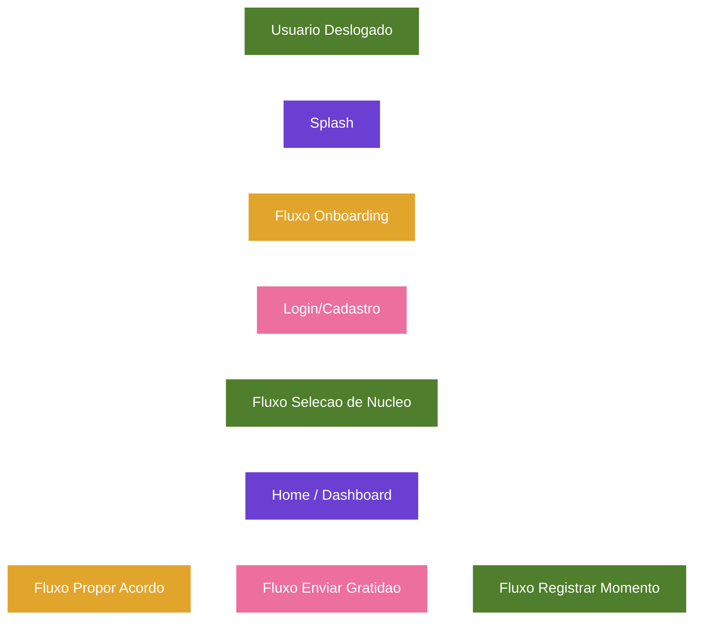

# Projeto Nós - Fluxos, Navegação e Interações (Versão 2.2)

## Categoria
**2.x - Interface e Implementação**

## Documentos Relacionados

### Versões 1.x (Visão e Regras de Negócio)
- [v1.2 - Sistema de Aprovação e Construção de Acordos](Projeto_Nos_v1.2_Sistema_de_Aprovacao_e_Construcao_de_Acordos.md)
- [v1.3 - Evolução para Núcleos](Projeto_Nos_v1.3_Evolucao_Para_Nucleos.md)
- [v1.4 - Sistema de Impacto](Projeto_Nos_v1.4_Sistema_de_Impacto.md)
- [v1.5 - Sistema de Reconhecimento e Gratidão](Projeto_Nos_v1.5_Sistema_de_Reconhecimento_e_Gratidao.md)
- [v1.6 - Sistema de Marcos de Evolução e Celebrações Saudáveis](Projeto_Nos_v1.6_Sistema_de_Marcos_de_Evolucao_e_Celebracoes_Saudaveis.md)
- [v1.7 - Sistema de Linguagens de Cuidado e Amor](Projeto_Nos_v1.7_Sistema_de_Linguagens_de_Cuidado_e_Amor.md)
- [v1.8 - Manifesto do Núcleo](Projeto_Nos_v1.8_Manifesto_do_Nucleo.md)
- [v1.9 - Calendário do Núcleo e Sincronização Segura](Projeto_Nos_v1.9_Calendario_do_Nucleo_e_Sincronizacao_Segura.md)
- [v1.10 - Sistema de Conversas Guiadas e Mediação Afetiva](Projeto_Nos_v1.10_Sistema_de_Conversas_Guiadas_e_Mediacao_Afetiva.md)

### Versões 2.x (Interface e Implementação)
- [v2.0 - Alinhamento das Telas com a Documentação](Projeto_Nos_v2.0_Alinhamento_das_Telas_com_a_Documentacao.md)
- [v2.1 - Catálogo Completo das Interfaces](Projeto_Nos_v2.1_Catalogo_Completo_das_Interfaces.md)
- [v2.2 - Fluxos, Navegação e Interações](Projeto_Nos_v2.2_Fluxos_Navegacao_e_Interacoes.md)
- [v2.3 - Design System, Componentes e Tom de Interface](Projeto_Nos_v2.3_Design_System_Componentes_e_Tom_de_Interface.md)
- [v2.4 - Modelo Funcional, Dados, Estados e Regras](Projeto_Nos_v2.4_Modelo_Funcional_Dados_Estados_e_Regras.md)
- [v2.5 - Matriz de Permissões, Privacidade e Visibilidade](Projeto_Nos_v2.5_Matriz_de_Permissoes_Privacidade_Visibilidade.md)
- [v2.6 - Estados Vazios, Erros e Carregamento](Projeto_Nos_v2.6_Estados_Vazios_Erros_e_Carregamento.md)
- [v2.7 - Notificações e Eventos do Sistema](Projeto_Nos_v2.7_Notificacoes_e_Eventos_do_Sistema.md)

---

## Status

Documento de especificação de fluxos.

## Relação com a v2.1

A versão 2.1 documenta cada tela individualmente. Esta versão 2.2 documenta como as telas se conectam, quais ações existem, quais estados mudam e quais regras devem orientar a experiência de ponta a ponta.

## Objetivo

Transformar as interfaces do protótipo em fluxos implementáveis, com navegação, gatilhos, permissões, estados e efeitos esperados.

---

# 1. Modelo Mental de Navegação

O Projeto Nós funciona em torno de um contexto ativo: o Núcleo.

Toda navegação principal deve responder a três perguntas:

1. Quem é o usuário atual?
2. Qual é o Núcleo ativo?
3. Qual vínculo, acordo, memória ou evento está sendo cuidado agora?

## Estrutura principal

O app possui cinco áreas principais acessíveis pela navegação inferior:

- Início;
- Acordos;
- Memórias;
- Conexões;
- Perfil.

Essas áreas sempre pertencem ao Núcleo ativo.

## Fluxos focados

Algumas telas ocultam a navegação inferior para manter concentração e privacidade:

- Splash;
- Onboarding;
- Novo acordo;
- Detalhe de hábito;
- Núcleos;
- Convite;
- Notificações;
- Registrar momento;
- Gratidão;
- Aceitar convite;
- Perfil de membro;
- Experiência;
- Revisão;
- Promoção para Essência;
- Conversa de cuidado;
- Espaço de Conversa Guiada;
- Manifesto;
- Configurações;
- Sobre mim;
- Tipos de vínculo;
- Jornada;
- Aprovações.

Regra: fluxos focados devem ter ação clara de voltar, concluir ou cancelar.

---

# 2. Fluxo de Entrada e Onboarding

## 2.1 Splash para primeira decisão

### Origem

Tela 01 - Splash e Entrada Afetiva.

### Ações

- "Começar agora";
- "Entrar na minha conta".

### Resultado esperado

- "Começar agora" inicia onboarding de conta;
- "Entrar na minha conta" deve abrir login em produção;
- no protótipo, entrar pode navegar diretamente para Home.

### Regras

- usuário não deve acessar dados de Núcleo antes de autenticação;
- tom inicial deve reforçar privacidade, intimidade e propósito;
- a árvore deve ser apresentada como símbolo de cuidado.

## 2.2 Criar conta

### Etapas

1. Informar nome.
2. Informar e-mail.
3. Informar senha.
4. Validar campos.
5. Escolher caminho: criar Núcleo ou entrar em Núcleo existente.

### Estados

- vazio;
- preenchido parcialmente;
- erro de validação;
- carregando;
- conta criada.

### Regras

- mensagens de erro devem ser específicas e humanas;
- senha inválida não deve expor regra técnica de forma fria;
- após criar conta, usuário ainda precisa de um Núcleo para ter Home completa.

## 2.3 Escolher caminho

### Opções

- criar novo Núcleo;
- entrar com convite.

### Resultado

- criar novo Núcleo leva à seleção de tipo;
- entrar com convite leva ao aceite ou inserção de código.

### Regras

- usuário pode criar ou participar de múltiplos Núcleos;
- cada Núcleo deve ter propósito próprio.

## 2.4 Criar Núcleo

### Etapas

1. Selecionar tipo: casal, família, irmãos, pais e filhos, amigos.
2. Informar nome.
3. Informar propósito.
4. Gerar convite.
5. Concluir e abrir Home do novo Núcleo.

### Regras

- tipo do Núcleo altera sugestões de acordos, experiências e Manifesto;
- propósito alimenta Perfil, Manifesto e Home;
- convite inicial deve ser opcional, mas recomendado.

## 2.5 Entrar em Núcleo

### Etapas

1. Receber convite por link, código ou QR.
2. Ver remetente, tipo de Núcleo, propósito e membros.
3. Aceitar ou recusar.
4. Ao aceitar, entrar no Núcleo e abrir Home.

### Regras

- aceite precisa ser voluntário;
- convite deve ser revogável e expirar quando configurado;
- usuário deve entender que acordos, gratidões e memórias serão compartilhados dentro daquele Núcleo.

---

# 3. Fluxo de Troca de Núcleo

## Origem

- seletor de Núcleo na Home;
- botão "Trocar de núcleo" no Perfil;
- tela "Seus núcleos".

## Ações

- selecionar Núcleo existente;
- aceitar convite recebido;
- criar novo Núcleo.

## Efeitos

Ao trocar Núcleo ativo, devem ser recarregados:

- Home;
- árvore;
- acordos;
- memórias;
- calendário;
- conexões;
- notificações;
- configurações do Núcleo;
- Manifesto;
- convites.

## Regras

- nenhum dado de um Núcleo deve aparecer em outro;
- cache local deve ser separado por `nucleoId`;
- notificações devem indicar a qual Núcleo pertencem quando o usuário participa de vários.

---

# 4. Fluxo da Home

## Objetivo

Mostrar o estado atual do Núcleo e conduzir a pequenas ações de cuidado.

## Entradas

- login concluído;
- troca de Núcleo;
- retorno de fluxos concluídos;
- toque em "Início" na navegação inferior.

## Blocos funcionais

- saudação personalizada;
- Núcleo ativo;
- card emocional;
- árvore resumida;
- gratidão recente;
- calendário;
- próximos momentos.

## Interações

- tocar na árvore abre Nossa Árvore;
- tocar em gratidão abre Memórias ou detalhe;
- tocar no calendário filtra eventos;
- tocar em evento abre experiência, acordo ou evento;
- tocar em notificações abre Notificações;
- tocar no seletor abre Seus Núcleos.

## Estados

- Núcleo com dados;
- Núcleo recém-criado;
- sem eventos futuros;
- sem gratidões recentes;
- offline;
- carregando.

## Estados vazios recomendados

- sem gratidão: "Ainda não há registros de gratidão por aqui. Um pequeno obrigado pode começar essa memória.";
- sem próximos momentos: "Nada marcado por enquanto. Que tal criar um momento simples para vocês?";
- Núcleo novo: "Este jardim começou agora. Convide quem faz parte dessa história."

## Regras

- Home não deve virar painel de cobrança;
- prioridade visual deve ser acolhimento e continuidade;
- ações rápidas devem ser discretas e úteis.

---

# 5. Fluxo de Acordos

## 5.1 Hub de Acordos

### Entradas

- bottom nav "Acordos";
- retorno de detalhe;
- retorno de novo acordo;
- retorno de revisão.

### Abas

- Hábitos;
- Experiências;
- Essência.

### Filtros

- Todos;
- Em andamento;
- Concluídos.

### Interações

- tocar em hábito abre detalhe;
- tocar em experiência abre detalhe de experiência;
- tocar em item de Essência abre detalhe da prática consolidada;
- botão adicionar abre Novo acordo.

### Regras

- categorias não devem ser misturadas visualmente;
- Essência deve ter tratamento mais identitário e menos operacional;
- acordos pendentes devem indicar que aguardam aceite.

## 5.2 Novo acordo

### Etapas oficiais

1. Necessidade.
2. Proposta.
3. Conversar.
4. Acordo.

### Etapa Necessidade

Pergunta: "Qual necessidade você gostaria de transformar em um acordo?"

Opções:

- Mais conexão;
- Mais tempo juntos;
- Mais carinho;
- Comunicação;
- Respeito;
- Outro.

### Etapa Proposta

Deve ajudar a transformar necessidade em ideia concreta.

Campos recomendados:

- título;
- descrição;
- categoria;
- frequência;
- participantes;
- impacto esperado;
- linguagem de cuidado;
- data de revisão.

### Etapa Conversar

Deve permitir explicar intenção e ouvir o outro.

Campos recomendados:

- mensagem de contexto;
- dificuldade esperada;
- flexibilidade;
- pergunta aberta para o outro.

### Etapa Acordo

Deve apresentar versão final clara.

Campos recomendados:

- "O que vamos fazer";
- "Com que frequência";
- "Quando revisar";
- "Quem participa";
- "Como saberemos que está funcionando";
- botão de enviar para aprovação ou confirmar.

### Regras

- proposta não vira acordo sem aceite;
- texto deve sair de necessidade e cuidado, não cobrança;
- IA pode sugerir redação, mas usuário deve editar e confirmar;
- acordo deve ser específico, praticável e revisável.

## 5.3 Detalhe do hábito

### Interações

- Detalhes;
- Histórico;
- Reflexões;
- Revisar;
- Registrar momento.

### Regras

- histórico deve mostrar registros sem punir falhas;
- reflexões devem ajudar o vínculo, não avaliar pessoas;
- revisão deve ser acessível sem dramatizar.

## 5.4 Registrar momento

### Resultado esperado

Ao salvar:

- cria memória;
- atualiza histórico do acordo;
- pode atualizar progresso;
- pode contribuir para árvore;
- pode gerar marco se houver critério atingido.

### Regras

- nota e foto são opcionais;
- humor "Difícil" pode sugerir conversa de cuidado, mas não obrigar;
- registros não devem ser editados por outros membros, exceto regras futuras de moderação.

## 5.5 Revisar acordo

### Caminhos

- manter;
- ajustar;
- conversar sobre dificuldades;
- encerrar;
- promover para Essência.

### Regras

- qualquer mudança estrutural exige aprovação;
- encerrar precisa de comum acordo;
- revisão pode gerar novo período de teste;
- promoção para Essência precisa de consentimento.

## 5.6 Conversa de cuidado

### Gatilhos

- baixa adesão;
- escolha "Conversar sobre dificuldades";
- humor "Difícil";
- desencontro recorrente;
- solicitação manual do usuário.

### Fluxo

1. Convite (Conversar agora · Adiar · Prefiro não agora).
2. Preparação com Ponte do Nós.
3. Cartão de Intenção opcional (mensagem única).
4. Conversa ao vivo agendada (desfecho preferencial).
5. Desfecho pós-encontro opcional.

### Regras

- deve usar primeira pessoa;
- deve evitar acusação;
- **não possui chat ou thread de mensagens**;
- adiar ou recusar não gera penalidade;
- desfecho preferencial é encontro presencial.

## 5.7 Promoção para Essência

### Gatilhos

- prática consistente;
- impacto percebido positivo;
- tempo mínimo ou marco alcançado;
- desejo dos envolvidos.

### Regras

- Essência exige aceite;
- frase deve ser positiva e permanente;
- se alguém recusar, hábito permanece como hábito.

---

# 6. Fluxo de Experiências e Agenda

## 6.1 Experiência

Experiência é um momento que o Núcleo deseja viver.

Exemplo do protótipo:

- "Jantar romântico";
- tipo: mensal;
- intenção: "Criar momentos a sós, sem pressa.";
- próxima data: "8 de junho";
- histórico: "7 vezes".

## 6.2 Agendar experiência

### Etapas

1. Escolher ideia.
2. Escolher data e horário.
3. Definir participantes.
4. Confirmar intenção.
5. Enviar convite quando aplicável.

### Regras

- calendário interno é fonte oficial;
- evento externo sincronizado não pode revelar dados sensíveis sem consentimento;
- depois do evento, app deve sugerir registrar momento.

## 6.3 Tipos de evento

Herdados da v1.9:

- Experiência;
- Hábito agendado;
- Revisão;
- Conversa de cuidado;
- Celebração;
- Data importante;
- Evento livre.

## 6.4 Confirmação de participação

Estados:

- pendente;
- aceito;
- recusado;
- talvez;
- remarcação sugerida.

Regra: eventos que envolvem presença de mais de uma pessoa devem permitir confirmação respeitosa.

---

# 7. Fluxo de Memórias

## Entradas

- bottom nav "Memórias";
- gratidão na Home;
- registro de momento;
- marco alcançado;
- pós-evento;
- perfil de membro.

## Filtros

- Tudo;
- Fotos;
- Agradecimentos;
- Marcos.

## Tipos de memória

- gratidão;
- reconhecimento;
- celebração;
- momento registrado;
- foto;
- experiência vivida;
- marco de hábito;
- marco de Essência;
- entrada de membro;
- Manifesto confirmado.

## Interações

- abrir detalhe;
- reagir;
- responder;
- compartilhar internamente;
- associar a acordo;
- ocultar, se permitido.

## Regras

- Memórias são privadas ao Núcleo por padrão;
- visibilidade pode ser restrita por tipo ou autor;
- apagar memória deve respeitar autoria e direitos dos envolvidos;
- memórias sensíveis não devem alimentar Manifesto sem critério.

---

# 8. Fluxo de Gratidão

## Entradas

- botão de gratidão no perfil de membro;
- ação rápida em Conexões;
- Home;
- Memórias;
- pós-momento.

## Etapas

1. Selecionar destinatário.
2. Escrever mensagem.
3. Usar sugestão opcional.
4. Enviar.
5. Gerar notificação e memória.

## Sugestões

- Por me ouvir;
- Pelo cuidado;
- Por estar presente.

## Regras

- gratidão deve ser livre e autêntica;
- não deve exigir reciprocidade;
- não deve compor ranking;
- destinatário deve poder receber notificação conforme configuração.

---

# 9. Fluxo de Perfil Afetivo

## 9.1 Perfil próprio

### Blocos

- bio;
- completude;
- lista de desejos;
- música;
- filmes e séries;
- sabores;
- hobbies;
- formas de cuidado;
- datas importantes.

### Interações

- editar;
- adicionar desejo;
- adicionar tag;
- remover informação;
- definir visibilidade.

### Regras

- usuário controla seu perfil;
- completude é incentivo leve;
- informações podem ser diferentes por Núcleo em versão futura.

## 9.2 Perfil de membro

### Blocos

- vínculo;
- estatísticas relacionais;
- linguagens de cuidado;
- ideias de presente;
- gostos;
- ações rápidas.

### Interações

- agradecer;
- criar acordo;
- registrar momento;
- ver perfil completo.

### Regras

- métricas devem informar, não comparar;
- sugestões de presente devem ser respeitosas e opcionais;
- linguagens de cuidado não são rótulos fixos.

---

# 10. Fluxo de Conexões

## Objetivo

Transformar a rede de vínculos em uma visualização navegável e acionável.

## Interações principais

- filtrar por força;
- tocar em pessoa;
- cuidar do laço;
- agradecer;
- registrar momento;
- ver atividade recente;
- abrir aprovações;
- convidar membro.

## Forças de laço

- Forte;
- Médio;
- Frágil.

## Regras

- "Frágil" deve ser comunicado com delicadeza;
- força do laço deve ser calculada por sinais positivos e tempo de interação, não por vigilância invasiva;
- usuário deve poder cuidar sem se sentir culpado;
- filtros não devem ocultar permanentemente pessoas importantes.

## Possíveis sinais para cálculo

- última interação;
- gratidões trocadas;
- momentos registrados;
- experiências vividas;
- acordos ativos;
- datas importantes próximas;
- respostas pendentes.

Esses sinais devem ser ponderados com cuidado e transparência.

---

# 11. Fluxo de Aprovações

## Objetivo

Centralizar consentimentos necessários.

## Tipos de aprovação

- novo acordo;
- ajuste de acordo;
- encerramento de acordo;
- promoção para Essência;
- convite de experiência;
- mudança de fase da jornada;
- entrada em Núcleo;
- confirmação de Manifesto;
- evento com participação obrigatória.

## Estados

- aguardando você;
- enviado por você;
- aceito;
- recusado;
- em conversa;
- expirado;
- cancelado.

## Ações

- aceitar;
- conversar;
- recusar;
- cancelar envio;
- reenviar lembrete suave.

## Regras

- recusar é uma resposta válida;
- aceitar deve registrar data e autor;
- conversar não deve bloquear o vínculo;
- lembretes devem ser limitados e respeitosos.

---

# 12. Fluxo de Conversas Guiadas

## Decisão de produto

O Projeto Nós **não possui chat livre**. Conversas Guiadas preparam encontros presenciais; não substituem diálogo face a face.

## Gatilhos

- conversa de cuidado;
- aprovação escolhida como "Conversar";
- acordo difícil;
- vínculo frágil;
- desencontro registrado;
- Novo Acordo, etapas Compreensão e Conversar;
- Demonstrar Gratidão (Conversa de Gratidão).

## Tipos de conversa (v1.10)

- Compreensão (troca única estruturada).
- Alinhamento.
- Reparo.
- Revisão de acordo.
- Gratidão.
- Necessidade não atendida.
- Retomada.

## Fases do fluxo

### Fase 0 — Convite

- Conversar agora.
- Adiar.
- Prefiro não agora.

### Fase 1 — Preparação

- Reconhecer o momento.
- Escolher tipo de conversa.
- Micro-pausa opcional.
- Rascunho em primeira pessoa com Ponte do Nós.

### Fase 2 — Cartão de Intenção (opcional)

- Mensagem única ao destinatário.
- Respostas estruturadas: aceitar · sugerir horário · adiar.
- Não abre thread.

### Fase 3 — Conversa ao vivo

- Evento no calendário interno (v1.9).
- Modo silencioso: agendar sem Cartão de Intenção.

### Fase 4 — Desfecho

- Ajuste de acordo.
- Gratidão.
- Pausa.
- Nova proposta.
- Registro de momento.
- Encerrar com cuidado.

## Papel do Ponte do Nós

O Ponte do Nós apoia a preparação. Não julga, não diagnostica, não decide quem está certo.

Pode:

- sugerir linguagem em primeira pessoa;
- reforçar rascunhos cuidadosos;
- detectar tom acusatório e sugerir reformulação privada;
- recomendar Conversa ao vivo cedo em temas sensíveis;
- propor desfechos seguros após preparação.

Não pode:

- diagnosticar pessoas;
- decidir quem está certo;
- expor rascunhos ao destinatário;
- pressionar reconciliação;
- incentivar conversa prolongada por texto.

## Exceção: Compreensão

No fluxo de Novo Acordo, permite **uma troca estruturada**:

- A expressa necessidade ou proposta.
- B reformula o que entendeu (campo único).
- A confirma ou solicita Conversa ao vivo.

Não é chat. Não permite respostas em cadeia.

## Estados

- convite;
- preparando;
- cartaoEnviado;
- aguardandoEncontro;
- encontroRealizado;
- desfechoRegistrado;
- adiada;
- arquivada;
- compreensaoPendente;
- compreensaoConfirmada.

## Regras

- máximo uma intervenção do Ponte do Nós por etapa;
- feedback corretivo visível só ao autor;
- recusar ou adiar não penaliza;
- Manifesto não usa conteúdo literal de conversas difíceis;
- marcos celebram cuidado, não volume de interações.

---

# 13. Fluxo do Manifesto

## Entradas

- Perfil;
- marco de maturidade;
- promoção para Essência;
- convite para ler manifesto;
- confirmação de todos.

## Estados

- inexistente;
- elegível para geração;
- gerado;
- em revisão;
- confirmado;
- histórico.

## Interações

- ler completo;
- compartilhar;
- assinar/confirmar;
- consultar histórico;
- atualizar em versão futura.

## Regras

- Manifesto confirmado exige aceite;
- dados sensíveis não devem aparecer literalmente sem autorização;
- texto deve representar valores e práticas, não conflitos específicos;
- pode ser atualizado com o amadurecimento do Núcleo.

---

# 14. Fluxo de Notificações

## Tipos

- gratidão recebida;
- acordo cumprido;
- convite recebido;
- entrada de membro;
- marco alcançado;
- hábito virou Essência;
- lembrete de agenda;
- aprovação pendente;
- resposta em diálogo.

## Agrupamento

- Hoje;
- Esta semana;
- Anteriores.

## Regras

- notificações devem ser configuráveis;
- tom deve ser positivo ou neutro-cuidadoso;
- evitar linguagem de cobrança;
- notificações sensíveis devem ocultar conteúdo em tela bloqueada.

---

# 15. Fluxos de Erro e Recuperação

## Convite inválido

Mensagem recomendada:

"Esse convite não está mais disponível. Peça um novo código para quem cuida desse Núcleo com você."

## Aprovação expirada

Mensagem recomendada:

"Essa proposta ficou antiga. Vocês podem criar uma nova, com calma."

## Evento removido

Mensagem recomendada:

"Esse momento foi removido do calendário do Núcleo."

## Sem permissão

Mensagem recomendada:

"Você não tem acesso a esse conteúdo neste Núcleo."

## Offline

Mensagem recomendada:

"Você está sem conexão agora. Vamos guardar suas alterações e sincronizar quando voltar."

---

# 16. Regras Transversais de Interação

1. Toda ação sensível deve ter confirmação ou possibilidade de desfazer.
2. Toda navegação deve preservar o Núcleo ativo.
3. Fluxos de cuidado devem priorizar texto editável pelo usuário.
4. IA pode sugerir, mas não deve decidir por pessoas.
5. Estados vazios devem convidar, não cobrar.
6. Progresso deve ser coletivo e simbólico.
7. Consentimento deve ser explícito em acordos, Essência, eventos importantes e Manifesto.
8. Privacidade deve aparecer em momentos de entrada, convite, memória e sincronização.
9. Métricas devem ser usadas para cuidado, não comparação.
10. O app deve sempre favorecer reparação, conversa e clareza antes de encerramento ou conflito.

---

# Diagrama de Fluxo da Versao

## Fluxo complementar — confirmação do Hábito — decisão de 2026-10-03

**Versão de implementação vigente: 0.11.0; confirmação implementada e validada.**

Propor duração de 7 a 30 dias → aceite inicial unânime → início do teste no último aceite → prazo completo → confirmações individuais → atingir o limiar → ativo. Legado sem datas exige novo período unânime. Revisão pendente impede ativação; ajuste aplicado abre novo teste com votos novos; recusa preserva o combinado. Encerrar preserva histórico. Hábitos ativos mantêm registro de momentos e revisão.

Regra canônica: [v1.2 — confirmação pós-teste](Projeto_Nos_v1.2_Sistema_de_Aprovacao_e_Construcao_de_Acordos.md#regra-de-confirmação-do-hábito--decisão-de-2026-10-03).
