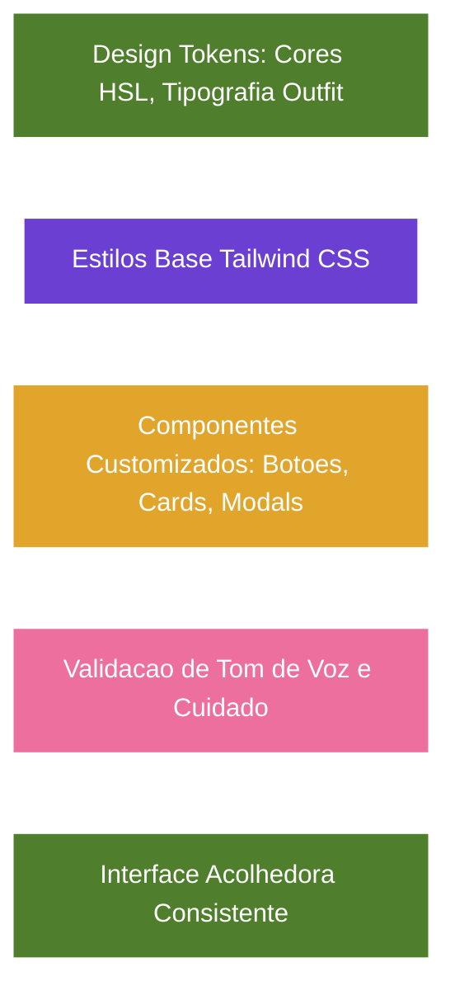

# Projeto Nós - Design System, Componentes e Tom de Interface (Versão 2.3)

## Categoria
**2.x - Interface e Implementação**

## Documentos Relacionados

### Versões 1.x (Visão e Regras de Negócio)
- [v1.2 - Sistema de Aprovação e Construção de Acordos](Projeto_Nos_v1.2_Sistema_de_Aprovacao_e_Construcao_de_Acordos.md)
- [v1.3 - Evolução para Núcleos](Projeto_Nos_v1.3_Evolucao_Para_Nucleos.md)
- [v1.4 - Sistema de Impacto](Projeto_Nos_v1.4_Sistema_de_Impacto.md)
- [v1.5 - Sistema de Reconhecimento e Gratidão](Projeto_Nos_v1.5_Sistema_de_Reconhecimento_e_Gratidao.md)
- [v1.6 - Sistema de Marcos de Evolução e Celebrações Saudáveis](Projeto_Nos_v1.6_Sistema_de_Marcos_de_Evolucao_e_Celebracoes_Saudaveis.md)
- [v1.7 - Sistema de Linguagens de Cuidado e Amor](Projeto_Nos_v1.7_Sistema_de_Linguagens_de_Cuidado_e_Amor.md)
- [v1.8 - Manifesto do Núcleo](Projeto_Nos_v1.8_Manifesto_do_Nucleo.md)
- [v1.9 - Calendário do Núcleo e Sincronização Segura](Projeto_Nos_v1.9_Calendario_do_Nucleo_e_Sincronizacao_Segura.md)
- [v1.10 - Sistema de Conversas Guiadas e Mediação Afetiva](Projeto_Nos_v1.10_Sistema_de_Conversas_Guiadas_e_Mediacao_Afetiva.md)

### Versões 2.x (Interface e Implementação)
- [v2.0 - Alinhamento das Telas com a Documentação](Projeto_Nos_v2.0_Alinhamento_das_Telas_com_a_Documentacao.md)
- [v2.1 - Catálogo Completo das Interfaces](Projeto_Nos_v2.1_Catalogo_Completo_das_Interfaces.md)
- [v2.2 - Fluxos, Navegação e Interações](Projeto_Nos_v2.2_Fluxos_Navegacao_e_Interacoes.md)
- [v2.3 - Design System, Componentes e Tom de Interface](Projeto_Nos_v2.3_Design_System_Componentes_e_Tom_de_Interface.md)
- [v2.4 - Modelo Funcional, Dados, Estados e Regras](Projeto_Nos_v2.4_Modelo_Funcional_Dados_Estados_e_Regras.md)
- [v2.5 - Matriz de Permissões, Privacidade e Visibilidade](Projeto_Nos_v2.5_Matriz_de_Permissoes_Privacidade_Visibilidade.md)
- [v2.6 - Estados Vazios, Erros e Carregamento](Projeto_Nos_v2.6_Estados_Vazios_Erros_e_Carregamento.md)
- [v2.7 - Notificações e Eventos do Sistema](Projeto_Nos_v2.7_Notificacoes_e_Eventos_do_Sistema.md)

---

## Status

Documento de especificação visual e de componentes.

## Relação com versões anteriores

- v1.1 define a filosofia do produto.
- v1.2 a v1.10 definem sistemas funcionais.
- v2.1 cataloga as telas.
- v2.2 descreve fluxos e navegação.
- v2.3 transforma o protótipo em padrões reutilizáveis de interface.

## Objetivo

Documentar o sistema visual, os componentes, o tom de voz e os padrões de microinteração observados no protótipo `Nós App.dc.html`, para orientar implementação consistente em app mobile ou web responsivo.

---

# 1. Personalidade Visual

O Projeto Nós deve parecer:

- íntimo;
- acolhedor;
- calmo;
- orgânico;
- seguro;
- afetivo sem ser infantil;
- simbólico sem perder clareza;
- orientado a cuidado, não produtividade.

## Metáfora visual central

A árvore é o símbolo principal do produto.

Ela representa:

- crescimento coletivo;
- raízes;
- continuidade;
- amadurecimento;
- memória;
- cuidado recorrente;
- identidade do Núcleo.

Ela não representa:

- placar individual;
- desempenho competitivo;
- obrigação;
- cobrança emocional.

---

# 2. Paleta de Cores

As cores do protótipo formam um sistema afetivo com quatro papéis principais: crescimento, cuidado, afeto e tranquilidade.

## Verde - crescimento e cuidado

Uso:

- árvore;
- botões principais de cuidado;
- progresso positivo;
- filtros ativos;
- ações de confirmação;
- linguagem de natureza.

Exemplos observados:

- `#4F7E2C` verde principal;
- `#5C8A3A` verde de ação;
- `#6BA340` verde em gradientes;
- `#6E9A47` verde complementar;
- `#A9C77F` verde suave;
- `#DCE8C6` fundo orgânico.

Diretriz:

- usar verde para ações que cultivam, confirmam ou aproximam;
- evitar usar verde para ranking ou "sucesso" competitivo.

## Roxo - identidade, ação principal e vínculo

Uso:

- ações principais em algumas telas;
- destaque de marca;
- cards de Núcleo;
- sensação de intimidade e profundidade.

Exemplos observados:

- `#6A3FD1`;
- `#7B4FE0`;
- `#5B35B1`;
- `#EDE7F7`;
- `#DAD3EC`.

Diretriz:

- usar roxo como cor de marca e navegação emocional;
- equilibrar com verde para não tornar a experiência excessivamente digital.

## Rosa - gratidão, carinho e vínculo romântico/afetivo

Uso:

- gratidão;
- perfil de Ana;
- linguagem de cuidado afetiva;
- fases românticas;
- botões de agradecer.

Exemplos observados:

- `#EC6F9E`;
- `#D9789F`;
- `#F0A6C0`;
- `#FCE4ED`;
- `#C85C8E`.

Diretriz:

- usar rosa para afeto explícito e gratidão;
- não usar rosa para erro ou alerta crítico.

## Amarelo/âmbar - convite, atenção leve e celebração

Uso:

- convites;
- experiências;
- badges de pendência;
- celebrações;
- lembretes suaves.

Exemplos observados:

- `#E2A52C`;
- `#F4C268`;
- `#FBF0D8`;
- `#F3E7C6`.

Diretriz:

- usar para atenção sem urgência agressiva;
- pendências devem parecer convite à decisão, não alarme.

## Fundos neutros

Uso:

- base das telas;
- cards;
- áreas de leitura.

Exemplos observados:

- `#F6F3EB` fundo principal;
- `#FCFBF4` fundo de card;
- `#FFFFFF` cards;
- `#EBE8DD` bordas;
- `#F3F4EC` fundo de diálogo.

Diretriz:

- manter fundo quente e suave;
- evitar branco puro como fundo de tela inteira quando a tela for emocional.

---

# 3. Tipografia

## Fontes observadas

- `Fredoka`;
- `Plus Jakarta Sans`;
- `Baloo 2`.

## Papéis

### Fredoka

Uso:

- títulos de tela;
- botões;
- labels afetivas;
- nomes de seções importantes.

Personalidade:

- amigável;
- arredondada;
- leve;
- próxima.

### Plus Jakarta Sans

Uso:

- textos de apoio;
- metadados;
- parágrafos;
- descrições;
- campos;
- microcopy.

Personalidade:

- legível;
- contemporânea;
- neutra;
- organizada.

### Baloo 2

Uso:

- marca "Nós" na splash;
- momentos muito identitários.

Diretriz:

- usar com parcimônia;
- não aplicar em textos longos.

---

# 4. Layout Base

## Protótipo

O protótipo usa moldura de celular com:

- largura aproximada de 402px;
- altura aproximada de 858px;
- cantos arredondados;
- status bar;
- dynamic island;
- scroll interno por tela.

## Implementação real

Em app real:

- respeitar safe areas;
- manter padding lateral entre 20px e 24px;
- usar rolagem vertical;
- fixar botões principais no final quando o fluxo exigir decisão;
- evitar telas densas demais em áreas emocionais.

## Espaçamento

Padrões recomendados:

- padding lateral: 20px;
- gap entre cards: 12px a 16px;
- gap entre título e subtítulo: 2px a 6px;
- margem superior de bloco: 16px a 24px;
- padding de card: 14px a 20px.

---

# 5. Componentes Principais

## 5.1 App Frame

### Função

Container visual do protótipo. Em produção, corresponde à tela mobile.

### Elementos

- área segura superior;
- conteúdo rolável;
- navegação inferior quando aplicável.

### Regras

- conteúdo não deve ficar oculto atrás da bottom nav;
- fluxos focados devem ocultar bottom nav;
- telas de conversa podem usar header sticky.

---

## 5.2 Status Bar e Header

### Tipos de header

1. Header simples com título.
2. Header com botão voltar.
3. Header com avatar e contexto.
4. Header com ações à direita.
5. Header sticky para diálogo.

### Quando usar

- simples: telas principais;
- com voltar: fluxos focados;
- com avatar: perfil, membro, diálogo;
- com ações: Home, Conexões, Perfil.

### Regras

- botão voltar deve ser claro;
- header não deve competir com o conteúdo emocional;
- títulos devem ser curtos.

---

## 5.3 Bottom Navigation

### Itens

- Início;
- Acordos;
- Memórias;
- Conexões;
- Perfil.

### Estado ativo

- ícone e label na cor ativa;
- demais em verde/cinza suave.

### Regras

- sempre pertence ao Núcleo ativo;
- ocultar em fluxos de decisão;
- não adicionar muitas abas.

---

## 5.4 Card de Núcleo

### Uso

- Home;
- Seus Núcleos;
- Perfil;
- Convites;
- Manifesto.

### Conteúdo

- tipo do Núcleo;
- nome;
- propósito;
- membros;
- nível;
- status ativo.

### Estados

- ativo;
- convite recebido;
- pendente;
- novo;
- selecionável.

### Regras

- propósito deve aparecer como frase humana;
- card ativo deve ser visualmente destacado;
- membros podem aparecer como avatares de iniciais.

---

## 5.5 Card de Árvore

### Uso

- Home;
- Nossa Árvore;
- Splash;
- Aceitar convite;
- Manifesto;
- Conexões.

### Conteúdo

- imagem da árvore;
- nível;
- estágio;
- experiência atual;
- meta;
- indicadores coletivos.

### Estados

- árvore inicial;
- raízes fortes;
- copa florescente;
- marco alcançado;
- carregando.

### Regras

- nunca mostrar contribuição individual como ranking;
- progresso deve ser coletivo;
- mensagens devem reforçar continuidade.

---

## 5.6 Card de Acordo

### Uso

- Hub de Acordos;
- Aprovações;
- Perfil de membro;
- Revisão.

### Conteúdo

- título;
- frequência;
- progresso;
- categoria;
- status;
- participantes;
- impacto esperado, quando necessário.

### Estados

- em andamento;
- concluído;
- pendente de aprovação;
- em revisão;
- elegível para Essência;
- na Essência.

### Regras

- progresso deve ser discreto;
- status pendente deve indicar consentimento;
- card deve abrir detalhe.

---

## 5.7 Card de Gratidão

### Uso

- Home;
- Memórias;
- Notificações;
- Conexões.

### Conteúdo

- autor;
- destinatário;
- mensagem;
- horário;
- reações;
- vínculo opcional com acordo/momento.

### Estados

- enviada;
- recebida;
- lida;
- respondida;
- associada a marco.

### Regras

- evitar contadores competitivos;
- destacar mensagem humana;
- permitir resposta carinhosa.

---

## 5.8 Card de Memória

### Uso

- Memórias;
- Experiência;
- Perfil;
- Conexões.

### Tipos

- foto;
- gratidão;
- marco;
- momento;
- experiência;
- celebração.

### Regras

- cada tipo deve ter visual próprio, mas manter consistência;
- memórias sensíveis devem respeitar visibilidade;
- linha do tempo deve ser acolhedora, não cronologia fria.

---

## 5.9 Card de Perfil Afetivo

### Uso

- Sobre mim;
- Perfil de membro;
- Perfil.

### Conteúdo

- completude;
- bio;
- desejos;
- gostos;
- linguagens de cuidado;
- datas.

### Regras

- usuário controla seus dados;
- completude deve ser incentivo;
- campos devem aceitar ausência sem constranger.

---

## 5.10 Card de Aprovação

### Uso

- Aprovações;
- revisão;
- convites;
- jornada.

### Conteúdo

- autor;
- tipo;
- proposta;
- data;
- ações.

### Ações

- aceitar;
- conversar;
- recusar;
- cancelar;
- reenviar.

### Regras

- recusa é válida;
- "Conversar" deve ser tão legítimo quanto aceitar;
- pendências não devem soar como cobrança.

---

## 5.11 Chips e Tags

### Tipos

- filtros;
- categorias;
- gostos;
- linguagens;
- status;
- vínculos;
- sugestões.

### Estados

- ativo;
- inativo;
- selecionado;
- removível;
- desabilitado.

### Regras

- chips devem ser curtos;
- quando forem editáveis, indicar remoção;
- usar cor conforme domínio: verde para cuidado, rosa para afeto, âmbar para convite, azul para informação.

---

## 5.12 Botões

### Primário

Uso:

- continuar;
- salvar;
- aceitar;
- enviar gratidão;
- promover;
- compartilhar.

Visual:

- preenchido;
- gradiente verde ou roxo conforme contexto;
- texto em branco;
- altura confortável.

### Secundário

Uso:

- entrar;
- manter;
- conversar;
- talvez;
- agora não.

Visual:

- fundo claro;
- borda suave;
- texto colorido.

### Destrutivo leve

Uso:

- recusar;
- cancelar convite;
- encerrar de comum acordo.

Visual:

- evitar vermelho agressivo;
- usar rosa/terracota suave;
- pedir confirmação quando afetar vínculo.

### Regras

- botões devem usar verbos humanos;
- evitar "Excluir" em contextos afetivos sem explicação;
- ação primária por tela deve ser clara.

---

## 5.13 Campos de Texto

### Uso

- nome;
- e-mail;
- senha;
- propósito;
- mensagem de gratidão;
- nota de momento;
- conversa de cuidado;
- bio.

### Regras

- placeholders devem ser exemplos acolhedores;
- campos afetivos devem aceitar texto livre;
- mensagens sugeridas devem ser editáveis;
- erros devem ser específicos.

---

## 5.14 Segment Controls e Abas

### Usos observados

- Hábitos / Experiências / Essência;
- Detalhes / Histórico / Reflexões;
- Tudo / Fotos / Agradecimentos / Marcos.

### Regras

- abas alteram conteúdo no mesmo contexto;
- estado ativo deve ser claro;
- não usar abas para ações irreversíveis.

---

## 5.15 Indicadores de Progresso

### Usos

- experiência da árvore;
- progresso do hábito;
- completude do perfil;
- força do laço;
- onboarding.

### Regras

- progresso deve ser interpretativo, não punitivo;
- sempre que possível, acompanhar de texto explicativo;
- não comparar pessoas.

---

## 5.16 Ponte do Nós

### Uso

- Espaço de Conversa Guiada;
- Conversa de Cuidado;
- preparação antes de Cartão de Intenção;
- Compreensão no fluxo de Novo Acordo.

### Anatomia

- ícone de folha ou ponto de luz verde (`#5C8A3A`);
- label **PONTO DO NÓS** em uppercase, discreto;
- texto da dica em Plus Jakarta Sans, tom encorajador;
- fundo suave (`#F3F4EC` ou `#DCE8C6`).

### Variantes

- reforço positivo (rascunho em 1ª pessoa);
- sugestão privada de reformulação (tom acusatório detectado);
- encaminhamento para Conversa ao vivo (impasse ou tema sensível);
- pós-encontro (desfecho sugerido).

### Regras

- máximo um Ponte do Nós visível por etapa;
- feedback corretivo visível somente ao autor do rascunho;
- nunca usar tom de sermão, diagnóstico ou julgamento;
- não substituir o botão principal de agendar Conversa ao vivo.

---

# 6. Ícones e Símbolos

## Símbolos recorrentes

- árvore: Núcleo, crescimento, identidade;
- coração: gratidão, carinho, cuidado;
- folha: cultivo, leveza, continuidade, Ponte do Nós;
- calendário: momentos e agenda;
- check: aprovação ou conclusão;
- sino: notificações;
- usuário com mais: convite;
- seta: navegação;
- escudo: espaço seguro.

## Regras

- ícones devem reforçar sentido, não decorar sem função;
- todo ícone acionável deve ter área de toque confortável;
- em implementação acessível, ícones devem ter label.

---

# 7. Tom de Voz

## Voz do Nós

O Nós fala como uma presença calma que ajuda pessoas a se cuidarem melhor.

Características:

- acolhedor;
- simples;
- respeitoso;
- esperançoso;
- não julgador;
- concreto;
- íntimo sem ser invasivo.

## Preferir

- "Que tal cuidar disso com calma?"
- "Um pequeno obrigado pode virar memória."
- "Nada vira acordo sem o sim das pessoas envolvidas."
- "Fale do que você sente, não do que o outro errou."
- "Cada relação é um jardim diferente."
- "Vocês se ouviram com carinho."

## Evitar

- "Você falhou."
- "Você perdeu a sequência."
- "Seu desempenho caiu."
- "Cobre uma resposta."
- "Fulano não cumpriu."
- "Ranking de gratidão."
- "Meta obrigatória."

---

# 8. Microcopy por Contexto

## Acordos

Preferir:

- "Pequenas ações, grandes laços."
- "O que vocês querem fazer?"
- "Ajustar o acordo."
- "Encerrar de comum acordo."

Evitar:

- "Descumprimento";
- "inadimplente";
- "falha";
- "penalidade".

## Gratidão

Preferir:

- "Um pequeno obrigado faz a árvore de vocês crescer."
- "Por me ouvir."
- "Pelo cuidado."

Evitar:

- "Ganhe pontos agradecendo";
- "Você recebeu menos gratidões".

## Conversas difíceis e Conversas Guiadas (v1.10)

Preferir:

- "Quando um acordo fica difícil, não é falha de ninguém."
- "Podemos conversar pessoalmente com calma?"
- "Fale do que você sente, não do que o outro errou."
- "Alguns temas pedem presença — que tal marcar um encontro?"
- "Você pode adiar se não for um bom momento."

Evitar:

- "Resolver conflito";
- "culpado";
- "acusação";
- "provar";
- "Enviar mensagem";
- "Continuar conversando aqui";
- "Responder agora".

## Convites

Preferir:

- "Só quem tem o código entra."
- "Ao entrar, você compartilha acordos, gratidões e memórias só com este Núcleo."

Evitar:

- "Entrar automaticamente";
- "acesso público".

---

# 9. Estados Visuais

## Carregando

Deve ser suave e discreto.

Sugestões:

- skeleton cards;
- árvore com leve opacidade;
- texto "Carregando seu Núcleo..." apenas quando necessário.

## Vazio

Deve convidar para uma ação pequena.

Exemplos:

- "Ainda não há memórias. Vocês podem registrar o primeiro momento quando quiserem."
- "Nenhum acordo por enquanto. Comece por uma necessidade simples."

## Erro

Deve explicar e oferecer caminho.

Exemplo:

- "Não conseguimos carregar este Núcleo agora. Tente novamente em instantes."

## Sucesso

Deve celebrar sem exagero.

Exemplo:

- "Gratidão enviada. Esse cuidado agora faz parte da memória de vocês."

## Pendente

Deve indicar espera sem pressão.

Exemplo:

- "Aguardando o sim da Ana."

---

# 10. Acessibilidade

## Contraste

Garantir contraste suficiente entre:

- texto verde e fundo claro;
- texto branco em gradientes;
- badges coloridas e fundo.

## Toque

Áreas acionáveis devem ter pelo menos 44px de altura/largura.

## Texto

- não depender apenas de emoji;
- não usar fonte pequena em conteúdo essencial;
- permitir aumento de fonte sem quebrar tela;
- labels de chips devem quebrar ou adaptar.

## Leitores de tela

Elementos como árvore, gráficos e avatares precisam de descrição.

Exemplo:

- "Árvore do Núcleo, nível 7, 1.250 de 1.800 pontos de experiência."

---

# 11. Padrões de Animação

O protótipo usa animações leves:

- árvore flutuando;
- folhas caindo;
- brilho discreto;
- preenchimento de progresso.

## Regras

- animações devem ser lentas e suaves;
- não devem atrapalhar leitura;
- respeitar redução de movimento do sistema;
- evitar excesso em telas de conversa ou revisão.

---

# 12. Diretrizes de Implementação para IA

Ao implementar novas telas do Projeto Nós:

1. Comece pelo Núcleo ativo.
2. Escolha componentes existentes antes de criar novos.
3. Use árvore, cards, chips e botões conforme o domínio da ação.
4. Mantenha textos curtos, humanos e sem julgamento.
5. Não adicione ranking, competição ou streak punitivo.
6. Não exponha dados fora do Núcleo.
7. Transforme estados vazios em convites leves.
8. Use consentimento explícito para acordos, Essência, Manifesto e eventos importantes.
9. Preserve o tom visual orgânico: fundos quentes, bordas suaves, cores de cuidado.
10. Evite interfaces frias, administrativas ou corporativas.

---

# Diagrama de Fluxo da Versao

## Orientações de consentimento na interface — decisão de 2026-10-03

**Versão de implementação vigente: 0.11.0; confirmação implementada e validada.**

Antes de aceitar e confirmar, mostrar texto visível explicando: iniciar teste, ajustar e encerrar exigem unanimidade; somente confirmação pós-teste usa maioria absoluta até 150 participantes ou um terço acima de 150. Mostrar exemplos 2/2, 2/3, 76/150 e 51/151, além da contagem real do ciclo. Não usar “todos concordaram” quando apenas o limiar foi alcançado. Ausência de resposta não é Sim. A ação em andamento deve bloquear reenvio e informar resultado ou erro; respeitar movimento reduzido. Ajustes devem explicar o novo prazo e a invalidação de confirmações anteriores antes do consentimento.

Regra canônica: [v1.2 — confirmação pós-teste](Projeto_Nos_v1.2_Sistema_de_Aprovacao_e_Construcao_de_Acordos.md#regra-de-confirmação-do-hábito--decisão-de-2026-10-03).
