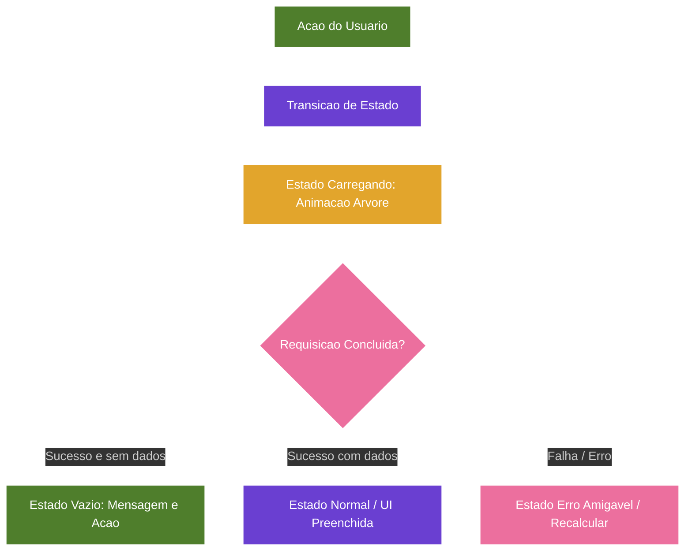

# Projeto Nós - Estados Vazios, Erros e Carregamento (Versão 2.6)

## Categoria
**2.x - Interface e Implementação**

## Documentos Relacionados

### Versões 1.x (Visão e Regras de Negócio)
- [v1.2 - Sistema de Aprovação e Construção de Acordos](Projeto_Nos_v1.2_Sistema_de_Aprovacao_e_Construcao_de_Acordos.md)
- [v1.3 - Evolução para Núcleos](Projeto_Nos_v1.3_Evolucao_Para_Nucleos.md)
- [v1.4 - Sistema de Impacto](Projeto_Nos_v1.4_Sistema_de_Impacto.md)
- [v1.5 - Sistema de Reconhecimento e Gratidão](Projeto_Nos_v1.5_Sistema_de_Reconhecimento_e_Gratidao.md)
- [v1.6 - Sistema de Marcos de Evolução e Celebrações Saudáveis](Projeto_Nos_v1.6_Sistema_de_Marcos_de_Evolucao_e_Celebracoes_Saudaveis.md)
- [v1.7 - Sistema de Linguagens de Cuidado e Amor](Projeto_Nos_v1.7_Sistema_de_Linguagens_de_Cuidado_e_Amor.md)
- [v1.8 - Manifesto do Núcleo](Projeto_Nos_v1.8_Manifesto_do_Nucleo.md)
- [v1.9 - Calendário do Núcleo e Sincronização Segura](Projeto_Nos_v1.9_Calendario_do_Nucleo_e_Sincronizacao_Segura.md)
- [v1.10 - Sistema de Conversas Guiadas e Mediação Afetiva](Projeto_Nos_v1.10_Sistema_de_Conversas_Guiadas_e_Mediacao_Afetiva.md)

### Versões 2.x (Interface e Implementação)
- [v2.0 - Alinhamento das Telas com a Documentação](Projeto_Nos_v2.0_Alinhamento_das_Telas_com_a_Documentacao.md)
- [v2.1 - Catálogo Completo das Interfaces](Projeto_Nos_v2.1_Catalogo_Completo_das_Interfaces.md)
- [v2.2 - Fluxos, Navegação e Interações](Projeto_Nos_v2.2_Fluxos_Navegacao_e_Interacoes.md)
- [v2.3 - Design System, Componentes e Tom de Interface](Projeto_Nos_v2.3_Design_System_Componentes_e_Tom_de_Interface.md)
- [v2.4 - Modelo Funcional, Dados, Estados e Regras](Projeto_Nos_v2.4_Modelo_Funcional_Dados_Estados_e_Regras.md)
- [v2.5 - Matriz de Permissões, Privacidade e Visibilidade](Projeto_Nos_v2.5_Matriz_de_Permissoes_Privacidade_Visibilidade.md)
- [v2.6 - Estados Vazios, Erros e Carregamento](Projeto_Nos_v2.6_Estados_Vazios_Erros_e_Carregamento.md)
- [v2.7 - Notificações e Eventos do Sistema](Projeto_Nos_v2.7_Notificacoes_e_Eventos_do_Sistema.md)

---

## Status

Documento de especificação de estados de interface.

## Relação com as versões anteriores

- v2.2 descreve fluxos e estados de erro.
- v2.4 descreve estados globais e estados vazios por entidade.
- v2.6 consolida todos os estados em um catálogo único para implementação.

## Objetivo

Centralizar todos os estados de interface (vazios, carregamento, erro) para garantir consistência, alinhamento com o tom do projeto e facilitar a implementação.

---

# 1. Regra-Mãe dos Estados

Todo estado deve:

1. Ser humano e acolhedor, nunca técnico ou frio.
2. Orientar o usuário para a próxima ação, se possível.
3. Evitar linguagem de culpa ou erro.
4. Preservar o tom de cuidado do Projeto Nós.

---

# 2. Estados de Carregamento

## 2.1 Carregamento Geral

### Quando usar

- Tela inicial após login ou troca de Núcleo.
- Carregamento de listas longas (acordos, memórias).
- Processamento de ações sensíveis (envio de convite, aprovação).

### Mensagens recomendadas

- "Estamos preparando o seu espaço de cuidado..."
- "Carregando memórias e acordos..."
- "Processando sua ação com calma..."

### Elementos visuais

- Ícone da árvore em animação suave (não distraente).
- Texto curto e positivo.

---

## 2.2 Carregamento por Tela/Eixo

| Tela/Eixo | Mensagem de Carregamento                 |
| --------- | ---------------------------------------- |
| Início    | "Carregando o seu Núcleo..."             |
| Acordos   | "Preparando seus acordos..."             |
| Memórias  | "Traçando sua história de cuidado..."    |
| Conexões  | "Conectando seus vínculos..."            |
| Perfil    | "Carregando seu perfil afetivo..."       |
| Manifesto | "Preparando a essência do seu Núcleo..." |

---

# 3. Estados Vazios

## 3.1 Estados Vazios de Contexto Geral

### Sem Núcleo (Autenticado, Sem Núcleo Ativo)

**Quando usar**: Tela inicial após login, quando o usuário não tem nenhum Núcleo ou não selecionou nenhum.
**Mensagem**: "Crie ou entre em um Núcleo para começar a cultivar seus laços."
**Ação recomendada**: Botão "Criar Núcleo" e link "Entrar com convite".

---

## 3.2 Estados Vazios por Tela/Eixo

| Tela/Eixo                      | Estado Vazio                            | Mensagem                                                                                            | Ação Recomendada                      |
| ------------------------------ | --------------------------------------- | --------------------------------------------------------------------------------------------------- | ------------------------------------- |
| Início (sem gratidão)          | Sem gratidão recente                    | "Ainda não há registros de gratidão por aqui. Um pequeno obrigado pode começar essa memória."       | Botão "Agradecer"                     |
| Início (sem próximos momentos) | Sem eventos futuros                     | "Nada marcado por enquanto. Que tal criar um momento simples para vocês?"                           | Botão "Criar evento"                  |
| Acordos                        | Sem acordos                             | "Comece por uma necessidade simples. Um acordo nasce melhor quando nasce de uma conversa."          | Botão "Novo acordo"                   |
| Memórias                       | Sem memórias                            | "Ainda não há memórias por aqui. Quando algo bonito acontecer, vocês podem guardar juntos."         | Botão "Registrar momento"             |
| Gratidões (seção)              | Sem gratidões                           | "Um pequeno obrigado pode ser o primeiro registro positivo deste Núcleo."                           | Botão "Enviar gratidão"               |
| Calendário                     | Sem eventos                             | "Nada marcado por enquanto. Vocês podem criar um momento quando fizer sentido."                     | Botão "Adicionar evento"              |
| Perfil Afetivo (próprio)       | Sem perfil completo                     | "Conte um pouco sobre você para quem te ama cuidar melhor."                                         | Botão "Completar perfil"              |
| Aprovações                     | Sem aprovações pendentes                | "Nada esperando seu sim agora."                                                                     | Nenhuma (ou link para "Criar acordo") |
| Manifesto                      | Manifesto inexistente                   | "Quando seu Núcleo estiver pronto, vocês poderão gerar um Manifesto que represente a sua essência." | Texto informativo, sem ação inicial   |
| Conexões                       | Sem vínculos (apenas usuário no Núcleo) | "Convide quem faz parte dessa história para começar a cultivar vínculos."                           | Botão "Convidar membro"               |

---

# 4. Estados de Erro e Recuperação

## 4.1 Erros de Convite

| Tipo de Erro                   | Mensagem                                                                                            | Ação Recomendada                                        |
| ------------------------------ | --------------------------------------------------------------------------------------------------- | ------------------------------------------------------- |
| Convite expirado               | "Esse convite não está mais disponível. Peça um novo código para quem cuida desse Núcleo com você." | Botão "Voltar"                                          |
| Convite inválido/código errado | "Esse código não corresponde a nenhum convite ativo. Verifique com quem te convidou."               | Campo para re-inserir código + botão "Tentar novamente" |
| Convite já aceito              | "Você já aceitou esse convite! Vamos para o seu Núcleo?"                                            | Botão "Ir para o Núcleo"                                |

---

## 4.2 Erros de Permissão

| Tipo de Erro            | Mensagem                                                       | Ação Recomendada  |
| ----------------------- | -------------------------------------------------------------- | ----------------- |
| Sem permissão de acesso | "Você não tem acesso a esse conteúdo neste Núcleo."            | Botão "Voltar"    |
| Somente leitura         | "Você pode ver esse conteúdo, mas não pode editar ou remover." | Texto informativo |

---

## 4.3 Erros de Rede e Sincronização

| Tipo de Erro              | Mensagem                                                                                  | Ação Recomendada                                                       |
| ------------------------- | ----------------------------------------------------------------------------------------- | ---------------------------------------------------------------------- |
| Offline                   | "Você está sem conexão agora. Vamos guardar suas alterações e sincronizar quando voltar." | Ícone offline + texto informativo                                      |
| Sincronizando             | "Estamos sincronizando suas alterações com calma..."                                      | Animação de sincronização                                              |
| Conflito de sincronização | "Houve uma divergência nas alterações. Vamos revisar juntos?"                             | Opção "Ver alterações" + "Usar minha versão" + "Usar versão do Núcleo" |
| Sessão expirada           | "Sua sessão expirou por segurança. Vamos entrar novamente?"                               | Botão "Entrar novamente"                                               |

---

## 4.4 Erros de Validação e Formulários

| Tipo de Erro            | Mensagem                                                          |
| ----------------------- | ----------------------------------------------------------------- |
| Campo obrigatório vazio | "Esse campo é importante para cuidarmos bem. Preencha com calma." |
| E-mail inválido         | "Esse e-mail não parece válido. Verifique com atenção."           |
| Senha fraca             | "Escolha uma senha que seja segura para você, sem pressa."        |
| Erro ao criar conta     | "Houve um pequeno problema. Vamos tentar novamente?"              |
| Erro ao salvar          | "Não conseguimos salvar essa alteração. Vamos tentar de novo?"    |

---

## 4.5 Erros Específicos de Fluxo

| Tipo de Erro            | Mensagem                                                             | Ação Recomendada            |
| ----------------------- | -------------------------------------------------------------------- | --------------------------- |
| Aprovação expirada      | "Essa proposta ficou antiga. Vocês podem criar uma nova, com calma." | Botão "Criar nova proposta" |
| Evento removido         | "Esse momento foi removido do calendário do Núcleo."                 | Botão "Voltar"              |
| Conteúdo não encontrado | "Esse conteúdo não está mais disponível. Vamos voltar?"              | Botão "Voltar"              |

---

# 5. Estados Globais (herdados da v2.4)

## 5.1 Autenticação

| Estado               | Descrição                                 |
| -------------------- | ----------------------------------------- |
| deslogado            | Usuário não autenticado                   |
| criandoConta         | Processo de criação de conta em andamento |
| autenticadoSemNucleo | Autenticado, mas sem Núcleo selecionado   |
| autenticadoComNucleo | Autenticado e com Núcleo ativo            |
| sessaoExpirada       | Sessão expirou, precisa reautenticar      |

---

## 5.2 Núcleo Ativo

| Estado          | Descrição                   |
| --------------- | --------------------------- |
| carregando      | Carregando dados do Núcleo  |
| selecionado     | Núcleo ativo selecionado    |
| semNucleo       | Nenhum Núcleo selecionado   |
| convitePendente | Convite de entrada pendente |
| erroAcesso      | Erro ao acessar o Núcleo    |

---

## 5.3 Sincronização

| Estado        | Descrição                       |
| ------------- | ------------------------------- |
| online        | Conectado e sincronizado        |
| offline       | Sem conexão de rede             |
| sincronizando | Sincronização em andamento      |
| conflito      | Conflito de dados detectado     |
| sincronizado  | Dados sincronizados com sucesso |

---

## 5.4 Permissão

| Estado           | Descrição               |
| ---------------- | ----------------------- |
| permitido        | Acesso permitido        |
| somenteLeitura   | Acesso somente leitura  |
| aguardandoAceite | Aguardando aprovação    |
| semPermissao     | Sem permissão de acesso |

---

# 6. Princípios para Implementação

1. **Consistência**: Usar sempre o mesmo estado para a mesma situação em todas as telas.
2. **Tom Acolhedor**: Evitar palavras como "erro", "falha", "problema" — preferir frases como "houve um pequeno problema".
3. **Ação Claro**: Sempre que possível, oferecer uma ação para recuperar ou continuar.
4. **Visual Leve**: Não usar cores vibrantes de alerta excessivamente — preferir tons suaves.
5. **Histórico**: Para erros graves, registrar log para debug, mas não exibir detalhes técnicos ao usuário.

---

# Diagrama de Fluxo da Versao

## Estados da confirmação pós-teste — decisão de 2026-10-03

**Versão de implementação vigente: 0.11.0; confirmação implementada e validada.**

Cobrir: legado sem datas; período aguardando aceites; teste em curso com término real; prazo concluído sem votos suficientes; confirmação própria registrada; limiar atingido e acordo ativo; revisão pendente; participante indisponível; período recusado; ciclo substituído; encerrado; carregamento; erro de consulta e erro de escrita. Falha de consulta não deve ser apresentada como histórico vazio. Desabilitar novas submissões enquanto pendentes; fornecer feedback acessível. Aguardar prazo não ativa automaticamente. Não simular dias concluídos ou votos.

Regra canônica: [v1.2 — confirmação pós-teste](Projeto_Nos_v1.2_Sistema_de_Aprovacao_e_Construcao_de_Acordos.md#regra-de-confirmação-do-hábito--decisão-de-2026-10-03).

## Ajuste aprovado de navegação e sessão — 2026-10-07

O fluxo vigente implementado na v0.13.0 é Conta → Seus Núcleos (/nucleos) → Início do Núcleo escolhido. Sem associações, a lista oferece criação ou convite; retorno específico permitido tem prioridade após autenticar. Todo /comecar e /nucleos exige sessão validada antes da renderização, inclusive rascunho e prévia de convite. Esta decisão substitui a abertura de rascunho antes do login e a listagem multínucleo apenas planejada.

Token expirado com renovação válida mantém a sessão. Sessão ausente, inválida ou não renovável pede login; falha operacional bloqueia sem afirmar logout. Ações/consultas continuam verificando identidade e autorização, com RLS por associação. Listagem não usa chave administrativa e não aceita convite automaticamente. [Contrato e validação](./_andamento/funcionalidades/navegacao-sessao.md).
