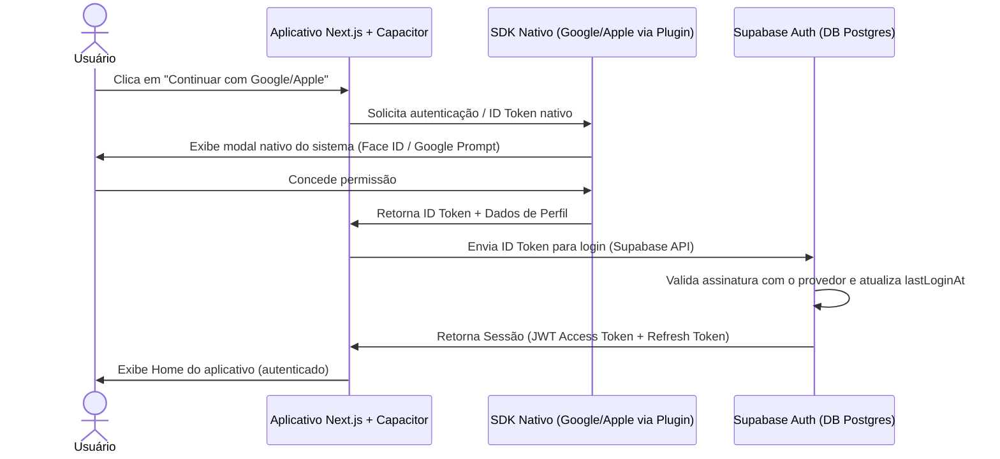
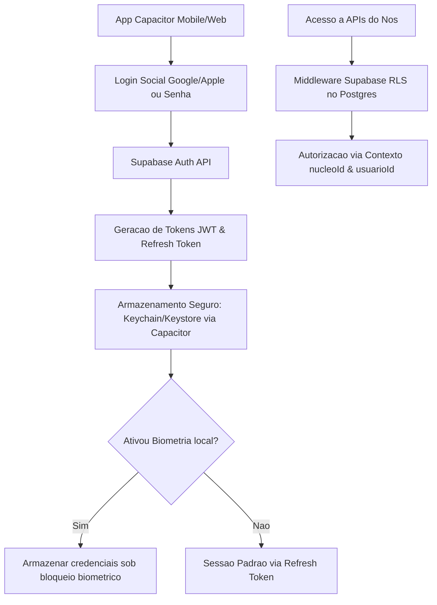

# Projeto Nós - Autenticação e Segurança (Versão 2.8)

## Categoria
**2.x - Interface e Implementação**

## Documentos Relacionados

### Versões 1.x (Visão e Regras de Negócio)
- [v1.1 - Visão e Regras de Negócio](Projeto_Nos_v1.1_Visao_e_Regras_de_Negocio.md)
- [v1.2 - Sistema de Aprovação e Construção de Acordos](Projeto_Nos_v1.2_Sistema_de_Aprovacao_e_Construcao_de_Acordos.md)
- [v1.3 - Evolução para Núcleos](Projeto_Nos_v1.3_Evolucao_Para_Nucleos.md)
- [v1.4 - Sistema de Impacto](Projeto_Nos_v1.4_Sistema_de_Impacto.md)
- [v1.5 - Sistema de Reconhecimento e Gratidão](Projeto_Nos_v1.5_Sistema_de_Reconhecimento_e_Gratidao.md)
- [v1.6 - Sistema de Marcos de Evolução e Celebrações Saudáveis](Projeto_Nos_v1.6_Sistema_de_Marcos_de_Evolucao_e_Celebracoes_Saudaveis.md)
- [v1.7 - Sistema de Linguagens de Cuidado e Amor](Projeto_Nos_v1.7_Sistema_de_Linguagens_de_Cuidado_e_Amor.md)
- [v1.8 - Manifesto do Núcleo](Projeto_Nos_v1.8_Manifesto_do_Nucleo.md)
- [v1.9 - Calendário do Núcleo e Sincronização Segura](Projeto_Nos_v1.9_Calendario_do_Nucleo_e_Sincronizacao_Segura.md)
- [v1.10 - Sistema de Conversas Guiadas e Mediação Afetiva](Projeto_Nos_v1.10_Sistema_de_Conversas_Guiadas_e_Mediacao_Afetiva.md)

### Versões 2.x (Interface e Implementação)
- [v2.0 - Alinhamento das Telas com a Documentação](Projeto_Nos_v2.0_Alinhamento_das_Telas_com_a_Documentacao.md)
- [v2.1 - Catálogo Completo das Interfaces](Projeto_Nos_v2.1_Catalogo_Completo_das_Interfaces.md)
- [v2.2 - Fluxos, Navegação e Interações](Projeto_Nos_v2.2_Fluxos_Navegacao_e_Interacoes.md)
- [v2.3 - Design System, Componentes e Tom de Interface](Projeto_Nos_v2.3_Design_System_Componentes_e_Tom_de_Interface.md)
- [v2.4 - Modelo Funcional, Dados, Estados e Regras](Projeto_Nos_v2.4_Modelo_Funcional_Dados_Estados_e_Regras.md)
- [v2.5 - Matriz de Permissões, Privacidade e Visibilidade](Projeto_Nos_v2.5_Matriz_de_Permissoes_Privacidade_Visibilidade.md)
- [v2.6 - Estados Vazios, Erros e Carregamento](Projeto_Nos_v2.6_Estados_Vazios_Erros_e_Carregamento.md)
- [v2.7 - Notificações e Eventos do Sistema](Projeto_Nos_v2.7_Notificacoes_e_Eventos_do_Sistema.md)
- [v2.8 - Autenticação e Segurança](Projeto_Nos_v2.8_Autenticacao_e_Seguranca.md)

---

## Status

Documento de especificação completa de autenticação, segurança de dados e gerenciamento de sessões, alinhado com a stack tecnológica definida para o projeto.

## Relação com as versões anteriores

- **v1.9**: Consolida a regra de que o login social (Google/Apple) não se confunde e nem concede permissão automática para sincronização de calendário externo.
- **v2.0**: Detalha a Fase 1 da implementação da arquitetura base (Autenticação).
- **v2.1 e v2.2**: Padroniza os botões e os fluxos da interface de Splash e Onboarding de Login.
- **v2.4**: Mapeia os estados de UI relacionados à sessão e o campo `lastLoginAt` na entidade Usuário.
- **v2.5**: Define o contexto de privacidade (`usuarioId` e `nucleoId`) que o sistema de autorização deve validar em cada requisição.
- **v2.6**: Detalha os estados de erro de autenticação e a transição para `sessaoExpirada`.

## Objetivo

Especificar a arquitetura de autenticação, integração e segurança de dados do Projeto Nós baseada na stack de desenvolvimento unificada (Web-first com Next.js, Supabase e Capacitor), garantindo a proteção da privacidade afetiva e dos fluxos do aplicativo.

---

# 1. Princípios da Autenticação Afetiva

A autenticação no Projeto Nós deve ser segura sem se tornar fria ou puramente burocrática. Os princípios abaixo norteiam a implementação:

1. **Facilidade e Redução de Atrito**: O uso de logins sociais e biometria reduz barreiras de entrada para manter o usuário conectado com seus entes queridos.
2. **Consentimento Explícito e Modular**: O usuário deve saber exatamente o que está compartilhando. Autorizar o login não autoriza o acesso ao calendário pessoal (Google Calendar ou Apple Calendar).
3. **Privacidade Proativa**: Informações afetivas e notificações confidenciais nunca devem ser exibidas em telas bloqueadas ou sem a devida identificação do usuário.
4. **Desconexão Saudável**: O fluxo de logout ou expiração de sessão deve ser claro, preservando os dados locais do dispositivo sem corromper o histórico do Núcleo.

---

# 2. Definição da Stack Tecnológica (Web-first)

O Projeto Nós adota uma abordagem de desenvolvimento **Web-first**, em que o aplicativo responsivo construído para a web moderna é empacotado para distribuição nativa nos dispositivos móveis (Android e iOS) através de uma runtime que preserva a experiência visual única e dá acesso direto a APIs nativas do hardware quando necessário.

### 2.1 Frontend Web
- **React + Next.js + TypeScript**: Base estrutural do aplicativo para uma navegação ágil, otimização de renderização e forte tipagem estática de dados afetivos.
- **Tailwind CSS**: Utilitários para criação de interfaces flexíveis, responsivas e alinhadas com o tom de cuidado visual.
- **shadcn/ui / Componentes Próprios**: Componentes acessíveis e polidos com base no catálogo visual e no tom de interface descritos na **v2.3**.

### 2.2 Backend e Dados
- **Supabase Cloud**: Backend-as-a-Service (BaaS) principal, provendo:
  - **Postgres**: Banco de dados relacional que gerencia as entidades do sistema.
  - **Supabase Auth**: Sistema de autenticação integrado (com suporte a login social, e-mail/senha e tokens JWT/Refresh).
  - **Row Level Security (RLS)**: Regras de banco de dados que validam se o usuário conectado pertence ao `nucleoId` da linha requisitada, impedindo acessos não autorizados.
  - **Supabase Storage**: Armazenamento seguro de imagens do Núcleo (fotos de perfil, memórias registradas).
  - **Realtime**: Sincronização em tempo real para notificações e atualizações de estados de conversas guiadas ou novos marcos.
- **Node.js/Next.js API Routes**: Usadas para orquestração de fluxos complexos, integração segura com o envio de convites e funções administrativas sensíveis que exigem isolamento do lado do cliente.

### 2.3 Mobile Wrap
- **Capacitor**: Runtime que envolve a aplicação Next.js compilada em aplicativos nativos (inicialmente direcionado para **Android** e, em segunda fase, para **iOS**).
  - Permite o uso de plugins nativos da comunidade para acesso a hardware de biometria, armazenamento persistente seguro (*secure storage*), notificações push e deep linking.

### 2.4 Infraestrutura e Deploy
- **Vercel**: Deploy automatizado e hospedagem da aplicação Next.js para acesso web.
- **Supabase Cloud**: Gerenciamento de nuvem do Postgres, Auth, RLS e Storage.
- **Google Play Console**: Distribuição do aplicativo nativo compilado via Capacitor para dispositivos Android.
- **Apple Developer (TestFlight & App Store Connect)**: Homologação e distribuição para dispositivos iOS.

---

# 3. Provedores de Identidade Social (Google & Apple)

O login social é realizado integrando os SDKs nativos obtidos pelo Capacitor e enviando o token de identificação resultante para validação final na API do Supabase Auth.



## 3.1 Login com Google (Sign in with Google)
- **Implementação**: Uso do plugin do Capacitor (ex: `@codetrix-studio/capacitor-google-auth`) para acionar o fluxo nativo no Android/iOS, obtendo o `idToken` que é repassado ao método `signInWithIdToken` do cliente do Supabase. No web-only, o fluxo é feito via SDK oficial do Supabase OAuth.
- **Regra de Escopo**: Solicitar apenas e-mail e dados de perfil básico. A integração com o Google Calendar descrita na **v1.9** deve exigir um consentimento modular separado dentro das configurações do aplicativo, sem qualquer dependência direta do login básico.

## 3.2 Login com Apple (Sign in with Apple)
- **Implementação**: Integração usando o plugin do Capacitor (ex: `capacitor-signin-with-apple`). No iOS, o plugin aciona o fluxo nativo seguro do sistema; na Web, ele abre um redirecionamento seguro da Apple.
- **Captura de Dados no Primeiro Login**: O nome completo do usuário é retornado pela Apple apenas na **primeira autenticação**. O aplicativo Next.js deve capturar esse nome imediatamente e persistir no banco de dados Supabase antes de concluir a interface de onboarding.
- **E-mails Privados**: O sistema aceita o cadastro de e-mails mascarados criados pela funcionalidade *"Ocultar Meu E-mail"* da Apple.

---

# 4. Autenticação Biométrica

No contexto de aplicativos móveis compilados com o Capacitor, a biometria nativa é utilizada como mecanismo de acesso rápido e seguro, impedindo que o dispositivo precise recarregar senhas ou login social a cada abertura.

## 4.1 Armazenamento Seguro e Ativação
1. **Ativação Opcional**: O usuário opta pela biometria no menu de configurações do aplicativo.
2. **Uso de Plugin do Capacitor**: Integração de plugins de biometria nativa (ex: `@capacitor-community/native-biometric`).
3. **Criptografia local**:
   - Ao ativar, as credenciais de sessão segura (Refresh Token do Supabase) são salvas em chaves protegidas no hardware (*Keychain* do iOS ou *Keystore* do Android).
   - O aplicativo configura as chaves para que a leitura exija autenticação biométrica com sucesso.
4. **Desbloqueio de Sessão**:
   - Se o aplicativo for reaberto após um período de inatividade superior a **10 minutos**, um modal biométrico nativo é exibido.
   - O sucesso na leitura biométrica libera o Refresh Token armazenado, enviando-o à API do Supabase para obter um novo JWT e restabelecer a interface sem atrito.

## 4.2 Fallback de Segurança
- Caso o usuário mude as biometrias cadastradas no sistema ou o hardware falhe, o aplicativo solicita a reautenticação pelo provedor Supabase (E-mail/Senha ou Login Social).

---

# 5. Recuperação de Senha

Para as contas tradicionais baseadas em e-mail e senha, o Supabase Auth fornece a infraestrutura de envio de e-mails de redefinição de forma automática.

## 5.1 Regras de Fluxo Seguro
1. **Prevenção de Enumeração de Usuários**: A resposta da rota de solicitação de recuperação de senha no Next.js deve ocultar se o e-mail inserido existe no banco de dados, mostrando sempre uma mensagem genérica de sucesso.
2. **Magic Links e Tokens de Uso Único**: O Supabase envia um e-mail contendo um link temporário (validade de **1 hora**) que realiza o login automático do usuário na interface e o redireciona diretamente para a tela de redefinição de senha (`/reset-password`).
3. **Complexidade da Senha**: O frontend Next.js e o backend validam a força da nova senha para garantir que tenha ao menos 8 caracteres contendo caracteres alfanuméricos e especiais.

---

# 6. Gerenciamento de Sessões e Expiração

## 6.1 Tokens de Sessão (Supabase JWT)
- **Access Token (JWT)**: Vida útil padrão de **1 hora**. É armazenado na memória da aplicação (estado) ou em cookies seguros para requisições web. É passado no header `Authorization: Bearer <token>` em todas as chamadas de API.
- **Refresh Token**: Deve ficar gravado de forma persistente e protegida. A duração real depende da configuração do Supabase e precisa ser verificada no projeto; 30 dias é uma meta de produto, não um prazo implementado. Na Web, usar cookie `HttpOnly` e `Secure` em produção. O fluxo web inicial usa `SameSite=Lax` para permitir o retorno de links externos de confirmação de e-mail; avaliar `Strict` somente se o fluxo completo continuar funcionando. No app mobile (Capacitor), usar armazenamento seguro nativo do dispositivo.

## 6.2 Inatividade e Redirecionamento
- **Timeout Web**: Caso a aplicação web Next.js não registre interação por **15 minutos**, o token expira localmente e transiciona para o estado `sessaoExpirada`.
- **Interrupção de Acesso (Mobile)**: Ao reabrir o aplicativo após o tempo limite de inatividade (10 minutos), o aplicativo solicita biometria nativa antes de renderizar os dados afetivos salvos localmente.
- **Tratamento do Estado `sessaoExpirada`**: Caso a validação do Refresh Token falhe no backend do Supabase, o fluxo de UI do Next.js deve limpar os dados afetivos cacheados e redirecionar o usuário à tela de Splash com a mensagem:
  > *"Sua sessão expirou por segurança. Vamos entrar novamente?"*

---

# 7. Autorização e Controle de Acesso

O controle de acesso no Projeto Nós é garantido através do modelo de **Row Level Security (RLS)** do PostgreSQL do Supabase, em conjunto com validações no Next.js.

## 7.1 Row Level Security (RLS) no Supabase
Cada tabela de conteúdo afetivo (Acordos, Memórias, Gratidões, Eventos) possui políticas de RLS ativas para garantir que nenhum dado saia do contexto correto:

```sql
-- Exemplo de política de RLS para leitura de acordos
CREATE POLICY "Membros do Núcleo podem ler acordos" ON acordos
  FOR SELECT
  USING (
    auth.uid() IN (
      SELECT usuario_id FROM membros_nucleo WHERE nucleo_id = acordos.nucleo_id
    )
  );
```

As políticas de RLS realizam as seguintes checagens automáticas:
1. **Identidade**: O ID do usuário na sessão ativa (`auth.uid()`) é validado.
2. **Contexto de Pertença (`nucleoId`)**: O banco verifica se o usuário conectado é um membro ativo associado ao `nucleoId` da tabela consultada.
3. **Papel**: O banco valida o papel (Criador, Administrador ou Membro regular) no relacionamento do Núcleo para permitir ações de escrita ou exclusão, seguindo a matriz da **v2.5**.

---

# 8. Segurança e Conformidade (LGPD/GDPR)

## 8.1 Criptografia
- **Dados em Trânsito**: Todas as conexões entre o frontend Next.js/Capacitor e o Supabase/API Routes ocorrem estritamente sob protocolo HTTPS com TLS 1.3.
- **Dados em Repouso**: Banco de dados relacional e arquivos de mídia do Storage são criptografados em repouso no Supabase (AES-256).

## 8.2 Direitos dos Titulares de Dados (LGPD/GDPR)
1. **Consentimento Explícito**: Os fluxos de onboarding do Next.js devem obter consentimento claro de privacidade e termos.
2. **Direito de Portabilidade**: Disponibilização de rota em `/api/user/export` no Next.js que gera um dump formatado dos dados do usuário (JSON) a partir do banco Postgres, disponibilizando-o para download.
3. **Direito ao Esquecimento e Anonimização**:
   - Ao excluir a conta, os dados pessoais identificáveis (e-mail, biometria local, chaves de autenticação no Supabase) são permanentemente apagados.
   - **Anonimização de Histórico**: Para evitar a remoção abrupta de memórias ou gratidões que afetam outros membros ativos do Núcleo, os registros textuais são mantidos, mas a associação do autor é convertida para um usuário anônimo genérico (*"Ex-membro"*), apagando-se permanentemente o vínculo com o usuário original.


---

# Diagrama de Fluxo da Versao




## Segurança das decisões de teste do Hábito — decisão de 2026-10-03

**Versão de implementação vigente: 0.11.0; confirmação implementada e validada.**

A contagem do navegador não autoriza ativação. O banco verifica sessão, integrante, participante do ciclo, prazo e revisão pendente; calcula o limiar sobre a fotografia persistida e serializa decisões bloqueando primeiro o Hábito. Proibir escrita direta e execução pública dos helpers; usar SECURITY DEFINER com search_path vazio e nomes qualificados. Respostas simultâneas não podem ativar antes do limiar, reutilizar votos de ciclo anterior nem competir com revisão. A leitura de votos de terceiros permanece restrita, inclusive após ativação.

Regra canônica: [v1.2 — confirmação pós-teste](Projeto_Nos_v1.2_Sistema_de_Aprovacao_e_Construcao_de_Acordos.md#regra-de-confirmação-do-hábito--decisão-de-2026-10-03).
