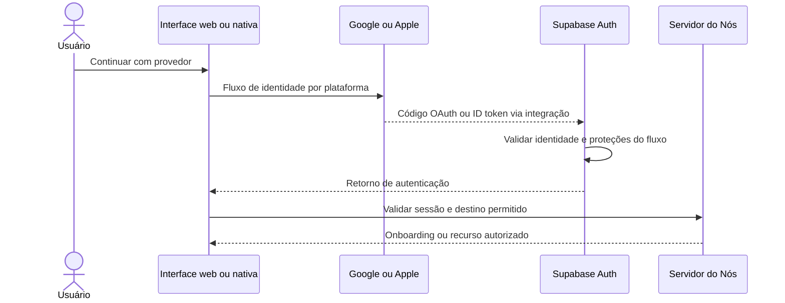
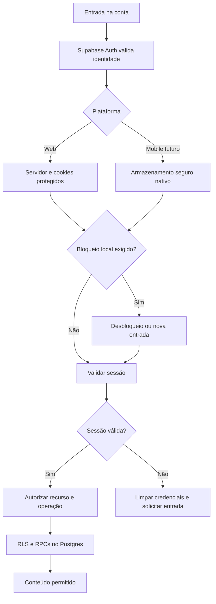

# Projeto Nós - Autenticação e Segurança (Versão 2.8)

## Categoria
**2.x - Interface e Implementação**

## Documentos Relacionados

### Versões 1.x (Visão e Regras de Negócio)
- [v1.1 - Visão e Regras de Negócio](Projeto_Nos_v1.1_Visao_e_Regras_de_Negocio.md)
- [v1.2 - Sistema de Aprovação e Construção de Acordos](Projeto_Nos_v1.2_Sistema_de_Aprovacao_e_Construcao_de_Acordos.md)
- [v1.3 - Evolução para Núcleos](Projeto_Nos_v1.3_Evolucao_Para_Nucleos.md)
- [v1.4 - Sistema de Impacto](Projeto_Nos_v1.4_Sistema_de_Impacto.md)
- [v1.5 - Sistema de Reconhecimento e Gratidão](Projeto_Nos_v1.5_Sistema_de_Reconhecimento_e_Gratidao.md)
- [v1.6 - Sistema de Marcos de Evolução e Celebrações Saudáveis](Projeto_Nos_v1.6_Sistema_de_Marcos_de_Evolucao_e_Celebracoes_Saudaveis.md)
- [v1.7 - Sistema de Linguagens de Cuidado e Amor](Projeto_Nos_v1.7_Sistema_de_Linguagens_de_Cuidado_e_Amor.md)
- [v1.8 - Manifesto do Núcleo](Projeto_Nos_v1.8_Manifesto_do_Nucleo.md)
- [v1.9 - Calendário do Núcleo e Sincronização Segura](Projeto_Nos_v1.9_Calendario_do_Nucleo_e_Sincronizacao_Segura.md)
- [v1.10 - Sistema de Conversas Guiadas e Mediação Afetiva](Projeto_Nos_v1.10_Sistema_de_Conversas_Guiadas_e_Mediacao_Afetiva.md)

### Versões 2.x (Interface e Implementação)
- [v2.0 - Alinhamento das Telas com a Documentação](Projeto_Nos_v2.0_Alinhamento_das_Telas_com_a_Documentacao.md)
- [v2.1 - Catálogo Completo das Interfaces](Projeto_Nos_v2.1_Catalogo_Completo_das_Interfaces.md)
- [v2.2 - Fluxos, Navegação e Interações](Projeto_Nos_v2.2_Fluxos_Navegacao_e_Interacoes.md)
- [v2.3 - Design System, Componentes e Tom de Interface](Projeto_Nos_v2.3_Design_System_Componentes_e_Tom_de_Interface.md)
- [v2.4 - Modelo Funcional, Dados, Estados e Regras](Projeto_Nos_v2.4_Modelo_Funcional_Dados_Estados_e_Regras.md)
- [v2.5 - Matriz de Permissões, Privacidade e Visibilidade](Projeto_Nos_v2.5_Matriz_de_Permissoes_Privacidade_Visibilidade.md)
- [v2.6 - Estados Vazios, Erros e Carregamento](Projeto_Nos_v2.6_Estados_Vazios_Erros_e_Carregamento.md)
- [v2.7 - Notificações e Eventos do Sistema](Projeto_Nos_v2.7_Notificacoes_e_Eventos_do_Sistema.md)
- [v2.8 - Autenticação e Segurança](Projeto_Nos_v2.8_Autenticacao_e_Seguranca.md)

---

## Status

Especificação de autenticação, autorização, sessões e proteção de dados, com requisitos e pendências explícitos. A presença de um requisito neste documento não comprova implementação, configuração no serviço nem conformidade jurídica.

**Revisão documental:** 2026-10-06. **Versão do aplicativo consultada:** 0.11.0. A edição documental permanece v2.8.

### Situação dos requisitos originais

| Requisito | Situação em 2026-10-06 | Condição para concluir |
|---|---|---|
| Login com Google | Especificado; implementação pendente | Fluxo por plataforma, callback seguro e validação com conta de teste |
| Login com Apple | Especificado; implementação pendente | Nome ausente, e-mail privado, configuração e credenciais operacionais validados |
| Touch ID, Face ID e impressão digital | Planejados para mobile | Plugin e armazenamento seguro comprovados em dispositivo real |
| Recuperação de senha | Implementada na v0.12.0; operação de lançamento pendente | Jornada local com e-mail/PKCE, senha nova e revogação validadas; SMTP remoto de lançamento a conferir |
| Sessões e expiração | Sessão web e renovação pelo servidor existentes; limites propostos | Configurações efetivas, bloqueio, escopo de logout e revogação verificados |
| Criptografia e LGPD/GDPR | Requisitos documentados; auditoria e fluxos de direitos pendentes | Evidências de infraestrutura, bases legais e política de retenção registradas |
| Autorização e tokens | RLS/RPCs existentes nos recortes entregues | Cobertura por recurso/operação, incluindo módulos futuros |
| Recomendações de stack | Supabase escolhido; comparação na seção 2.5 | Reavaliar somente diante de necessidade concreta |

Evidências do estado atual: [frontend e limites de segurança](_andamento/tecnologias/frontend.md), [estado do projeto](_andamento/estado.md), `src/features/auth/actions.ts`, `src/lib/supabase/server.ts`, `src/lib/supabase/cookie-options.ts`, `src/proxy.ts` e migrações em `supabase/migrations`. O cadastro, a confirmação por e-mail, a entrada e a saída já existem; isso não conclui os demais fluxos deste documento.

## Relação com as versões anteriores

- **v1.9**: Login social não concede acesso automático ao calendário externo.
- **v2.0**: Detalha os requisitos da arquitetura base de autenticação.
- **v2.1 e v2.2**: Orienta entrada, retorno de autenticação e recuperação; alterações visuais futuras devem consultar o Atlas vivo e atualizar a ficha correspondente.
- **v2.4**: Distingue estados de UI, sessão e campos de auditoria, como `lastLoginAt`.
- **v2.5**: É a referência de papéis, visibilidade e permissões por operação.
- **v2.6**: Orienta mensagens e distingue expiração, bloqueio local e indisponibilidade do serviço.
- **v2.7**: Orienta notificações sem exposição de conteúdo íntimo.

## Objetivo

Definir os contratos de autenticação e proteção da privacidade afetiva na stack web-first (Next.js e Supabase), com evolução mobile via Capacitor. Separar decisões vigentes, propostas e validações necessárias antes da publicação.

---

# 1. Princípios da Autenticação Afetiva

1. **Facilidade com proteção**: Login social e desbloqueio biométrico devem reduzir atrito sem remover validações de identidade e autorização.
2. **Consentimento modular**: Entrada na conta, calendário externo e outras integrações são finalidades distintas.
3. **Privacidade por padrão**: Dados íntimos não aparecem antes da validação de acesso; notificações em tela bloqueada não revelam conteúdo afetivo por padrão.
4. **Desconexão segura**: Logout limpa credenciais e caches pessoais do dispositivo sem apagar o histórico persistido do Núcleo. Retenção de rascunhos após logout exige contrato próprio; atualmente os rascunhos são mantidos apenas em memória.
5. **Autorização no servidor e banco**: Ocultar controles na interface não concede nem revoga permissões.
6. **Estado honesto**: Falha de rede ou indisponibilidade do Auth não deve ser apresentada como credencial inválida ou conta inexistente.

---

# 2. Stack Tecnológica e Fronteiras de Execução

## 2.1 Frontend Web

- **React + Next.js + TypeScript**: App Router e componentes de servidor, com interações no cliente quando necessárias.
- **Tailwind CSS e componentes próprios**: Seguem v2.3 e a prioridade visual do Atlas vivo. shadcn/ui é opção de composição, sem adoção presumida de dependências.
- **Modelo atual de autenticação**: Operações no servidor; cookies `HttpOnly`, `Secure` em produção e `SameSite=Lax`. O navegador não recebe os tokens para uso por um cliente Supabase de autenticação.

## 2.2 Backend e Dados

- **Supabase Auth**: Identidade, confirmação e emissão/renovação de tokens.
- **Postgres + RLS + RPCs**: Autorização por recurso e regras transacionais dos Núcleos.
- **Supabase Storage e Realtime**: Uso condicionado a contratos e políticas próprios; sua presença na stack não comprova que todos os módulos os utilizem.
- **Servidor Next.js**: Server Actions e Route Handlers para operações protegidas e integrações. A sessão do usuário deve acompanhar operações sujeitas a RLS.
- **Segredos administrativos**: `service_role`, chaves secretas e credenciais dos provedores ficam exclusivamente em ambiente de servidor. Operações privilegiadas precisam validar ator, finalidade e recurso, pois podem contornar RLS.

## 2.3 Mobile com Capacitor — fronteira pendente

A ordem vigente é web, Android e depois iOS. Capacitor fornece a ponte para APIs nativas; não executa o servidor Next.js dentro do pacote do aplicativo.

O projeto utiliza cookies, Server Actions e renderização dinâmica. Portanto, não assumir que sua compilação atual pode ser exportada diretamente para um pacote estático. A [documentação do Next.js sobre exportação estática](https://nextjs.org/docs/app/guides/static-exports) descreve restrições para recursos dependentes de servidor.

Antes de empacotar Android, registrar uma decisão de arquitetura que escolha e valide:

| Alternativa | Consequência a avaliar |
|---|---|
| Interface web hospedada carregada pelo shell | Dependência de rede, cookies na WebView, políticas de distribuição e integração com plugins |
| Interface estática local com API remota | Adaptação dos recursos de servidor, autenticação por tokens e política de origens/CORS |

O contrato deverá identificar hospedagem do servidor, origem web/nativa, endpoints, armazenamento, atualização do aplicativo e retorno de login/recuperação por deep link. Reutilizar componentes não significa reutilizar automaticamente o transporte de sessão.

Plugins nativos são **candidatos**, não dependências aprovadas: verificar manutenção, licença, compatibilidade com a versão de Capacitor, Android/iOS suportados e acesso ao segredo condicionado à autenticação do sistema. A escolha exige prova em dispositivo real.

## 2.4 Infraestrutura

Vercel hospeda o Next.js; Supabase Cloud fornece Auth e dados. Google Play Console e Apple Developer/TestFlight/App Store Connect pertencem às etapas mobile. Registrar configurações efetivas por ambiente sem incluir credenciais.

## 2.5 Justificativa e alternativas de autenticação

| Opção | Adequação ao Projeto Nós | Custo de adoção a avaliar |
|---|---|---|
| **Supabase Auth — escolha vigente** | Integração já existente com Postgres, `auth.uid()`, RLS e RPCs | Limites do plano, SMTP, controles de sessão e operação |
| **Firebase Authentication** | Alternativa com SDKs e provedores de identidade | Integração com autorização do Postgres e migração de identidades/sessões |
| **Auth0** | Alternativa a considerar se surgirem requisitos específicos de identidade/federação | Integração de tokens, configuração, custos e migração |

Não há necessidade demonstrada de migração. Comparação funcional baseada na [documentação do Firebase Authentication](https://firebase.google.com/docs/auth) e nos [fluxos de autenticação do Auth0](https://auth0.com/docs/get-started/authentication-and-authorization-flow). Preços, limites e disponibilidade de recursos devem ser conferidos quando houver avaliação de contratação.

---

# 3. Login Social com Google e Apple

**Status:** planejado. O Supabase Auth valida a identidade externa e emite a sessão do Nós. Tokens de Google/Apple não substituem tokens da sessão Supabase nem autorizam acesso ao Núcleo.

## 3.1 Contratos por plataforma

| Plataforma | Fluxo previsto | Retorno e armazenamento |
|---|---|---|
| Web | OAuth pelo Supabase com PKCE e callback no servidor | Troca de código no servidor; cookies protegidos |
| Android | SDK nativo compatível ou navegador do sistema, conforme decisão mobile | ID token validado ou código trocado; armazenamento seguro nativo |
| iOS | Google conforme SDK compatível; Apple preferencialmente pelo fluxo nativo | Captura dos dados disponibilizados e sessão protegida |

Callbacks e nomes de rotas futuros devem ser fechados na implementação, sem confundir o callback do Supabase cadastrado no provedor com o retorno final ao aplicativo.



O diagrama resume as alternativas; no fluxo nativo o aplicativo entrega o ID token ao Auth, enquanto na web o servidor conclui a troca do código de sessão retornado.

## 3.2 Google

Solicitar apenas identidade, e-mail e perfil básico. Configurar clientes e origens por plataforma e ambiente. A permissão do Google Calendar é solicitada separadamente, conforme v1.9. Ver [integração Google no Supabase](https://supabase.com/docs/guides/auth/social-login/auth-google).

## 3.3 Apple

Aceitar e-mail privado (*Ocultar Meu E-mail*). O nome pode ser disponibilizado apenas na primeira autorização pelos métodos compatíveis; capturá-lo quando presente. No OAuth, em retornos posteriores ou quando o dado não vier, oferecer preenchimento posterior no onboarding sem bloquear indevidamente a autenticação.

Configurar identificadores web/nativos e callback. Quando o fluxo depender de segredo Apple com validade limitada, registrar responsável, prazo de renovação e verificação operacional. Ver [integração Apple no Supabase](https://supabase.com/docs/guides/auth/social-login/auth-apple).

## 3.4 Proteções e identidades vinculadas

- Usar SDKs oficiais/compatíveis e PKCE no fluxo por código; conferir `state` e `nonce` quando aplicáveis, conforme o contrato do provedor. Não desabilitar verificações para contornar falhas de integração.
- Permitir apenas retornos cadastrados e destinos internos validados; rejeitar redirecionamento aberto e deep link inesperado.
- Cancelamento retorna à entrada sem criar sessão parcial. Callback inválido não revela tokens ou detalhes internos; falha do provedor permite nova tentativa.
- Vincular/desvincular identidade requer sessão validada e reautenticação recente. Não implementar fusão de contas apenas por coincidência de e-mail; usar o mecanismo documentado do Auth e verificar seu comportamento.
- Impedir remoção do último método de entrada sem alternativa comprovada. Conta exclusivamente social recupera acesso pelo provedor; criação de senha exige fluxo autenticado próprio.
- `lastLoginAt` é campo de auditoria, não prova de sessão válida. Mapear o atributo do Auth ou atualização própria; não presumir atualização automática de campo da aplicação.

---

# 4. Biometria e Desbloqueio Local

**Status:** planejado para mobile. Touch ID, Face ID e impressão digital desbloqueiam uma sessão existente; não substituem validação remota nem constituem automaticamente MFA da conta.

## 4.1 Ativação e segredo protegido

1. Ativação opcional em configurações, após sessão validada e verificação de capacidade do dispositivo.
2. O aplicativo recebe somente o resultado da autenticação do sistema; não coleta, transmite ou armazena amostras faciais/digitais.
3. No iOS, usar Keychain com controle de acesso adequado. No Android, proteger o segredo em armazenamento criptografado com chave no Keystore. Não presumir suporte de hardware em todos os aparelhos.
4. Exigir autenticação do sistema para liberar o segredo: mostrar um prompt e depois ler token desprotegido não atende ao requisito. Rotação de tokens e retomada de sessão devem respeitar esse bloqueio.
5. Após desbloquear, renovar/validar a sessão antes de buscar conteúdo. Token inválido exige nova entrada.

## 4.2 Bloqueio e fallback

A proposta existente de bloqueio após **10 minutos** permanece uma meta não implementada. Ao ir para segundo plano, ocultar conteúdo em prévias do sistema; ao retornar, comparar o tempo decorrido antes de renderizar dados íntimos. Não depender apenas de um timer suspenso pelo sistema operacional.

| Situação | Comportamento exigido |
|---|---|
| Cancelamento ou tentativa malsucedida | Manter bloqueado e oferecer nova tentativa/entrada |
| Sem sensor ou sem biometria cadastrada | Oferecer entrada convencional; não anunciar opção indisponível |
| Alteração de biometria ou chave invalidada | Reautenticar e reconfigurar armazenamento quando necessário |
| Bloqueio pelo sistema ou falha do plugin | Usar entrada convencional; não liberar conteúdo automaticamente |
| Biometria desativada | Após o limite local, exigir entrada recente pelo método disponível |
| Sessão revogada | Biometria não restaura autorização; exigir nova entrada |

Não introduzir PIN próprio como fallback sem contrato específico. Na web, biometria não está incluída nesta entrega; eventual uso de passkeys/WebAuthn exige especificação separada.

---

# 5. Recuperação e Política de Senha

**Status em 2026-10-07:** recuperação implementada na v0.12.0 e validada em jornada real local. Configurações de retorno e mínimo de senha do nos-dev aplicadas; SMTP/remetente/domínio de lançamento não certificados. [Contrato executável](_andamento/funcionalidades/conta-entrada.md).

## 5.1 Fluxo de recuperação

1. Solicitar e-mail e responder genericamente: “Se houver uma conta com esse e-mail, enviaremos as orientações.” Aplicar limites por origem e destino sem expor existência da conta.
2. Enviar link de **recuperação**, distinto de login por magic link. A meta inicial é validade de uma hora, a configurar e verificar no ambiente; tratar uso único, expiração e rejeição.
3. Validar o retorno e a evidência de recuperação no servidor antes de permitir alteração. Rotas implementadas: `/conta/recuperar`, `/auth/recovery` e `/conta/nova-senha`; prova assinada vinculada à sessão por 15 minutos após validar o link.
4. Ao abrir em outro navegador/dispositivo, considerar a dependência do verificador PKCE; se a prova estiver ausente, orientar reinício seguro da recuperação.
5. Na tela de recuperação, não redirecionar automaticamente à Home apenas porque o Auth criou uma sessão. Concluir a senha, aplicar a política de sessões e então orientar nova entrada.
6. Após sucesso, a política implementada é revogar globalmente a renovação das sessões anteriores e exigir nova autenticação. Validar o comportamento real do Auth e a janela residual dos JWTs, conforme seção 6.3.

Configurar SMTP próprio, remetente e domínio, entrega e limites antes da publicação. Falha de envio pode depender da existência da conta: manter resposta pública neutra inclusive nesse caso e diagnóstico operacional sem dados pessoais. Link inválido/reutilizado e falha ao salvar têm estados próprios. Ver [autenticação por senha no Supabase](https://supabase.com/docs/guides/auth/passwords).

## 5.2 Política de senha — proposta de evolução

**Implementação atual v0.12.0:** cadastro e redefinição compartilham mínimo oito/máximo 128 caracteres, letra, número e símbolo em `src/features/auth/input.ts`; Auth local e nos-dev exigem mínimo oito. A recomendação abaixo é proposta documental; o código e a configuração do Auth ainda não foram alterados.

Adotar mínimo de **15 caracteres** quando a senha for fator único, permitir ao menos 64 caracteres e frases com espaços, sem exigir mistura de classes. Bloquear senhas comuns/comprometidas, permitir colar e usar gerenciadores; não impor troca periódica sem motivo de segurança. Referência: [NIST SP 800-63B-4](https://pages.nist.gov/800-63-4/sp800-63b.html), seção 3.1.1. A recomendação é técnica, não obrigação legal universal.

Na entrega correspondente, sincronizar cadastro, recuperação, mensagens e configuração do backend. Não invalidar contas existentes só pela mudança de política; definir aplicação às próximas definições de senha. Senhas permanecem sob responsabilidade do Auth e nunca entram em tabelas de perfil, logs ou relatórios do Nós.

---

# 6. Sessões, Tokens e Expiração

## 6.1 Transporte e validação

Na web atual, o servidor lê/renova a sessão por `@supabase/ssr`; o navegador envia cookies ao Nós e não manipula refresh tokens. `HttpOnly` depende dessa arquitetura: acesso direto futuro pelo SDK no navegador exigirá reavaliar o contrato. Não expor tokens para habilitar Realtime sem definir autorização e transporte. Ver [guia SSR do Supabase](https://supabase.com/docs/guides/auth/server-side/advanced-guide).

Nas chamadas do servidor ao Supabase, usar a sessão validada. No futuro cliente nativo por tokens, enviar access token no header apropriado sobre HTTPS. Não afirmar que todas as requisições do navegador enviam `Authorization: Bearer`.

Validar identidade no servidor, assinatura/validade dos tokens pelos mecanismos do Auth e autorização por recurso. Cookies presentes ou dados de `getSession()` isolados não bastam para autorizar operação. A implementação atual consulta `getUser()`; uma futura validação apenas criptográfica não comprova ausência de revogação.

## 6.2 Prazos e estados distintos

| Mecanismo | Meta/configuração | Efeito |
|---|---|---|
| Access token | Referência inicial de uma hora; conferir ambiente | Limita validade do JWT |
| Duração máxima da sessão | Meta de produto de 30 dias, pendente | Exige política efetiva no Auth/servidor |
| Bloqueio web | Proposta de 15 minutos sem interação | Oculta conteúdo e exige retomada autenticada |
| Bloqueio mobile | Proposta de 10 minutos | Exige desbloqueio/entrada antes do conteúdo |

**Bloqueio local não expira o JWT no servidor.** A inatividade de interface também não é equivalente à inatividade de renovação medida pelo Auth. Confirmar plano e configuração suportados antes de prometer limites. `sessaoBloqueada` é estado de UI proposto; `sessaoExpirada` representa a impossibilidade confirmada de continuar a sessão. Ver [sessões no Supabase](https://supabase.com/docs/guides/auth/sessions).

Falha transitória de rede deve manter acesso bloqueado e permitir tentativa; limpar a sessão por revogação/expiração comprovada, sem tratar toda falha como logout. A mensagem de expiração é: “Sua sessão expirou por segurança. Vamos entrar novamente?”.

## 6.3 Logout e revogação

| Ação | Política proposta |
|---|---|
| Sair deste dispositivo | Escopo `local`, remoção de credenciais e caches locais |
| Sair de todos os dispositivos | Escopo `global`, reautenticação recente e revogação das sessões |
| Recuperar senha/excluir conta | Revogar sessões afetadas e impedir renovação |

A ação atual chama `signOut()` sem escopo explícito; não presumir saída apenas local. Os controles separados acima ainda serão implementados. Ver [escopos de saída do Supabase](https://supabase.com/docs/guides/auth/signout).

Revogar refresh tokens não invalida instantaneamente todo JWT emitido. Definir uma janela residual aceitável; ações críticas devem consultar a validade da sessão no backend, além de verificar JWT. Se houver acesso direto ao banco, a garantia imediata também precisará existir na fronteira correspondente, não só no Next.js.

Limpar dados pessoais em memória, caches de consultas, armazenamento nativo e inscrições de canais; impedir reaparecimento por voltar no navegador ou trocar de conta. Respostas autenticadas não podem ir para cache compartilhado. A indisponibilidade ao revogar deve ser sinalizada, sem prometer encerramento remoto concluído.

---

# 7. Autorização por Recurso e Operação

RLS, permissões SQL e funções de escrita devem aplicar a matriz v2.5. As tabelas existentes usam nomes como `nucleus_members` e `nucleus_agreements`; nomes conceituais em português não são esquema executável.

## 7.1 Exemplo de leitura existente

Trecho ilustrativo correspondente ao recorte de acordos, não uma migração nova:

```sql
CREATE POLICY "members read nucleus agreements"
ON public.nucleus_agreements
FOR SELECT TO authenticated
USING (
  EXISTS (
    SELECT 1 FROM public.nucleus_members AS m
    WHERE m.nucleus_id = nucleus_agreements.nucleus_id
      AND m.user_id = (SELECT auth.uid())
  )
);
```

Esse trecho verifica pertencimento para leitura do acordo. Não demonstra escrita, papel administrativo, revogação de sessão ou visibilidade individual. No esquema consultado, o vínculo representa pertencimento e os papéis são `creator` e `member`; não há estado `active` de membro nem papel `administrator` implementado. Se houver suspensão/saída lógica ou novos papéis, atualizar esquema e políticas antes de prometer essa proteção.

## 7.2 Contratos obrigatórios

| Operação/recurso | Validação necessária |
|---|---|
| Leitura | Identidade, pertencimento e visibilidade específica do conteúdo |
| Criação | Núcleo autorizado, autoria vinculada à sessão e campos válidos |
| Alteração/exclusão | Recurso real, regra de negócio, autoria/papel quando aplicável |
| Conteúdo privado e votos individuais | Somente autor/participante permitido; administrador não ganha acesso íntimo |
| Escrita direta futura | `USING`/`WITH CHECK` conforme operação, sem permitir troca indevida de Núcleo/autor |
| RPCs | Validar identidade, recurso, participação, prazo e estado na transação |
| Storage | Bucket privado, políticas de objetos e URLs assinadas de curta duração |
| Realtime | Assinatura e payload autorizados; não divulgar votos ou conteúdo íntimo por canal amplo |

A aplicação atual restringe escritas dos recortes sensíveis a RPCs. Usar `SECURITY DEFINER` apenas quando necessário, `search_path` restrito, nomes qualificados e grants mínimos; não deixar helpers executáveis pelo público. Não usar metadados editáveis pelo usuário como autoridade para papéis.

Não confiar em `usuarioId`/`nucleoId` enviados pelo cliente. Após saída/remoção do Núcleo, novos acessos devem ser negados; invalidar caches e canais correspondentes. URLs assinadas já emitidas podem permanecer válidas até expirar, exigindo janela documentada.

---

# 8. Proteção de Dados e LGPD/GDPR

## 8.1 Criptografia e limites da proteção

Exigir HTTPS em produção, TLS moderno compatível com os serviços e sem exceções de validação de certificado. TLS 1.3 é preferência técnica; não afirmar exclusividade sem evidência de todas as conexões.

Registrar garantias do provedor para banco, objetos, backups, região e gestão de chaves. AES-256 só deve ser declarado para componentes cuja documentação/configuração o comprove. Criptografia em repouso protege a infraestrutura e não equivale a criptografia ponta a ponta. Esta última não está definida para o Nós e exigiria contrato de chaves, recuperação e compatibilidade com consultas/funcionalidades.

## 8.2 Finalidades e bases legais

Antes da publicação, inventariar categorias de dados, finalidade, base legal, destinatários, prazo e responsáveis. O produto pode conter dados sensíveis em textos/fotos; não assumir que todo dado afetivo tem a mesma classificação.

Separar aceite de termos, ciência do aviso de privacidade e consentimentos específicos revogáveis. LGPD admite bases legais distintas; a base aplicável e o tratamento de dados sensíveis exigem avaliação própria. Se houver menores, definir regras de idade/responsável antes de liberar o fluxo. Não declarar conformidade apenas por usar Supabase.

Registrar controlador, operadores, canal de atendimento, integrações, região e transferências internacionais. Avaliar o âmbito de aplicação do GDPR conforme público e operação. Referências: [LGPD](https://www.planalto.gov.br/ccivil_03/_ato2015-2018/2018/lei/l13709compilado.htm) e [GDPR](https://eur-lex.europa.eu/eli/reg/2016/679/oj/eng).

## 8.3 Exportação e atendimento de direitos

`/api/user/export` é endpoint proposto. Exigir sessão validada e reautenticação recente; exportar somente dados acessíveis ao titular, sem dump indiscriminado de votos, rascunhos ou conteúdos privados de terceiros. Definir JSON legível, mídia pertinente e explicação de campos.

Download privado, temporário, sem cache compartilhado; excluir o artefato após o prazo documentado. Solicitações de acesso, correção, exclusão e revogação precisam de canal, acompanhamento e prazos aplicáveis. Esses fluxos ainda não estão implementados.

## 8.4 Exclusão, conteúdo compartilhado e retenção

Trocar autoria por “Ex-membro” não garante anonimização: texto, imagem e contexto podem reidentificar a pessoa. Tratar a operação como desvinculação de autoria até demonstrar anonimização efetiva. A manutenção do histórico compartilhado exige análise de conteúdo e fundamento de retenção, não preservação automática de todo texto.

| Categoria | Política a fechar antes de implementar exclusão |
|---|---|
| Conta, identidade e sessões | Revogação, remoção no Auth e tratamento de vínculos/constraints no banco |
| Perfil e conteúdo privado | Eliminação conforme solicitação e hipóteses aplicáveis |
| Conteúdo compartilhado | Avaliar exclusão, redação e retenção justificada considerando outras pessoas |
| Fotos/anexos | Remover objetos e derivados pertinentes; controlar caches e links |
| Logs de segurança | Retenção mínima justificada, acesso restrito e descarte |
| Backups | Prazo de expiração e procedimento para não reintroduzir dados excluídos após restauração |
| Dispositivos | Invalidar sessões e apagar segredos/caches do app ao processar o estado; prever dispositivos offline |

Definir prazos, responsáveis e execução idempotente com retomada de falhas; verificar referências de autoria antes de apagar `auth.users`. Não prometer remoção imediata de todas as cópias/backups ou apagar biometria do sistema operacional: o Nós elimina seus segredos locais, não os cadastros biométricos do aparelho. Prazos concretos permanecem pendentes, sem duração arbitrária presumida.

## 8.5 Controles operacionais

- Rate limiting de entrada, recuperação e convites, com proteção contra abuso e respostas sem enumeração.
- Reautenticação recente para exportar/excluir conta, trocar credenciais e vincular identidades.
- Proteção CSRF em operações por cookie, validação de origem e CSP compatível com Next.js; `HttpOnly` não substitui prevenção de XSS.
- Logs mínimos de eventos de segurança, sem senha, token, código, URL de recuperação ou conteúdo íntimo.
- Segregação de ambientes, rotação de segredos e acesso administrativo restrito; backups e restauração verificados.
- Procedimento de incidente com responsável, contenção, investigação e comunicação conforme regras aplicáveis.

---

# 9. Critérios de Aceite e Próximas Entregas

Os cenários abaixo são critérios de implementação futura; não são resultados de testes já executados nesta revisão.

| Área | Evidência necessária |
|---|---|
| Login social | Sucesso, cancelamento, callback inválido, token rejeitado, destino indevido e retorno por plataforma |
| Apple e identidades | Nome ausente, e-mail privado, vinculação segura e proteção do último método |
| Recuperação | Resposta genérica, limite de solicitações, link expirado/reutilizado, outro dispositivo e senha redefinida |
| Senha | Mesmas regras no cadastro/recuperação/backend; gerenciador e colagem funcionais |
| Sessões | Renovação, expiração efetiva, bloqueio por inatividade, múltiplas abas e falha de rede |
| Logout | Escopos local/global, tentativa remota com JWT residual, voltar no navegador e troca de usuário |
| Biometria | Dispositivo real, cancelamento, mudança de cadastro, segredo inacessível e sessão revogada |
| Autorização | Negativas entre Núcleos, conteúdo privado, autoria/papel, RPCs, Storage e Realtime quando usados |
| Direitos | Exportação sem dados privados de terceiros, exclusão retomável e tratamento de backups |
| Operação | SMTP, limites, cabeçalhos/CSP, logs sem segredos e evidência de criptografia |

Sequência recomendada: completar recuperação/SMTP e política web de sessão; validar autorização e operação antes de publicação; implementar login social web; fechar arquitetura Android e prova de armazenamento/biometria; depois realizar a etapa iOS. Políticas propostas de senha, prazos e retenção deverão virar contratos executáveis nas entregas correspondentes.

---

# 10. Diagrama Geral de Acesso



O bloqueio local protege a interface; a autorização de cada operação continua obrigatória no servidor e banco. Storage e Realtime devem aplicar os contratos da seção 7.2 quando incorporados.

---

## Segurança das decisões de teste do Hábito — decisão de 2026-10-03

**Versão de implementação vigente: 0.11.0; confirmação implementada e validada.**

A contagem do navegador não autoriza ativação. O banco verifica sessão, integrante, participante do ciclo, prazo e revisão pendente; calcula o limiar sobre a fotografia persistida e serializa decisões bloqueando primeiro o Hábito. Proibir escrita direta e execução pública dos helpers; usar SECURITY DEFINER com search_path vazio e nomes qualificados. Respostas simultâneas não podem ativar antes do limiar, reutilizar votos de ciclo anterior nem competir com revisão. A leitura de votos de terceiros permanece restrita, inclusive após ativação.

Regra canônica: [v1.2 — confirmação pós-teste](Projeto_Nos_v1.2_Sistema_de_Aprovacao_e_Construcao_de_Acordos.md#regra-de-confirmação-do-hábito--decisão-de-2026-10-03).


## Ajuste aprovado de navegação e sessão — 2026-10-07

O fluxo vigente implementado na v0.13.0 é Conta → Seus Núcleos (/nucleos) → Início do Núcleo escolhido. Sem associações, a lista oferece criação ou convite; retorno específico permitido tem prioridade após autenticar. Todo /comecar e /nucleos exige sessão validada antes da renderização, inclusive rascunho e prévia de convite. Esta decisão substitui a abertura de rascunho antes do login e a listagem multínucleo apenas planejada.

Token expirado com renovação válida mantém a sessão. Sessão ausente, inválida ou não renovável pede login; falha operacional bloqueia sem afirmar logout. Ações/consultas continuam verificando identidade e autorização, com RLS por associação. Listagem não usa chave administrativa e não aceita convite automaticamente. [Contrato e validação](./_andamento/funcionalidades/navegacao-sessao.md).
