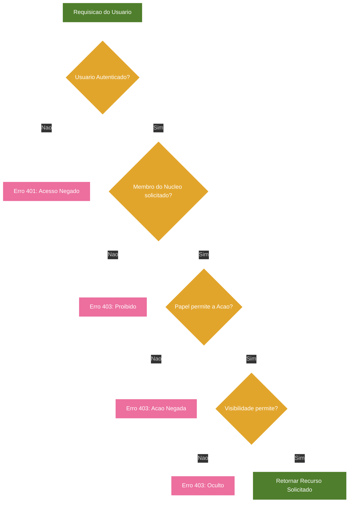

# Projeto Nós - Matriz de Permissões, Privacidade e Visibilidade (Versão 2.5)

**Revisão de 06/11/2026:** seguir o [fluxo Proposta → Hábito → Essência](projeto-nos-v1.1-visao-e-regras-de-negocio.md#fluxo-vigente-dos-acordos). Esta alteração da especificação não modifica o aplicativo.

**Atualização de direção — projeto v1.0.0 — 14/10/2026:** para Núcleos/acordos, seguir [contrato administrativo aprovado](../andamento/funcionalidades/administracao-participacao.md). Votação coletiva de acordos, administração futura e consenso para ajuste de propósito descritos neste documento são referência histórica do modelo substituído. Consentimento individual, isolamento e privacidade permanecem; novo modelo implementado e validado localmente; publicação, migração remota e operação pendentes. Demais módulos futuros não recebem novas regras por inferência.

## Categoria
**2.x - Interface e Implementação**

## Documentos Relacionados

### Versões 1.x (Visão e Regras de Negócio)
- [v1.2 - Sistema de Aprovação e Construção de Acordos](projeto-nos-v1.2-sistema-de-aprovacao-e-construcao-de-acordos.md)
- [v1.3 - Evolução para Núcleos](projeto-nos-v1.3-evolucao-para-nucleos.md)
- [v1.4 - Sistema de Impacto](projeto-nos-v1.4-sistema-de-impacto.md)
- [v1.5 - Sistema de Reconhecimento e Gratidão](projeto-nos-v1.5-sistema-de-reconhecimento-e-gratidao.md)
- [v1.6 - Sistema de Marcos de Evolução e Celebrações Saudáveis](projeto-nos-v1.6-sistema-de-marcos-de-evolucao-e-celebracoes-saudaveis.md)
- [v1.7 - Sistema de Linguagens de Cuidado e Amor](projeto-nos-v1.7-sistema-de-linguagens-de-cuidado-e-amor.md)
- [v1.8 - Manifesto do Núcleo](projeto-nos-v1.8-manifesto-do-nucleo.md)
- [v1.9 - Calendário do Núcleo e Sincronização Segura](projeto-nos-v1.9-calendario-do-nucleo-e-sincronizacao-segura.md)
- [v1.10 - Sistema de Conversas Guiadas e Mediação Afetiva](projeto-nos-v1.10-sistema-de-conversas-guiadas-e-mediacao-afetiva.md)

### Versões 2.x (Interface e Implementação)
- [v2.0 - Alinhamento das Telas com a Documentação](projeto-nos-v2.0-alinhamento-das-telas-com-a-documentacao.md)
- [v2.1 - Catálogo Completo das Interfaces](projeto-nos-v2.1-catalogo-completo-das-interfaces.md)
- [v2.2 - Fluxos, Navegação e Interações](projeto-nos-v2.2-fluxos-navegacao-e-interacoes.md)
- [v2.3 - Design System, Componentes e Tom de Interface](projeto-nos-v2.3-design-system-componentes-e-tom-de-interface.md)
- [v2.4 - Modelo Funcional, Dados, Estados e Regras](projeto-nos-v2.4-modelo-funcional-dados-estados-e-regras.md)
- [v2.5 - Matriz de Permissões, Privacidade e Visibilidade](projeto-nos-v2.5-matriz-de-permissoes-privacidade-visibilidade.md)
- [v2.6 - Estados Vazios, Erros e Carregamento](projeto-nos-v2.6-estados-vazios-erros-e-carregamento.md)
- [v2.7 - Notificações e Eventos do Sistema](projeto-nos-v2.7-notificacoes-e-eventos-do-sistema.md)

---

## Status

Documento de especificação de permissões e privacidade.

## Relação com as versões anteriores

- v1.1 descreve visão e regras de negócio.
- v2.4 descreve modelo funcional, dados, estados e regras.
- v2.5 descreve matriz de permissões, privacidade e visibilidade para implementação.

## Objetivo

Definir claramente quem pode ver, criar, editar e excluir cada entidade do sistema, alinhado com a filosofia do Projeto Nós.

---

# 1. Regra-Mãe de Permissões

Todo acesso a dados afetivos deve ser contextualizado por `nucleoId` ou `usuarioId`.

Nenhuma entidade sensível deve ser acessível fora de seu contexto de privacidade.

---

# 2. Papéis dos Membros do Núcleo

| Papel               | Descrição                                                                 |
|---------------------|---------------------------------------------------------------------------|
| Criador             | Membro que criou o Núcleo                                                |
| Administrador       | Membro com permissões administrativas (pode ser múltiplo)                |
| Membro              | Membro regular do Núcleo                                                 |
| Convidado Pendente  | Usuário que recebeu convite mas ainda não aceitou                        |

---

# 3. Matriz de Permissões por Entidade

## 3.1 Acordo

| Ação                  | Criador | Administrador | Membro | Convidado Pendente | Regras Adicionais |
|-----------------------|---------|---------------|--------|--------------------|-------------------|
| Ver                   | ✅       | ✅             | ✅      | ❌                  | Todos os membros do Núcleo podem ver acordos ativos. |
| Criar Proposta        | ✅       | ✅             | ✅      | ❌                  | Qualquer membro pode propor um novo acordo. |
| Editar Proposta       | ✅       | ✅             | ✅ (somente próprio) | ❌ | Apenas o autor da proposta pode editá-la antes da aprovação. |
| Editar Acordo Ativo   | ✅       | ✅             | ❌      | ❌                  | Requer nova aprovação dos participantes. |
| Excluir               | ✅       | ✅             | ❌      | ❌                  | Requer consenso dos participantes. |
| Aprovar/Recusar       | ✅       | ✅             | ✅ (se for participante) | ❌ | Apenas participantes do acordo podem votar. |

| Confirmar Hábito pós-teste | ✅ (se participante) | ✅ (se participante) | ✅ (se participante) | ❌ | Prazo completo e limiar do ciclo; cada pessoa registra apenas seu próprio Sim. |

## 3.2 Memória

| Ação                  | Criador | Administrador | Membro | Convidado Pendente | Regras Adicionais |
|-----------------------|---------|---------------|--------|--------------------|-------------------|
| Ver                   | ✅       | ✅             | ✅      | ❌                  | Depende da visibilidade configurada na memória. |
| Criar                 | ✅       | ✅             | ✅      | ❌                  | Qualquer membro pode criar memórias. |
| Editar                | ✅       | ✅             | ✅ (somente próprio) | ❌ | Apenas o autor da memória pode editá-la. |
| Excluir               | ✅       | ✅             | ✅ (somente próprio) | ❌ | Apenas o autor da memória pode excluí-la, a menos que haja regras do Núcleo. |

## 3.3 Gratidão

| Ação                  | Criador | Administrador | Membro | Convidado Pendente | Regras Adicionais |
|-----------------------|---------|---------------|--------|--------------------|-------------------|
| Ver                   | ✅       | ✅             | ✅      | ❌                  | Depende da visibilidade configurada na gratidão. |
| Criar                 | ✅       | ✅             | ✅      | ❌                  | Qualquer membro pode enviar gratidão a outro(s) membro(s). |
| Editar                | ❌       | ❌             | ❌      | ❌                  | Gratidão não pode ser editada após envio. |
| Excluir               | ✅       | ✅             | ✅ (somente próprio) | ❌ | Apenas o autor da gratidão pode excluí-la. |

## 3.4 Evento de Calendário

| Ação                  | Criador | Administrador | Membro | Convidado Pendente | Regras Adicionais |
|-----------------------|---------|---------------|--------|--------------------|-------------------|
| Ver                   | ✅       | ✅             | ✅      | ❌                  | Todos os membros do Núcleo podem ver eventos. |
| Criar                 | ✅       | ✅             | ✅      | ❌                  | Qualquer membro pode criar eventos. |
| Editar                | ✅       | ✅             | ✅ (somente próprio) | ❌ | Apenas o autor do evento pode editá-lo, a menos que seja evento do Núcleo. |
| Excluir               | ✅       | ✅             | ✅ (somente próprio) | ❌ | Apenas o autor do evento pode excluí-lo. |
| Confirmar Presença    | ✅       | ✅             | ✅      | ❌                  | Apenas participantes do evento podem confirmar. |

## 3.5 Convite

| Ação                  | Criador | Administrador | Membro | Convidado Pendente | Regras Adicionais |
|-----------------------|---------|---------------|--------|--------------------|-------------------|
| Ver (convites enviados) | ✅     | ✅             | ❌      | ❌                  | Apenas criador/administradores podem ver convites enviados. |
| Criar                 | ✅       | ✅             | ❌      | ❌                  | Apenas criador/administradores podem convidar novos membros. |
| Revogar               | ✅       | ✅             | ❌      | ❌                  | Apenas criador/administradores podem revogar convites. |
| Aceitar/Recusar       | ❌       | ❌             | ❌      | ✅                  | Apenas o destinatário do convite pode aceitar/recusar. |

## 3.6 Manifesto

| Ação                  | Criador | Administrador | Membro | Convidado Pendente | Regras Adicionais |
|-----------------------|---------|---------------|--------|--------------------|-------------------|
| Ver                   | ✅       | ✅             | ✅      | ❌                  | Todos os membros do Núcleo podem ver o Manifesto confirmado. |
| Gerar                 | ✅       | ✅             | ✅      | ❌                  | Qualquer membro pode solicitar geração de Manifesto. |
| Editar (em revisão)   | ✅       | ✅             | ✅      | ❌                  | Todos os membros podem colaborar na revisão do Manifesto. |
| Confirmar             | ✅       | ✅             | ✅      | ❌                  | Requer assinatura/aceite de todos os membros. |
| Arquivar              | ✅       | ✅             | ❌      | ❌                  | Apenas criador/administradores podem arquivar Manifestos antigos. |

## 3.7 Perfil Afetivo

| Ação                  | Criador | Administrador | Membro | Convidado Pendente | Regras Adicionais |
|-----------------------|---------|---------------|--------|--------------------|-------------------|
| Ver (próprio perfil)  | ✅       | ✅             | ✅      | ❌                  | Todo usuário pode ver seu próprio perfil. |
| Ver (perfil de outro membro) | ✅ | ✅ | ✅ | ❌ | Depende da configuração de visibilidade do perfil do outro usuário. |
| Criar/Editar          | ✅       | ✅             | ✅ (somente próprio) | ❌ | Apenas o usuário pode editar seu próprio perfil afetivo. |
| Excluir               | ✅       | ✅             | ✅ (somente próprio) | ❌ | Apenas o usuário pode excluir seu próprio perfil afetivo. |

## 3.8 Conversa Guiada

| Ação                  | Criador | Administrador | Membro | Convidado Pendente | Regras Adicionais |
|-----------------------|---------|---------------|--------|--------------------|-------------------|
| Ver                   | ✅ (se for participante) | ✅ (se for participante) | ✅ (se for participante) | ❌ | Apenas participantes da conversa podem acessá-la. |
| Criar                 | ✅       | ✅             | ✅      | ❌                  | Qualquer membro pode iniciar uma conversa guiada com outro(s) membro(s). |
| Editar (rascunhos)    | ✅       | ✅             | ✅ (somente próprio) | ❌ | Apenas o autor pode editar seus próprios rascunhos de preparação. |
| Arquivar              | ✅       | ✅             | ✅ (se for participante) | ❌ | Participantes podem arquivar conversas concluídas. |

---

# 4. Níveis de Visibilidade

## 4.1 Visibilidade de Memórias e Gratidões

| Nível de Visibilidade | Descrição                                                                 |
|-----------------------|---------------------------------------------------------------------------|
| `publicoNoNucleo`     | Visível para todos os membros do Núcleo (padrão para gratidões).          |
| `restrito`            | Visível apenas para participantes específicos (padrão para conversas guiadas). |
| `privado`             | Visível apenas para o autor (padrão para rascunhos).                     |

## 4.2 Visibilidade do Perfil Afetivo

| Nível de Visibilidade | Descrição                                                                 |
|-----------------------|---------------------------------------------------------------------------|
| `todosOsNucleos`      | Visível para todos os membros de todos os Núcleos que o usuário participa. |
| `somenteEsteNucleo`   | Visível apenas para membros do Núcleo selecionado.                        |
| `privado`             | Visível apenas para o próprio usuário.                                   |

---

# 5. Regras Gerais de Privacidade

1. **Dados Isolados por Núcleo**: Todos os dados de um Núcleo são completamente isolados de outros Núcleos.
2. **Privacidade Padrão**: Conteúdos sensíveis são privados ou restritos por padrão.
3. **Controle do Usuário**: Cada usuário tem controle total sobre seu perfil afetivo e suas criações (memórias, gratidões).
4. **Não há Hierarquia Afetiva**: Permissões administrativas não dão acesso a dados pessoais ou íntimos de outros membros.
5. **Histórico Preservado**: Ações importantes são registradas para auditoria.

---

# 6. Implementação Recomendada

## 6.1 Estrutura de Dados para Permissões

Adicionar campos em entidades relevantes:
- `visibilidade`: enum com valores como `publicoNoNucleo`, `restrito`, `privado`
- `autorId`: ID do usuário que criou a entidade
- `participantes`: array de IDs de membros participantes (para restrito)

## 6.2 Funções de Verificação de Permissão

Implementar funções como:
- `podeVer(usuarioId, entidade)`: verifica se o usuário pode ver a entidade
- `podeEditar(usuarioId, entidade)`: verifica se o usuário pode editar a entidade
- `podeExcluir(usuarioId, entidade)`: verifica se o usuário pode excluir a entidade
- `podeCriar(usuarioId, nucleoId, tipoEntidade)`: verifica se o usuário pode criar a entidade no Núcleo

---

# Diagrama de Fluxo da Versao

## Permissões da confirmação pós-teste — decisão de 2026-10-03

**Versão de implementação vigente: 0.11.0; confirmação implementada e validada.**

Somente participantes originais ainda integrantes podem registrar seu próprio Sim, após o prazo e sem revisão pendente. Integrantes posteriores podem consultar ciclos e contagem agregada, mas não votar automaticamente. A leitura de respostas individuais expõe apenas a própria pessoa; integrantes veem N, votos registrados e limiar exigido. Saída de participante não diminui o limiar e bloqueia a operação até regularização. Confirmar difere de alterar/encerrar: somente a primeira ação usa o limiar reduzido. Sem escrita direta nas tabelas; conferir sessão, pertencimento ao Núcleo e relação Hábito/ciclo no servidor e banco.

Regra canônica: [v1.2 — confirmação pós-teste](projeto-nos-v1.2-sistema-de-aprovacao-e-construcao-de-acordos.md#regra-de-confirmação-do-hábito--decisão-de-2026-10-03).

## Ajuste aprovado de navegação e sessão — 2026-10-07

O fluxo vigente implementado na v0.13.0 é Conta → Seus Núcleos (/nucleos) → Início do Núcleo escolhido. Sem associações, a lista oferece criação ou convite; retorno específico permitido tem prioridade após autenticar. Todo /comecar e /nucleos exige sessão validada antes da renderização, inclusive rascunho e prévia de convite. Esta decisão substitui a abertura de rascunho antes do login e a listagem multínucleo apenas planejada.

Token expirado com renovação válida mantém a sessão. Sessão ausente, inválida ou não renovável pede login; falha operacional bloqueia sem afirmar logout. Ações/consultas continuam verificando identidade e autorização, com RLS por associação. Listagem não usa chave administrativa e não aceita convite automaticamente. [Contrato e validação](../andamento/funcionalidades/navegacao-sessao.md).
